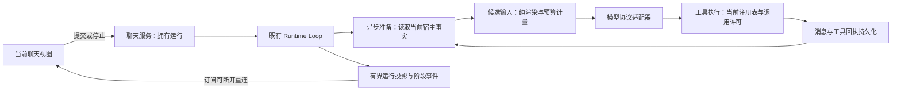

# 聊天运行链路架构对照：Meido 与 Shiori

状态：当前架构调研；main 已含 #291 的准备边界、#292、#293 和 #297。本分支继续流式热路径、展示纠正与架构整合，尚不表示已部署。
最后核验：2026-11-02。
来源：Meido main `5c8f72a` 与当前整合分支；Shiori 固定 `c14152ed225954a2a50da775075fe64dbf7b8b50`，读取该提交而非旧本地 checkout。用户明确要求将 #299／#300 合为一次完整对话交付。

事实来源：[固定源码调研](chat-responsiveness-shiori.md)、[完整规格](../specs/chat-responsiveness.md)、[ADR-0034](../adr/0034-context-preparation-boundaries.md)。

## 结论

25 秒准备耗时是表象。直接根因是把模型描述、预算估算和实际执行授权走成同一条会读取宿主配置／数据库的路径；同时，HTTP 流的生命周期承担了完整聊天任务的生命周期。这两类责任混合能解释“历史越长工具前后越慢”“其它页面一起卡”“刷新取消”等不同症状。

当前三个 Ticket 是交付切片，不能实现成三个互不相关的缓存／超时／重试补丁。应在既有模块上明确准备、计量、执行、持久化与订阅各自拥有的状态。

## 对照与证据

下表保留修复前事实及相应处理；交付状态以上文和实际 PR 为准。

| 边界 | 修复前 Meido 事实 | Shiori 对应事实 | 本轮处理 |
| --- | --- | --- | --- |
| 工具描述与执行准入 | `CapabilityResolution._select` 为可见工具调用实际 `authorization_denial`；namespace 提示对全部候选再调用；宿主授权闭包每次重建整套 policy | registry 的 schema／顺序／外部许可读取内存元数据，ToolExecutor 在真实调用和改参之后执行准入 | #291 分开准备投影与执行检查。准备读取当前事实，候选只筛选元数据；dispatch 保留当前实现与当前许可 |
| 请求准备、估算与发送 | `MeidoProvider.estimate_request` 修改 `_tool_prompt`／`_request_context`，调用可执行 I/O 的 namespace／context_blocks；`stream_response` 再构造一次 | ContextBundle／PromptRenderInput 表达输入，ContextWindowRequest 分开 render 与 measure；provider 以统一规范化请求计算预算 | #291 得到明确的准备输入和候选请求值，渲染／计量不回调宿主 I/O；发送使用该候选的同一规范化输入 |
| 压缩候选 | Meido 从最早可截断处依次估算所有候选，使长历史直接放大重活 | Shiori 从配置保留轮数向零递减，仅对不同合法窗口测量；摘要后再测最终完整请求 | #291 对齐保留轮数语义，保护当前输入及完整工具交换，提交前重核 |
| 持久窗口读取 | `ContextWindowStore.load` 按每个 removed ID 单独查询原文并重新 fingerprint，还可写失效 tombstone；prepare／commit 各有验证 | Shiori 的会话所有者负责 window snapshot／prepare／commit，归属、代次与原文前缀验证由窗口边界承担 | #291 先做等价的批量读取和异步准备，保持事务验证；不未经批准变更数据库格式或移除来源检查。此路径是源码确认的增长风险，未声称它是本次 25 秒的主要耗时 |
| 摘要与供应商用量 | 六字段、分批、原子提交已有；摘要大小直接取 output_tokens，缩短反馈不含计量细节；用量缺失语义不完整 | SummaryRequest／WorkingSummaryWriter／OutputTokenUsage 分别负责请求、连续归纳和可见输出口径 | #292 在单一摘要请求／计量边界修正合同，验证不同协议；不是延长超时或无条件重试 |
| 聊天任务归属 | `/messages` 的 SSE generator 包办准备、执行、消息保存、工具清理和回复收尾；request disconnect 取消其 task | DesktopChatService 持有 turn task，send 与 cancel 分离，服务退出负责排空／取消 | #293 用会话聊天服务持有既有 Runtime 任务；HTTP submit／subscribe／stop 分离，不新增另一套 Runtime |
| 前端视图与执行 | `useChat` 单个 activeReply 同时拥有连接与发送状态，卸载 abort；App 用 sending 禁止角色切换 | 桌面桥接向服务提交 turn，事件只是展示输入，服务拥有执行 | #293 选择角色／页面只决定订阅对象，稳定 runId 与有界当前投影支持重入；Stop 是明确服务命令 |
| 桌面与渠道协调 | 两条宿主组装链路在 main 中分别包装 MeidoProvider，但共享普通窗口与核心 loop；职责不一致容易让一次修复只覆盖一个入口 | 桌面和渠道入口最终进入共同角色运行及 passive pipeline，出站协议各自负责 | 本轮共享准备和计量改动需覆盖桌面、主人私聊、外部受限来源。保留各渠道的真实来源和投递回执，不把修复只写在桌面 SSE 路由 |
| 可观测性与验证 | 已有 run／tool audit 和过程 UI，但成功的局部功能测试未覆盖慢准备时整页请求的并发性与刷新生命周期 | 阶段职责明确，回合任务与投影分离，窗口和请求诊断有独立归属 | 三票各做对应端到端行为；最后组合验收准备→摘要→模型→工具→下一步骤→终态，阶段信息来自运行事实 |

## 整合时补齐的边界

- 接受只需角色与 Session 身份，原先却通过 `role_and_history` 呈现全部历史；恢复又在 `open_role_session` 后二次读取。现在 SessionManager 区分身份和纯行呈现，恢复 worker 先叠加同 run 活动行，再用同一批原始消息生成 messages/process；有同角色身份时 fence 不受其他角色影响；身份缺失或被有界淘汰时保守沿用全局最近接受身份，仍发现读取期间开始、结束并被淘汰的同角色运行。
- `ContextWindowProvider._estimate` 原先隐式改写待发送请求，普通路径也重复准备相同输入。现在复用现有 PreparedRequest/InputEstimate 作为局部返回值，试算不能替换选定输入；普通预算准备一次，摘要提交发送精确候选，实际供应商用量锚点仍在发送边界记录。
- ChatRunService 的 finish／最终读取异常原先会跳过终态。服务现在统一结束订阅并清理当前消息引用，Runtime 与宿主仍等待所属清理、前驱和已开始的写入；重复取消不提前放行。宿主失败仅向已有 agent_runs.error 写入通用错误，公共任务恢复为 failed，已保存正文、工具回执和 Runtime 原终态不改。数据库不可写时只能明确内存失败，不能保证这条新错误跨重启保存。
- 流式检查按完整请求／接受结果／窗口提交边界校验全历史；SSE 片段只检查当前来源和取消。固定来源授权为空时跳过无效的授权表查询，后来授予的来源不会扩大当前窗口；已有授权仍逐片段验证撤回，角色与来源账号检查保留。片段更新原所有者已有文本并发送事件，消息与工具回执在原边界保存。强杀可能丢失未提交片段，Stop 和有序退出等待补存。
- Windows reload 默认 Selector 无法运行 asyncio 子进程。服务入口使用 Proactor，旧 worker 完整退出后重绑自己的同端口监听者，避免残留 IOCP 关联；保留原 watcher、spawn 和私有 stdin 退出。真实 HTTP 子进程请求在 Uvicorn 0.30 与 0.48 重载前后通过；重绑存在短暂端口空档。

## 当前职责

重要分界：准备时取得工具描述，不代表取得未来执行的永久授权；前端当前显示哪个角色，不决定后端运行是否存在。实际外部效果与持久化回执仍由原有执行与存储负责。

## 保留的架构选择与当前证据限制

- Meido 的 FastAPI／SSE 与 Shiori 的 Electron JSONL bridge 不同，传输不同本身不是缺陷；要对齐的是任务归属和职责，而不是协议名称。
- 现有 SQLite 历史、工具审计、角色／渠道来源和预算锚点有稳定用途，复用这些事实，不能为获得更快结果删掉记录或放宽真实权限。
- 目前没有证据要求把所有插件重写成 Shiori SDK，或引入完整多代 CoreRuntime／PluginKernel。完整替换属于另一个架构范围，不能当成本轮性能修复的必要前提。
- 摘要仍是外部模型请求，厂商延迟不能靠本地重构保证消失。本轮消除重复准备、错误计量和错误生命周期，并让真实等待可见。
- 服务持有接受、排队、Runtime 消费及清理，HTTP 连接只订阅。界面用 Shiori typing/sparkles 与空回复光标表示等待，保留真实思考和工具反馈；内部 phase 不作为每条消息的常驻标签。当前上下文圆环只读取已保存上下文，以薄环及紧凑悬停／聚焦说明呈现，不参与发送或压缩。
- 具体恢复、容量、保存失败与 Stop 边界见[生命周期合同](../reference/chat-run-lifecycle.md)，决定见 [ADR-0035](../adr/0035-service-owned-desktop-chat-runs.md)。本次不迁移数据库格式或全局插件生命周期。

## 源码入口

- Meido：`backend/app/main.py` 的 `_runtime_capabilities`、`_run_channel_message`、`_accept_role_message`、`_desktop_snapshot`；`session_manager.py`、`chat_runs.py`、`server.py`；`agent_runtime/capabilities.py`、`meido_provider.py`、`context_provider.py`；`context_windows.py`；`web/src/features/chat/useChat.ts`、`useChatContextStatus.ts` 和 `ChatContextRing.tsx`。
- Shiori：[ToolRegistry](https://github.com/YinFengWindy/Shiori-Agent/blob/c14152ed225954a2a50da775075fe64dbf7b8b50/apps/backend/agent/tools/registry.py)、[ToolExecutor](https://github.com/YinFengWindy/Shiori-Agent/blob/c14152ed225954a2a50da775075fe64dbf7b8b50/apps/backend/agent/tools/execution.py)、[ContextWindowRequest](https://github.com/YinFengWindy/Shiori-Agent/blob/c14152ed225954a2a50da775075fe64dbf7b8b50/apps/backend/agent/core/passive_turn/context_window_request.py)、[PassiveTurnPipeline](https://github.com/YinFengWindy/Shiori-Agent/blob/c14152ed225954a2a50da775075fe64dbf7b8b50/apps/backend/agent/core/passive_turn/pipeline.py)、[DesktopChatService](https://github.com/YinFengWindy/Shiori-Agent/blob/c14152ed225954a2a50da775075fe64dbf7b8b50/apps/backend/desktop_bridge/chat_service.py)。
