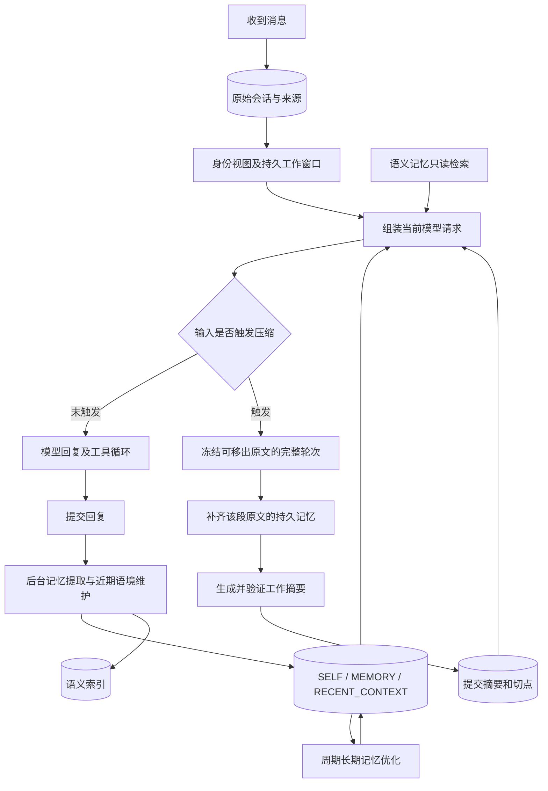

# Shiori 上下文与记忆架构：完整链路调研及 Meido 对照

调研日期：2026-11-02。状态：实施前固定基线。本文保留当时的源码差异和隔离验证结论；#302 的实现与验收记录见[交付验证](context-memory-delivery-302.md)。文中的“目前”均指下列固定提交。

## 结论先行

用户提出的方向成立：**正常回复应复用已经提交的摘要和原文切点；达到容量阈值后才尝试压缩，成功一次便保存一次。** 每轮仍需组装当前请求、读取相应记忆和估算容量，但这些动作不等于每轮重新总结历史。

当前问题不是只有一个慢函数。Meido 已有持久摘要、原文窗口、预算校准、工具恢复和后台任务，却没有完整复刻 Shiori 对这些职责的划分。直接影响回复路径的差异包括：

1. 在容量判断之前，按消息条数等待 Markdown 记忆整理。
2. 普通检索中同步等待缺失向量的补建。
3. 先花时间生成工作摘要，后确认原文是否完成记忆整理。
4. 把“记忆已经落盘”和“下游消费者完成”合成窗口前进的共同门槛。
5. 记忆准备校验整个消息列表，新增尾部消息也会让已完成的草稿失效。
6. 将动态信息放在历史之前，稳定记忆与动态检索内容又混在一起，不能保持 Shiori 的稳定请求前缀。

这些是**源码确认的结构差异**，并非六项都已被证明造成同一条线上慢请求。已记录的三条慢请求，直接证据是摘要生成/缩短及提交过程占用了 52–68 秒，三次都没有产生可复用的新窗口。具体某次 `WindowConflict` 的失败条件仍不能从已有日志确定。

Shiori 也不承诺绝对不等待：普通检索可能等查询向量；真正压缩需要等待记忆覆盖和摘要模型；已有明确的后台记忆失败也可能阻断下一轮。它同样会在本轮压缩失败后于下一轮再尝试。不能把“任何情况下只压一次”“后台失败永不影响回复”当成上游行为。

## 1. 调研范围与证据等级

| 项目 | 固定版本 | 本地只读源码 |
| --- | --- | --- |
| Shiori-Agent | `c14152ed225954a2a50da775075fe64dbf7b8b50`，本轮核对的 upstream main | `D:/shiori-context-memory-research-20261102` |
| Meido | `69b9c4a6f3aaeb3b3cc74c39a679822c3c6d9e10`，已合入 #301 | `D:/meido-279-chat-architecture` |

本轮检查了 GitHub #279 与开放 PR；未发现待合并 PR，未新建或修改 Issue。正式实例已经运行上述 Meido 版本，不能再将这次反馈归因于“没更新”。没有启动、停止或替换正式服务，也没有用正式数据做写入测试。

证据分为：

- **源码事实**：固定提交的函数、调用顺序、状态字段和实际分支。
- **行为验证**：临时数据库与受控模型调用真实维护/提交代码，无真实模型费用。
- **现场观测**：已有正式运行日志及 SQLite 只读提取的计数和耗时，不包含聊天原文、凭据或图片。
- **推断/待测**：例如动态前缀对实际缓存命中率的影响、共享锁的线上等待时间；不当成已测性能结果。

阅读了 Shiori 的 context-budget、memory-markdown 手册和模块文档，但以当前代码与测试为准。本文所说的请求排列主要指普通被动回复；主动任务和 Drift 有自己的临时输入，不能套用同一排列图。

## 2. 五种状态，不能混为一谈

| 层 | Shiori 的保存内容与责任 | 下一轮如何使用 | 重启后 |
| --- | --- | --- | --- |
| 原始会话 | `sessions.db` 内消息、来源、工具交换、投递状态 | 根据身份和当前上下文视图读取合法历史；原文不随压缩删除 | 保留 |
| 工作窗口 | 同库维护进度中的切点、工作摘要、来源 ID、版本和压缩次数 | 读取“已有摘要 + 切点之后的原文”，再加入当前回合 | 保留 |
| Markdown 角色记忆 | `SELF.md`、`MEMORY.md`、`HISTORY.md`、`PENDING.md`、`RECENT_CONTEXT.md`、journal | 不同文档承担不同提示/归档责任，不是全部每次注入 | 保留；待处理 snapshot 可恢复 |
| 语义记忆引擎 | `default_memory` 插件的结构化记录、向量、来源和状态 | 以 context/answer/procedure/timeline/interest 意图查询 | 保留；向量空间需匹配 |
| 请求计量与供应商缓存 | 本地 usage anchor、提示块缓存；远端供应商的 prompt/KV cache | 前者帮助预算，后者复用相同前缀的计算 | 本地 anchor 不持久；远端由供应商决定 |

**工作摘要不等于长期记忆；长期记忆不等于向量索引；输入用量校准也不等于 KV 缓存。** 保留完整原文与只发送活动窗口可以同时成立。[窗口提交][s-window]、[持久维护状态][s-progress]、[文档存储][s-documents]、[引擎构建][s-engine]。



失败路径见第 4 节；图中“后台”并不表示压缩所必需的记忆覆盖也可以跳过。

## 3. 一次正常回复到底准备什么

### 3.1 身份与原文窗口

Shiori 的角色有共享会话，但模型输入必须带上下文视图：用户上下文与外部会话各有可见范围。先确定本轮身份和视图，再读取该视图的已提交工作切点。记忆整理另有游标，不能用它直接替代模型窗口的起点。

`Session.get_history` 保留合法工具调用与结果、相应 reasoning 数据和稳定的历史用户封装；不会重放旧的动态 context frame。原文窗口按完整用户轮次对齐。使用明确切点时读取该切点之后的原文；不能擅自用一个固定“最近 N 条”把未摘要内容丢掉。主动消息使用较短的历史投影。[历史读取][s-history]、[工作窗口助手][s-helpers]。

### 3.2 回合入口的记忆积压检查

默认 `memory_window=40` 经配置换算为保留 20 条消息；普通后台整理至少需要另外 10 条，所以积压阈值通常是 30 条。这个**消息条数阈值服务于记忆维护**，不是模型上下文 token 阈值。

达到积压阈值时，上游入口请求后台整理，并继续当前热窗口；如果已经记录了明确的整理失败，则报错，而不是无声忽略。真正将原文从模型窗口移出时，才要求相应记忆覆盖完成。[入口检查][s-before]、[维护队列][s-maintenance]。

Meido 目前在桌面回复入口按 `max(24, recent_memory_count)` 判断，并 `await ... ensure_memory_for_window`。这发生在实际模型容量判断之前，即使本轮根本不需要压缩，也可能先等一次强制记忆维护。`to_thread` 避免堵塞事件循环，但**调用方仍然等待完成**。[Meido 回复入口][m-entry]。

### 3.3 普通检索不是每轮做一次总结

用户上下文默认调用 `MemoryEngine.query(intent="context")`；外部上下文不读取用户层私有记忆，特定系统轮次也可明确跳过检索。

普通 context/procedure 检索不生成 HyDE 假设。context 通常对当前查询做向量及关键词检索，再做融合和限量注入；显式 answer 检索才会并行生成两种辅助假设。没有可用引擎时，检索返回空，不等于宿主 Markdown 记忆不存在。[上下文准备][s-prepare]、[查询分流][s-query]。

上游查询向量有 8 秒的单路超时，失败路径可继续使用关键词结果。查询本身不顺带把所有缺失向量补齐。Meido 的 `recall_async` 则先查询，再等待最多 8 条缺失记录的 embedding 回填；隔离探针确实观察到首次 9 次 embedding 调用、补齐后下一次仅 1 次。8 条补建是并发等待，**不能把其耗时简单相加成 8 倍**。[上游检索器][s-retriever]、[Meido 检索][m-recall]。

### 3.4 稳定提示与动态信息的排列

普通被动回复的实际布局：

```text
Shiori:
稳定 system（角色设定、规则、SELF、MEMORY 等）
→ 之前的合法历史 / 工作摘要
→ 本轮动态 context frame（近期语境、检索结果、状态、技能等）
→ 当前用户输入

Meido rich 请求:
system
→ 本轮动态 context frame（本轮时间、固定记忆与检索混合内容、请求信息）
→ 历史 / 工作摘要 / 当前输入
```

上游将 `SELF`、`MEMORY` 放在 system；它们会读取文件，并不代表永不变化，但通常比时间、检索和关系状态变化少。`RECENT_CONTEXT` 只注入主题等概括部分，去掉重复的最近原文段。Meido 桌面入口目前把 `SELF+MEMORY` 合并后经 4000 字符预算截断，且 `include_recent=False` 将整个 `RECENT_CONTEXT` 排除；读取固定记忆的函数仍可能刷新近期文档。这同时偏离了内容分层、读取边界和请求排列。[上游提示块][s-blocks]、[提示分层][s-assembler]、[排列源码][s-envelope]、[Meido 固定记忆][m-docread]、[Meido 排列][m-prompt]。

探针验证了动态 frame 改变时，上游历史前缀保持不变，Meido 则在历史之前就出现差异。由此推断 Meido 更容易损失历史部分的供应商前缀缓存收益；**未通过真实供应商 A/B 测量具体命中率差值**。

## 4. 达阈值之后的工作压缩

### 4.1 谁决定是否压缩

普通请求入口 `RequestCompaction.ensure` 先计算预算。未到阈值时原样发送，不进入摘要模型；工具结果增加输入后，后续真实模型请求也会重新检查容量。`CompactionController` 是已决定压缩后调用的执行器，直接调用它不能证明普通低容量请求也会压缩。

默认预算关系是：

```text
硬输入上限 = 模型窗口 − 本次最大输出 − 安全余量
触发点 = min(模型指定压缩点或窗口的 75%, 硬输入上限)
目标值 = min(窗口的 40%, 触发点, 硬输入上限)
```

目标值用于选择保留轮次，**当前源码并不要求每次压缩后必须低于目标值才可发送**；在硬输入上限内仍可能接受。手册中的一些描述更强，应以实际 `_fits` 与回归测试为准。[请求门槛][s-request]、[预算类型][s-budget]、[压缩控制器][s-compaction]。

### 4.2 一次成功的提交顺序

1. 固定本轮可见历史及归属，选取完整轮次前缀；默认希望保留两轮，根据容量评估是否减到更少。
2. 检查这段待移出原文是否完成记忆整理。未覆盖部分先写 HISTORY/PENDING/近期语境等，推进持久记忆游标。
3. 生成工作摘要。包含 tasks、constraints、decisions、unfinished、tool_state、entities 与合法 source_message_ids。
4. 超长输入分批处理最长可容纳的连续前缀；前一批合法摘要传给下一批。非法来源、格式错误、截断等不能当作成功摘要。
5. 正文长度超限时仅进行一次缩短反馈；reasoning 与正文用量分开计算，缺失可靠用量时使用本地估算。
6. 使用同一套提示、工具和预算规则重新组装候选请求。验证通过后才一起提交摘要与切点。
7. 下一轮及重启后读取已提交摘要与切点，原始消息仍保存在会话库。

分批摘要只有全部成功才提交工作窗口；前面已经成功落盘的长期记忆不需要因为后面的摘要失败而回滚再提取。这是两个不同的提交进度。[控制器 `_attempt`][s-compaction]、[摘要生成][s-summary]、[摘要校验][s-summary-validation]、[窗口提交][s-window]。

### 4.3 记忆落盘与消费者进度分离

Shiori 保存 `memory_version`、`published_version`、`relationship_version` 和待处理 payload；“已提取并持久保存”与“事件发布/关系快照刷新完成”分别推进。

后续消费者失败时保留 payload。已经发布成功的事件不因关系刷新重试而再次发布；更早未发布的内容可放入 backlog。只要待移出原文已经被持久记忆覆盖，消费者失败本身不阻止工作窗口提交。

隔离验证直接执行真实维护与存储代码：让关系消费者抛错，观察到记忆游标已推进、消费者待处理；窗口仍可提交；重开 SessionManager 后切点、摘要和 payload 保留；恢复消费者时未再次调用提取模型，也未重复发布已发布事件。[记忆提交][s-memory-commit]、[消费者恢复][s-consumers]、[窗口门槛][s-window]。

Meido 的 `ensure_coverage` 要求游标已覆盖且不存在 `pendingEvent`。探针确认：文档及游标已保存、只是没有消费者 ACK 时，覆盖仍返回 false。并且 `_compact` 先生成工作摘要，再进入这个门槛，失败时已经花掉摘要等待时间。[Meido 覆盖检查][m-maintenance]、[Meido 压缩顺序][m-compact]。

### 4.4 并发追加、撤销与身份变化

Shiori 校验冻结前缀的 ID、内容、归属、代次和版本；前缀外的合法追加不使草稿失效。隔离验证中，在摘要阶段追加两条消息，原前缀仍可提交，追加内容保留在切点后。

撤销/编辑已覆盖来源、切换归属或变更身份边界则确实会使相关派生窗口失效。这些是保持数据来源正确所必需的条件，不应以“过度防御”为由全部删除。

Meido 工作窗口自身也有来源和版本保护；突出差异在 **Markdown 维护提交前比较整个消息列表**，尾部新增也导致草稿丢弃。现有测试 `test_memory_maintenance_discards_stale_snapshot` 明确锁定了这种行为。[上游前缀验证][s-window]、[Meido 全表快照比较][m-maintenance]。

### 4.5 失败并不等于可以无条件切换最小输入

| 情况 | Shiori 当前行为 | Meido 当前行为 |
| --- | --- | --- |
| 超软阈值但仍低于硬上限，摘要失败 | 本轮继续原输入；本轮不重复尝试，下一轮可再尝试 | 基本一致 |
| 记忆提取未覆盖待移出原文 | 压缩失败，不能推进切点 | 同样要求覆盖，但摘要生成顺序不同 |
| 已覆盖，后续消费者失败 | 保存恢复进度，仍可推进工作窗口 | pendingEvent 继续阻挡覆盖 |
| 已超过硬上限且摘要/记忆步骤出错 | 相应阶段错误向上返回；不把任意步骤失败都吞掉后直接用最小输入回复 | 捕获一组错误后可能进入瞬时 minimal 输入；下轮又面对未提交的大窗口 |
| 正常压缩方案仍不能容纳 | 受约束地减少保留/进入最小方案；业务工具被移除，回复协议保留 | 最小方案仍保留合法工具能力，只要预算允许 |

最后一项是 Meido 以前明确批准过的行为，不应借“对齐”悄悄反转。它与“任何压缩失败均退化后继续”的扩大捕获范围是两件事。需要分别审视。[上游请求失败分支][s-request]、[供应商溢出重试][s-budgeted]、[Meido 失败分支][m-fallback]。

## 5. Markdown 记忆怎样形成与更新

| 文档/状态 | 来源及更新时机 | 是否通常直接注入普通回复 |
| --- | --- | --- |
| `SELF.md` | 角色自身与关系理解，初始化及周期优化更新 | 是；外部上下文只读取允许的部分 |
| `MEMORY.md` | 低频合并后的长期用户知识 | 用户上下文注入；外部上下文不注入 |
| `PENDING.md` | 高频整理产生的候选事实 | 否，供长期优化消费 |
| `HISTORY.md` / journal | 已整理经历及来源；追加并防重 | 不整本注入，可供归档、检索或工具读取 |
| `RECENT_CONTEXT.md` | 活跃主题、近期事件、待跟进等；附最近原文段 | 只注入概括部分，剥离重复原文 |
| 记忆游标/消费者 payload | 存在会话维护状态中，和文档写入协调 | 用于恢复，不是自然语言提示 |

普通 `TurnCommitted` 将整理任务入队，同会话串行；积压未到阈值时只刷新最近原文，不调用总结模型。达到阈值后整理旧前缀，保留近期消息。用户层抽取与近期语境压缩有独立输出和模型调用；压缩窗口要求覆盖时可指定整理到某个前缀。[维护调度][s-maintenance]、[整理工作器][s-consolidation]。

重复写入按 `source_ref + kind` 留下索引和标记，避免失败重试重复追加。文档文件与 SQLite 并非一个跨文件 ACID 事务；它依赖提交顺序、防重标记和恢复状态，不能描述成“所有记忆文件原子落盘”。[文档存储][s-documents]、[记忆提交][s-memory-commit]。

`RECENT_CONTEXT` 带来源归属标记。新增合法绑定不必使原来源无效；删除原绑定或改变来源边界则不再使用不合法的旧文档。没有来源标记的角色文档不会在读取时被擅自赋予新的来源。[近期语境来源][s-recent]。

### 5.1 长期优化不在每次回复中重写

上游 `memory_optimizer` 默认约每 18 小时运行，先把 PENDING 重命名为 snapshot，让新提取内容继续写到新的 PENDING。优化合并长期记忆并归档后再更新 SELF；两步有间隔。失败、取消或进程中断后的 snapshot 会回滚合并，避免吞掉新候选。当前 SELF 写作规则版本为 2。

它有自身执行与配置代次控制，不是把每个角色的向量提取、普通回复读记忆、Markdown 整理全部塞在同一把长时间持有的锁中。Meido 的 MemoryWorker、覆盖检查和 MemoryOptimizer 共用角色锁，覆盖检查可能等待正在运行的优化或后处理。这个等待通路由源码确认，具体线上占用多久尚未采样。[上游优化器][s-optimizer]、[Meido 角色锁][m-worker]、[Meido 优化调度][m-optimizer]。

Meido 已有候选 snapshot、防重来源、优化周期与重启恢复，不应再次另建平行系统。它的 MEMORY 使用结构化记忆托管区，管理 API 的遗忘/编辑会同步 Markdown；上游的文档与默认语义引擎并不是这样一一映射。完整迁移必须先厘清已有文档和数据库谁是权威，不能覆盖旧文件了事。

## 6. 语义记忆引擎与显式记忆工具

### 6.1 引擎是可替换能力，不是宿主所有记忆的总开关

上游宿主拥有 Markdown 维护；`default_memory` 插件提供 `MEMORY_ENGINE`，使用当前配置的主/轻模型、独立 embedding 凭据和自己的数据库。缺少 embedding 凭据或模型/维度指纹不匹配时，插件启动失败，不自动借用聊天凭据，不静默重建已有向量空间。没有引擎时不能声称相关记忆工具已经可用，但宿主 Markdown 层仍是独立部分。[引擎构建][s-engine]、[向量指纹][s-fingerprint]。

Meido 已有 MemoryEngine 合同和默认实现，但它的开启状态与 Markdown 维护、优化器存在更强耦合；向量空间变化会按现有逻辑失效旧向量并补建。这是具体数据迁移策略差异，不能简单说 Meido “没有记忆架构”。

### 6.2 写入与读取的分工

上游的三类写入来源：

- 显式 `memorize`：模型选工具后执行，embedding 成功后保存结构化记忆；`forget_memory` 修改相应记忆状态。
- `TurnCommitted → TurnIngested`：异步后处理提取 profile/preference/procedure，保护本轮显式保存内容，处理替代/失效关系。
- `ConsolidationCommitted`：已整理经历形成 event，并可抽取其他长期事实，使用来源做防重。

查询根据 intent 分流。context/procedure 不走假设生成；answer 可用两条 HyDE；timeline 使用时间范围；interest 走偏好/画像。向量与词法在检索器中融合（RRF 的关键词权重 0.5），再做类型配额、相关性/热度和文本上限控制。Meido 也有意图分流和融合，但评分、配额及热度策略并非逐项等同。[查询路由][s-query]、[融合检索][s-retriever]、[引擎生命周期][s-engine-lifecycle]。

上游没有“所有写入失败一定阻止发布”的统一保证：例如 `save_from_consolidation` 的部分 event 保存异常会被记录后吞掉，其他提取步骤可能抛错。复刻时必须保留事实边界，不能将源码描述成理想化的可靠队列。[语义写入][s-memorizer]。

Meido 的普通 `remember` 是先存记录，再尝试 embedding；向量失败时记录仍可供词法检索。这也是它会出现“待补向量记录”的原因之一。把补建移出读路径与把写入改成 embedding-first 是两个不同改动，后者涉及既有产品行为和数据恢复选择。[Meido 写入][m-memory-write]。

### 6.3 哪些记忆工具常驻

上游 `memorize`、`forget_memory`、`recall_memory` 从当前引擎 `tool_profile` 注册为 `always_on=True`，不是先搜出工具再才能记忆；插件未能提供能力时不能只在提示中宣称存在。普通回复的自动 context 检索也不是伪装成模型调用 `recall_memory`。[记忆工具注册][s-memory-tools]。

其他延迟工具的恢复依赖当前合法原文窗口里的使用/解锁记录；压缩移出窗口的旧使用记录不会永久保留一个万能工具集合。可见 schema 和执行均来自当前注册表，调用意图短语只是展示信息。这一块 Meido 前轮已经迁移，不能为了记忆重构再恢复旧绑定缓存。[历史工具恢复][s-helpers]。

## 7. 多渠道、旁听、主动任务和子代理

| 场景 | 上游上下文与记忆边界 |
| --- | --- |
| 桌面与已绑定用户私聊 | 组成用户上下文，可读取用户长期记忆及相关外部会话动态；来源仍保留 |
| 群聊/陌生私聊 | 外部上下文，不读取用户层私有 MEMORY 和用户语义预检索；使用当前群笔记、近期动态和允许的成员档案 |
| 用户本人在群里的发言 | 可进入用户层整理，附群来源；群友发言进入外部层，不把群友身份当成用户事实 |
| 群成员档案 | 以渠道/身份范围维护，触发者、提及者等详细呈现，其他成员可用一行速记；用户本人的身份另处理 |
| 群旁听 | 独立消息库/游标；每群满 50 条或跨天的旧记录触发；入库触发与启动/每 30 分钟扫查均在后台；不推进角色会话整理游标，也不修改用户 RECENT_CONTEXT |
| 主动回复/Drift | 使用临时 system + 当前任务 frame，读取允许的角色记忆/近期信息；工具循环不是普通被动聊天窗口的复制品；实际确认投递的回复才进入可读历史 |
| 子代理 | 独立临时消息与用量作用域；子代理本身不自动提交主会话或角色记忆，调用方决定如何保存结果 |

旁听按群串行，不同群与角色会话整理不共享同一把长期锁；共享群笔记/成员资料提交时做内容版本校验，防止覆盖人工编辑。失败不推进相应批次游标，稍后再试。[旁听维护][s-listening]、[旁听调度][s-listening-trigger]、[旁听批次][s-listening-window]、[主动输入][s-proactive]、[Drift][s-drift]、[子代理][s-subagent]。

Meido 已有外部会话、成员档案、群动态和角色来源约束，存储形态与 Shiori 的共享会话视图不同。存储形式不同本身不是缺陷；本轮没有逐项验证全部群渠道网络行为，也不以“全盘复刻”为由把第三方渠道或主动功能一并重写。应先保持这些边界，统一它们进入上下文和维护提交的合同。

## 8. KV 缓存、提示缓存与用量校准

### 8.1 没有发现上游自己保存模型 KV

在被动请求/provider/SDK/默认记忆实现中，未发现 Shiori 自建并持久化 transformer KV、以 `past_key_values` 恢复远端推理或强制创建供应商缓存会话的路径。它仍发送完整的当前模型请求，通过稳定前缀让支持缓存的供应商复用计算，并读取 `cached_tokens` / cache hit 等用量。自定义供应商 extra 参数的可能性不能据此排除。[请求排列][s-envelope]、[供应商用量解析][s-provider]。

供应商 prompt caching 对前缀稳定性、模型和路由有条件；缓存命中并不让这些 token 从模型上下文容量里消失，也不保证消除后续生成时间。OpenRouter 当前文档描述了不同供应商的自动/显式缓存支持。对接新的 `session_id`、缓存服务或本地 KV 管理器不是本次看到的 Shiori 复刻范围。[OpenRouter 官方说明](https://openrouter.ai/docs/guides/best-practices/prompt-caching)。

### 8.2 本地两种缓存解决的是另外的问题

- `SectionCache` 缓存可复用提示块的渲染结果，减少本地组装。
- `UsageAnchors` 用已知实际输入量校准同请求或追加请求的预算；最多 64 个作用域，模型、连接、工具、历史等不兼容时失效；子调用可用独立作用域。动态 frame 在估算关系中单独处理，不代表它从真实请求中消失。

Meido 已引入实际值/追加差值/本地估算机制。继续优化应检查真实请求排列和持久窗口是否复用，不是再造一套“KV 缓存状态”。[提示缓存][s-assembler]、[用量锚点][s-anchor]。

## 9. 独立上下文检查与圆环

Shiori 的桌面入口在不发送草稿、不创建回合的情况下，读取同一用户上下文和实际模型；忙碌时明确返回不可检查。检查与手动 `/compact` 共用归属解析，但是否压缩由明确参数决定。普通检查不能因为圆环轮询就调用摘要模型或修改长期记忆。[独立入口][s-inspect]。

Meido 已有独立 `context-status` 和圆环简化，用户要求只保留 Shiori 式展示；不应再添加调试预算面板、阶段文案或重查控件。手动压缩曾明确排除在 #297 范围之外：它属于“尚未引入”，不能冒充本次优化必需的新功能。

## 10. 与 Meido 的取舍分类

| 分类 | 内容 | 处理原则 |
| --- | --- | --- |
| 已有且应复用 | 持久工作摘要、分批摘要、一次缩短、正文计量、工具原文窗口恢复、上下文圆环、独立检查、后台持有回复与刷新续接 | 不新增平行实现；修正连接这些模块的流程 |
| 应按上游收回的偏差 | 回复入口按消息条数阻塞整理；检索等待向量回填；summary-before-memory；消费者 ACK 阻止已覆盖窗口提交；尾部追加使记忆草稿失效；动态 frame 在历史前；读取混入近期文档写入 | 优先改调用顺序、读写责任与提交条件，而非再加超时/重试层 |
| 需明确迁移的数据差异 | MEMORY 托管区与结构化记忆同步；全局开关耦合；embedding-first 与 record-first；不同向量空间迁移方式 | 保留现有数据、手工编辑和来源；先定义兼容/迁移，不直接覆盖文件 |
| 已批准的产品差异 | minimal 输入仍可用工具；多协议模型适配；Web 回复生命周期；角色与外部来源隔离 | 不作为“过度添加”随意删除；与上游差异单独记录 |
| 上游存在但不是本轮自动新增 | 手动压缩；整个插件内核迁移；完整主动/Drift/旁听调度升级 | 列清范围，不因调研扩大任务 |
| 不应凭空新增 | 自建 KV 服务、永久 summary 失败熔断/冷却机制、新的记忆总线副本、另一套摘要数据库、额外圆环面板 | 没有上游证据及用户需求，不加入复刻 |

不能将权限检查、来源校验、持久化与取消边界一概归为过度防御。应该移除的是不必要的等待与重复责任，同时保留上游本来就具有的真实数据边界。

## 11. 已记录慢请求能证明什么

证据文件是研究机器上未提交的本地记录 `D:/meido/.data/plans/shiori-chat-consolidation-20261102/latency-evidence-20261102.json`，仅含计数和耗时；以下为该记录的汇总，不作为可下载的仓库附件。时间均为 2026-11-02 本地时间。

| 开始时间 | 总耗时 | 摘要过程合计 | 最终压缩结果 |
| --- | ---: | ---: | --- |
| 07:18:32 | 92.265 秒 | 67.500 秒 | 2834 → 缩短至 2305，仍超过 2000；未提交 |
| 07:20:25 | 81.708 秒 | 52.039 秒 | 2053 → 1910 已合法，但 `commit_summary` 出现 `WindowConflict` |
| 07:22:51 | 89.140 秒 | 59.198 秒 | 2388 → 2180，仍超过 2000；未提交 |

三轮估算输入约 106.5k–107.6k，触发点 75k、硬输入上限 87,712；没有成功持久化窗口/压缩记录，因此下一轮再次面临同一大窗口。这是“看上去每次都在准备/压缩”的直接机制，不能靠隐藏状态文案解决。

已有原生用量显示缓存命中：三次相关最终输入/命中分别为 12,376/12,310、12,312/12,065、13,716/12,311。这些是 minimal 降级后的输入，不能用它们声称完整 107k 窗口实际上只有 12k，也不能说供应商没有缓存。

可见的两次历史工具执行约 0.200 秒和 0.164 秒；不足以认定工具执行器本身很慢。工具前后附带的模型往返或摘要等待可能被用户感知为“工具慢”，需要分段测量。

现有 `thinkingDurationMs` 包含准备与摘要等时间，不能解释为纯模型 reasoning 时间。现场证据未细分每个网络请求的首 token、队列、生成和记忆锁等待。`WindowConflict` 同时可能对应覆盖、权限、来源或版本变化；目前不能锁定其中一项。

## 12. 这轮实际执行的验证

所有探针都使用临时数据、受控模型或 embedding 实现；没有使用真实渠道账号或发送付费模型请求。

| 验证 | 结果与覆盖 |
| --- | --- |
| Meido `test_context_windows.py` + `test_memory_engine.py` + `test_memory.py` | **119 passed，28.40 秒**；覆盖既有窗口、记忆、恢复与作用域行为 |
| Shiori `test_compaction.py` 单独运行 | **6 passed，1.35 秒**；包含软阈值失败继续原输入、最小输入回复协议、实际维护进度 |
| 本次 Shiori 架构探针 | **3 passed，3.15 秒**；真实记忆持久化、消费者失败与重启恢复、memory-before-summary、并发追加、低容量复用、动态 frame 排列 |
| 本次 Meido 架构探针 | **3 passed，2.98 秒**；查询时 8 条补建、pendingEvent 门槛、动态 frame 位于历史前 |
| Shiori 第一组合并测试 | **28 passed / 1 error**；Python 3.13 未关闭 SQLite 连接触发 ResourceWarning，被仓库 `-W error` 转为错误 |
| Shiori 文档/整理/检索组合补测 | **7 passed / 1 failed**，进程结束亦出现相同 unclosed SQLite 警告；不能声称上游全套绿色 |

上游组合测试的资源关闭问题是本次环境真实观测，不是摘要断言失败，也没有靠屏蔽 warning 将其包装成通过。研究探针开发中修正过返回值 tuple、时间夹具和绕过请求门槛的测试用法；最终结果以表中最后运行记录为准，未为通过探针修改产品代码。

探针及复现说明：[验证记录](../research/shiori-context-memory-verification-20261102.md)。前轮 #301 的浏览器用例在 [脚本][m-e2e] 中关闭了 memory/embedding，因此不能用于证明这次记忆开启情况下的整条路径顺畅。本轮没有冒称补做了带真实供应商的浏览器端到端。

## 13. 后续忠实复刻应怎样约束范围

实现目标应是一个完整结果：**正常对话复用稳定上下文；到阈值时完成一次可持久化的压缩；记忆维护与检索不因无关工作拖住每一轮；重启、并发追加和工具循环仍保持正确。**

具体应沿既有模块整合，而不是扩展框架：

1. **请求组装统一**：固定记忆与动态信息分开；历史位于动态 frame 前；普通发送与独立检查共用相同输入规则。读取不顺带写文档或回填向量。
2. **后台维护与硬依赖分开**：普通积压交给后台；只在要移出具体原文时补齐其记忆覆盖。保持后台失败的真实反馈，不增加假成功。
3. **一个可解释的提交链**：先记忆覆盖、再摘要；摘要与切点一次提交。记忆、消费者各自保存进度；仅对冻结前缀做相关失效校验，允许尾部追加。
4. **沿用上游失败边界**：区分软阈值失败、硬容量失败和普通模型错误。先解决为什么无法提交，不用无限重试、冷却定时器或无条件 minimal 掩盖。
5. **迁移保留数据**：旧摘要、原文、手工 MEMORY/SELF、结构化记录、待处理事件、来源与绑定均有明确兼容路径；存储重构不能变成重置记忆。

其中 MEMORY 权威关系、全局开关、向量空间迁移和既有 minimal 工具行为涉及实际产品取舍，应写清楚后再实施；本报告没有替用户默选改变这些语义。

交付前必须跑的端到端应包含 **memory 开启**，至少覆盖：

| 场景 | 可观测验收 |
| --- | --- |
| 未到阈值连续发送 | 不调用工作摘要，不在检索请求中等待库内补建；角色回复、设置页与圆环可同时使用 |
| 首次越阈值且成功 | 真实记忆整理后生成摘要；只有一次持久窗口提交；下一轮及重启复用，不再次总结同一前缀 |
| 摘要超长/模型超时 | 不推进错误窗口，不丢原文；软/硬阈值行为分别匹配约定，日志指出具体阶段 |
| 消费者失败 | 已保存记忆不重复提取；消费者可恢复；符合上游条件的窗口仍能提交 |
| 提取/摘要期间追加消息 | 旧前缀合法时继续提交，追加消息保留且下一轮可见 |
| 撤销/编辑/身份变更 | 受影响的派生内容失效，不跨角色、私有/外部作用域泄露 |
| 工具搜索与多次调用跨阈值 | 调用/结果成对；当前回合结果完整；工具依据当前原文窗口恢复，不重复执行已有副作用 |
| 切页、刷新、显式停止 | 后端任务生命周期保持既有语义，恢复同一回复，停止准确生效 |
| 缓存观察 | 比较真实请求稳定前缀及供应商 cached tokens；分别记录查询、记忆整理、摘要、首 token、输出耗时，避免把圆环估算当缓存命中 |

本报告只完成调研和行为对照。实施应复用已有成果，并以这些真实路径的验证作为交付依据。

## 源码索引（均固定到本次提交）

核心追踪入口：[请求组装][s-envelope] → [压缩请求门槛][s-request] → [压缩执行][s-compaction] → [记忆维护][s-maintenance] → [持久提交][s-memory-commit]；语义引擎从 [构建][s-engine] → [查询][s-query] / [写入][s-memorizer] 继续。正文每项关键结论均链接到相应固定版本源码。

[s-envelope]: https://github.com/YinFengWindy/Shiori-Agent/blob/c14152ed225954a2a50da775075fe64dbf7b8b50/apps/backend/agent/context.py#L87
[s-assembler]: https://github.com/YinFengWindy/Shiori-Agent/blob/c14152ed225954a2a50da775075fe64dbf7b8b50/apps/backend/agent/prompting/assembler.py#L37
[s-blocks]: https://github.com/YinFengWindy/Shiori-Agent/blob/c14152ed225954a2a50da775075fe64dbf7b8b50/apps/backend/agent/core/prompt_block.py#L211
[s-before]: https://github.com/YinFengWindy/Shiori-Agent/blob/c14152ed225954a2a50da775075fe64dbf7b8b50/apps/backend/agent/lifecycle/phases/before_turn.py#L140
[s-prepare]: https://github.com/YinFengWindy/Shiori-Agent/blob/c14152ed225954a2a50da775075fe64dbf7b8b50/apps/backend/agent/core/passive_turn/context.py#L61
[s-history]: https://github.com/YinFengWindy/Shiori-Agent/blob/c14152ed225954a2a50da775075fe64dbf7b8b50/apps/backend/session/manager/models.py#L134
[s-helpers]: https://github.com/YinFengWindy/Shiori-Agent/blob/c14152ed225954a2a50da775075fe64dbf7b8b50/apps/backend/agent/core/passive_turn/helpers.py#L25
[s-progress]: https://github.com/YinFengWindy/Shiori-Agent/blob/c14152ed225954a2a50da775075fe64dbf7b8b50/apps/backend/session/maintenance_progress.py#L91
[s-window]: https://github.com/YinFengWindy/Shiori-Agent/blob/c14152ed225954a2a50da775075fe64dbf7b8b50/apps/backend/session/manager/window.py#L135
[s-request]: https://github.com/YinFengWindy/Shiori-Agent/blob/c14152ed225954a2a50da775075fe64dbf7b8b50/apps/backend/agent/core/passive_turn/compaction.py#L81
[s-budget]: https://github.com/YinFengWindy/Shiori-Agent/blob/c14152ed225954a2a50da775075fe64dbf7b8b50/apps/backend/agent/prompting/input_budget.py#L11
[s-compaction]: https://github.com/YinFengWindy/Shiori-Agent/blob/c14152ed225954a2a50da775075fe64dbf7b8b50/apps/backend/core/compaction.py#L341
[s-summary]: https://github.com/YinFengWindy/Shiori-Agent/blob/c14152ed225954a2a50da775075fe64dbf7b8b50/apps/backend/core/compaction_summary.py
[s-summary-validation]: https://github.com/YinFengWindy/Shiori-Agent/blob/c14152ed225954a2a50da775075fe64dbf7b8b50/apps/backend/core/compaction_summary_validation.py
[s-budgeted]: https://github.com/YinFengWindy/Shiori-Agent/blob/c14152ed225954a2a50da775075fe64dbf7b8b50/apps/backend/agent/core/passive_turn/budgeted_request.py
[s-maintenance]: https://github.com/YinFengWindy/Shiori-Agent/blob/c14152ed225954a2a50da775075fe64dbf7b8b50/apps/backend/core/memory/markdown/maintenance.py#L194
[s-consolidation]: https://github.com/YinFengWindy/Shiori-Agent/blob/c14152ed225954a2a50da775075fe64dbf7b8b50/apps/backend/core/memory/markdown/consolidation.py#L139
[s-memory-commit]: https://github.com/YinFengWindy/Shiori-Agent/blob/c14152ed225954a2a50da775075fe64dbf7b8b50/apps/backend/session/manager/consolidation.py#L80
[s-consumers]: https://github.com/YinFengWindy/Shiori-Agent/blob/c14152ed225954a2a50da775075fe64dbf7b8b50/apps/backend/session/manager/consumers.py#L80
[s-documents]: https://github.com/YinFengWindy/Shiori-Agent/blob/c14152ed225954a2a50da775075fe64dbf7b8b50/apps/backend/agent/memory.py#L41
[s-recent]: https://github.com/YinFengWindy/Shiori-Agent/blob/c14152ed225954a2a50da775075fe64dbf7b8b50/apps/backend/core/memory/markdown/recent_context_document.py#L23
[s-optimizer]: https://github.com/YinFengWindy/Shiori-Agent/blob/c14152ed225954a2a50da775075fe64dbf7b8b50/plugins/memory_optimizer/backend/optimizer.py#L252
[s-engine]: https://github.com/YinFengWindy/Shiori-Agent/blob/c14152ed225954a2a50da775075fe64dbf7b8b50/plugins/default_memory/backend/construct.py#L57
[s-fingerprint]: https://github.com/YinFengWindy/Shiori-Agent/blob/c14152ed225954a2a50da775075fe64dbf7b8b50/plugins/default_memory/backend/fingerprint.py#L31
[s-query]: https://github.com/YinFengWindy/Shiori-Agent/blob/c14152ed225954a2a50da775075fe64dbf7b8b50/plugins/default_memory/backend/engine/query.py#L30
[s-retriever]: https://github.com/YinFengWindy/Shiori-Agent/blob/c14152ed225954a2a50da775075fe64dbf7b8b50/plugins/default_memory/backend/semantic/retriever.py#L83
[s-engine-lifecycle]: https://github.com/YinFengWindy/Shiori-Agent/blob/c14152ed225954a2a50da775075fe64dbf7b8b50/plugins/default_memory/backend/engine/lifecycle.py
[s-memorizer]: https://github.com/YinFengWindy/Shiori-Agent/blob/c14152ed225954a2a50da775075fe64dbf7b8b50/plugins/default_memory/backend/semantic/memorizer.py
[s-memory-tools]: https://github.com/YinFengWindy/Shiori-Agent/blob/c14152ed225954a2a50da775075fe64dbf7b8b50/plugins/default_memory/backend/tools/register.py#L40
[s-listening]: https://github.com/YinFengWindy/Shiori-Agent/blob/c14152ed225954a2a50da775075fe64dbf7b8b50/apps/backend/core/memory/markdown/listening.py#L100
[s-listening-trigger]: https://github.com/YinFengWindy/Shiori-Agent/blob/c14152ed225954a2a50da775075fe64dbf7b8b50/apps/backend/core/memory/markdown/listening_trigger.py#L44
[s-listening-window]: https://github.com/YinFengWindy/Shiori-Agent/blob/c14152ed225954a2a50da775075fe64dbf7b8b50/apps/backend/core/memory/markdown/listening_window.py#L32
[s-proactive]: https://github.com/YinFengWindy/Shiori-Agent/blob/c14152ed225954a2a50da775075fe64dbf7b8b50/plugins/proactive/backend/turn/prompt_context.py#L243
[s-drift]: https://github.com/YinFengWindy/Shiori-Agent/blob/c14152ed225954a2a50da775075fe64dbf7b8b50/plugins/proactive/backend/drift.py#L180
[s-subagent]: https://github.com/YinFengWindy/Shiori-Agent/blob/c14152ed225954a2a50da775075fe64dbf7b8b50/apps/backend/agent/subagent.py#L117
[s-provider]: https://github.com/YinFengWindy/Shiori-Agent/blob/c14152ed225954a2a50da775075fe64dbf7b8b50/apps/backend/agent/provider.py#L985
[s-anchor]: https://github.com/YinFengWindy/Shiori-Agent/blob/c14152ed225954a2a50da775075fe64dbf7b8b50/apps/backend/agent/prompting/usage_anchor.py#L110
[s-inspect]: https://github.com/YinFengWindy/Shiori-Agent/blob/c14152ed225954a2a50da775075fe64dbf7b8b50/apps/backend/desktop_bridge/context_requests.py#L23
[m-entry]: https://github.com/sawaki-zexi/meido/blob/69b9c4a6f3aaeb3b3cc74c39a679822c3c6d9e10/backend/app/main.py#L7350
[m-recall]: https://github.com/sawaki-zexi/meido/blob/69b9c4a6f3aaeb3b3cc74c39a679822c3c6d9e10/backend/app/memory_service.py#L294
[m-docread]: https://github.com/sawaki-zexi/meido/blob/69b9c4a6f3aaeb3b3cc74c39a679822c3c6d9e10/backend/app/main.py#L978
[m-prompt]: https://github.com/sawaki-zexi/meido/blob/69b9c4a6f3aaeb3b3cc74c39a679822c3c6d9e10/backend/app/agent_runtime/meido_provider.py#L553
[m-maintenance]: https://github.com/sawaki-zexi/meido/blob/69b9c4a6f3aaeb3b3cc74c39a679822c3c6d9e10/backend/app/memory_maintenance.py#L78
[m-compact]: https://github.com/sawaki-zexi/meido/blob/69b9c4a6f3aaeb3b3cc74c39a679822c3c6d9e10/backend/app/agent_runtime/context_provider.py#L373
[m-fallback]: https://github.com/sawaki-zexi/meido/blob/69b9c4a6f3aaeb3b3cc74c39a679822c3c6d9e10/backend/app/agent_runtime/context_provider.py#L486
[m-worker]: https://github.com/sawaki-zexi/meido/blob/69b9c4a6f3aaeb3b3cc74c39a679822c3c6d9e10/backend/app/memory_service.py#L540
[m-optimizer]: https://github.com/sawaki-zexi/meido/blob/69b9c4a6f3aaeb3b3cc74c39a679822c3c6d9e10/backend/app/memory_optimizer.py#L630
[m-memory-write]: https://github.com/sawaki-zexi/meido/blob/69b9c4a6f3aaeb3b3cc74c39a679822c3c6d9e10/backend/app/memory_service.py#L74
[m-e2e]: https://github.com/sawaki-zexi/meido/blob/69b9c4a6f3aaeb3b3cc74c39a679822c3c6d9e10/scripts/e2e/chat-e2e.mjs#L192
