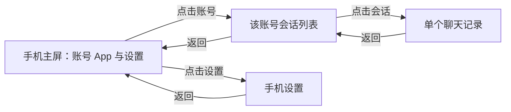

# Shiori 手机主页与连接后的会话流程

状态：当前（源码研究；Meido 适配建议未在本文中实现）。

最后核验：2026-10-25。事实来源：[Shiori 官方仓库固定提交][upstream]，以及 Meido 的固定提交 `09a34140154b912e84aa15ddb21310f052ab1c94`。GitHub API 核验时，Shiori `main` 为 `d149de7f052f77c5bb88d4d1393d48dce1870875`，提交时间为 `2026-10-24T10:42:02Z`。本机同源副本为 `D:\shiori-agent-ref-20261024`，已验证 remote 并获取该提交；读取使用 `git show <固定提交>:<路径>`，不依赖其工作树版本。

本文只调查实际用户流程、界面空状态和列表数据来源。**已提取**表示源码或测试直接证明，**推断**表示多个事实组合后的解释，**计划**表示针对 Meido 的适配方向。没有连接真实平台账号，也没有把静态源码核验当成登录后的实机验收。

## 1. 核心结论：先主屏，再 App，再会话

**已提取。** Shiori 手机默认打开主屏，主屏按角色账号显示可点击的 App 图标；点击某个账号 App 后才显示该账号的会话列表，再点击某个会话显示聊天。主页、列表、聊天由互斥的页面分支渲染，不把列表与未选中的详情同时放在手机里。[页面状态与路由][panel]

上图只表达导航，具体的设置内容和账号移除行为见下文。[路由回调][panel]

| 用户所处状态 | 源码证明的界面行为 | 证据 |
| --- | --- | --- |
| 当前角色没有账号 | 主屏仍有“设置”App，并显示无账号空状态 | [PhoneHomeScreen 第 33–54 行][home] |
| 已有 QQ 账号但没有保存的会话消息 | 主屏有“QQ”App；点击后进入单个 QQ 页面，显示无会话空状态 | [主屏按账号生成 App][presentation]、[列表空状态第 65–76 行][list] |
| 账号离线或连接失败，但仍在宿主账号列表中 | App 图标仍可点，图标变淡并标“离线”；历史读取没有额外在线门槛 | [App 状态映射][presentation]、[离线按钮第 35–44 行][home]、[打开 App 的分支][panel] |
| 账号已有会话 | 显示该账号的会话行；点击某行进入聊天 | [账号精确过滤][presentation]、[列表行][list] |
| 正在查看聊天 | 返回按钮回到原账号会话列表；列表返回主屏 | [PhonePanel 第 59–75 行][panel] |
| 当前打开的账号从列表消失 | 回到主屏；不生成一个“已移除账号”App | [PhonePanel 第 46–51、77–84 行][panel] |

**推断。** Meido 在连接 QQ 后出现“暂无渠道会话／选择一个会话”两块区域，主要是还在复用同时包含列表与详情的工作区，而非 Shiori 的逐页手机导航。连接成功本身不保证已经产生会话；空列表可以是真实状态，但显示位置应是 QQ App 内。[Meido 基线的工作区][meido-workspace]、[Shiori 页面分支][panel]

## 2. 主屏图标与设置的真实位置

**已提取。** 主屏是三列 App 网格，图标位于屏幕上部，按宿主提供的账号顺序排列。“设置”齿轮是同一网格的最后一枚 App，并非右上角按钮。图标外框为 `h-14 w-14`，内部图标为 `h-7 w-7`，下方为渠道名；账号离线时再显示离线提示。未加载账号时不显示已确认的空状态，加载失败则显示可重试错误。[PhoneHomeScreen 第 8–54 行][home]

**已提取。** 严格说是“每个角色账号一枚 App”，不是把所有受支持平台预先铺出来：`phoneApps` 先按 `roleId` 过滤，再给每个账号生成 `accountId`、渠道标签、图标和离线状态。Shiori 同一角色每个插件最多一个账号，因此常见表现等同于“QQ 一枚、Telegram 一枚”。QQ 注册的图标是通用 `ChatCircleIcon`，标签为 `QQ`，不是 QQ 官方企鹅图标。[App 投影][presentation]、[账号归属约束第 283–289 行][registry]、[QQ UI 注册第 30–33 行][qq-ui]

**已提取。** 主屏只使用宿主当前列出的账号；禁用插件的账号不在该列表中。它不把“没有账号”“账号离线”“插件未加载”合并成同一个状态。[App 投影注释及实现第 23–46 行][presentation]、[宿主列表第 147–154 行][registry]

**已提取。** Shiori 的手机“设置”页当前只有“旁听／默认每日上限”，返回主屏。账号连接仍在角色详情的账号页；无账号时看板娘文案也引导去角色账号页。因此，Meido 让同一个设置齿轮打开现有账号设置页，是为了保留当前连接流程所做的适配，不能描述成 Shiori 设置页内容的直接复刻。[PhoneSettingsPage][settings]、[无账号文案第 55 行][empty-copy]、[QQ 账号控件注册][qq-ui]

**已提取。** 无账号和无会话各有一个空状态。看板娘开启时显示对应角色插画和语句；关闭时显示花瓣标记与简短标签“还没有账号”或“还没有会话”。无会话的插画文案表达还没人来聊天，不会同时要求再“选择一个会话”。[空状态组件][empty]、[空状态文案第 55–57 行][empty-copy]、[列表第 74–76 行][list]

## 3. 会话来自本地消息历史，平台目录是另一条数据流

**已提取。** 手机打开或角色变化时读取会话列表；手机打开期间通过 `phone.conversation.updated` 事件追加、更新列表，新消息会话排到前面。客户端调用的是 `phone.conversations.list`，不是 QQ 好友或群目录接口。[列表加载与实时更新][conversations-hook]、[读取客户端第 100–123 行][client]

**已提取。** `phone.conversations.list` 调用 `ConversationService.list_network_threads(role_id)`，只取该角色当前、未归档的网络线程。桥接层再查询每个线程最新的本地保存消息、联系人和聊天类型；没有保存消息的线程直接跳过，桌面会话不出现在手机里，结果按最新消息时间降序排列。[请求处理第 149–170、194–199 行][requests]、[本地线程查询第 114–126 行][service]、[列表投影第 349–404 行][requests]

**已提取。** 手机显示的“联系人”不是平台全量通讯录。名字来自本地 `contacts` 记录；新网络联系人先以聊天 ID 命名，收到可用的平台群名或发送者名后更新。群聊类型也来自已经记录的消息字段。没有从 QQ 拉取全部好友和群后直接铺入手机列表的步骤。[本地联系人第 175–181、369–392 行][service]、[入站联系人更新第 170–184 行][routing]、[桥接列表的数据依赖][requests]

**已提取。** QQ 确实有实时平台目录能力：`QQAccountActions.discover` 在查询时调用 NapCat `get_friend_list`、`get_group_list` 或 `get_group_member_list`；这些能力注册到 `accounts.discover` 与账号目标查询。手机客户端的列表读取并不调用它们。这说明“平台可供投递的目标”与“手机已保存的聊天记录”在上游是两套查询。[QQ 目录查询第 166–203 行][qq-discover]、[RPC 注册第 81–90 行][qq-plugin]、[手机读取客户端][client]

### 3.1 不是扫码完成就生成好友、群会话

**已提取。** 正常入站先验证活跃账号、响应规则和发送者限制；可进入回合的私聊或点名群消息经 `RoleInboundRouter.route` 创建／取得聊天线程，并使用这次消息携带的名字更新联系人。仅连接账号或查询好友群目录不属于该建线程流程。[入站准入第 147–204 行][hub]、[入站建线程第 94–137 行][routing]、[目录查询][qq-discover]

**已提取。** 不能把这个结论写成“只有收到消息才建线程”。成功投递的主动文本也会经过 `ExternalPushSyncService`，创建／取得目标网络线程，将角色的出站文本保存为 `assistant` 消息。这样的会话可以在没有先收到对方消息的情况下出现。[出站同步第 81–127 行][push-sync]、[有保存消息即可生成会话行][requests]

**已提取。** 未 @ 且未回复角色的群消息不会启动回合；旁听只用于已有群会话，查不到已有线程时直接返回，不靠群消息广播创建所有群线程。配对命令也由插件消费，不应被当成一定出现聊天记录的动作。[群准入与旁听第 139–145、192–204、248–270 行][hub]、[配对消费第 87–118 行][hub]

**推断。** 对“已连接但没有会话”的合理解释是当前还没有可列出的本地消息历史；需要实际形成获准保存的渠道消息或已投递出站消息。单纯展示好友／群目录会改变手机列表语义，属于另一项产品能力。[手机列表过滤][requests]、[入站路由][routing]、[出站同步][push-sync]

### 3.2 账号精确过滤与账号移除的限制

**已提取。** 前端 `accountConversations` 严格按 `conversation.accountId === accountId` 过滤。对应测试明确排除其他账号和 `accountId: null` 的孤立会话，并保留桥接层的最新优先顺序。[过滤实现第 49–51 行][presentation]、[行为测试第 44–52 行][presentation-test]

**已提取。** 但桥接层的 `account_id` 不是从每条历史消息的最初账号快照直接取出：它通过当前角色的账号列表及线程渠道调用 `account_for_channel` 得到当前账号。该方法依赖每角色每插件一个账号的约束；当前角色在该平台没有账号时，列表行的 `account_id` 为 `None`。[桥接账号映射第 373–381 行][requests]、[SDK 解析第 150–175 行][account-model]

**已提取。** 账号被移除后，上游手机没有独立的历史账号 App：主屏来自当前账号，打开的 App 找不到时退回主屏；`account_id: null` 的历史行不会通过任何当前账号 App 的过滤。离线账号保留入口与已删除账号保留入口是两件不同的事。[PhonePanel 第 43–51 行][panel]、[主屏投影][presentation]、[孤立会话过滤测试][presentation-test]

**推断。** 单纯复制上游的渠道到当前账号映射，不能证明 Meido 已移除账号的历史归属仍然准确。Meido 如继续提供原有的历史浏览，应以自身稳定的 `accountId`／来源快照确定归属，保留一个标明“账号已移除”的只读入口；这是 Meido 适配，超出上述上游主屏行为。[Meido 历史账号提示][meido-workspace]、[Shiori 当前账号映射][requests]

## 4. 点击会话后的布局与返回

**已提取。** 会话列表是一整屏滚动列表。标题为 App 的渠道标签，左侧返回主屏；每行包含聊天头像或私聊／群聊占位图标、聊天名、最新时间和一行消息预览。群聊中对方的最新消息带发送者名，角色自己的消息不加前缀。[列表组件][list]、[预览规则第 54–64 行][presentation]

**已提取。** 聊天页是单个会话的只读 IM 气泡时间线，没有发送输入框。顶部显示聊天名和“返回会话列表”；角色自己的消息靠右，对方靠左，配对主人标“这是我”。页面默认定位最新消息，向上滚动读取更早历史；群旁听记录按时间合入并以虚线气泡、耳朵标记区分。[聊天页面第 15–63 行][chat]、[消息行第 35–76 行][message-row]

**已提取。** 外部私聊或群聊可以在右上角打开聊天信息；已配对主人的私聊没有该信息页。群聊信息包含群信息、成员、笔记、最近动态，支持旁听的群再加旁听区块。聊天信息／成员档案逐层覆盖聊天，返回时回到来源页面；下层页面保持挂载，所以聊天继续接收实时消息、未保存笔记仍在。[子页面管理][screens]、[信息分区与返回规则第 20–40、70–79 行][chat-info]

## 5. Meido 当前缺口与本次适配边界

以下对比固定在 Meido `09a34140154b912e84aa15ddb21310f052ab1c94`，不把后续实现状态混入研究。

**已提取。** 基线 `ChannelView` 仅在“没有账号且没有会话”时显示单独的设置空页；账号存在后进入统一 `channel-workspace`，同时渲染会话列表和消息区。未选择会话时，消息区显示“选择一个会话”。因此 QQ 连接成功后即使没有历史，也会落入用户看到的双空区域。[基线空页条件][meido-condition]、[基线列表与消息工作区][meido-workspace]、[基线未选中提示][meido-no-selection]

**计划：可直接采用的 Shiori 导航行为。** 手机默认显示按账号组织的 App 网格，设置位于同一网格；点账号进入该账号列表，空态只显示在列表页；点会话再进入单独聊天页；聊天、列表各自逐级返回。手机 App 列表不把平台好友／群目录混进消息历史。[对应上游页面路由][panel]、[主屏][home]、[本地列表投影][requests]

**计划：需要明确标为 Meido 适配的行为。** 保留现有手机设置中的角色账号连接入口；保留已移除账号的历史只读入口；保留现有来源回跳、投递状态、分页和群旁听行为。前两项不能声称与 Shiori 原样相同，后两类能力应在导航变化后继续验证。本文不提出数据库、渠道接入、身份授权或平台目录行为的变更。[上游手机设置内容][settings]、[上游账号消失回退][panel]、[Meido 基线会话实现][meido-view]

## 6. 核验范围与版本关系

- **已提取：** 已通过官方 GitHub API 固定最新 `main`，并在验证 remote 的本地副本读取固定提交；上文所有 Shiori 源码链接固定到该提交。
- **已提取：** 对旧研究基线 `4f266aeaf42fcd611362e2456417b91f659341cf` 到当前基线执行差异检查，`apps/desktop/renderer/src/phone/` 和 `apps/backend/desktop_bridge/phone_requests.py` 没有差异。本次补充的是此前账号配置研究未展开的手机流程，不是认定上游最近修改了手机导航。[旧基线手机目录][old-phone]、[当前手机目录][new-phone]
- **限制：** 本次只做源码与已有行为测试阅读，未运行上游 UI、未获得登录后截图、未使用真实 QQ 账号；颜色、尺寸和动画只以样式类与源码为依据。未验证 NapCat 在特定账号上的好友／群返回数量，也没有据此提出全量同步需求。
- **本次产物：** 只新增本文；不修改原有未跟踪的深度研究文档、实现、测试或真实数据。

[upstream]: https://github.com/YinFengWindy/Shiori-Agent/tree/d149de7f052f77c5bb88d4d1393d48dce1870875
[panel]: https://github.com/YinFengWindy/Shiori-Agent/blob/d149de7f052f77c5bb88d4d1393d48dce1870875/apps/desktop/renderer/src/phone/PhonePanel.tsx#L16-L84
[home]: https://github.com/YinFengWindy/Shiori-Agent/blob/d149de7f052f77c5bb88d4d1393d48dce1870875/apps/desktop/renderer/src/phone/PhoneHomeScreen.tsx#L8-L54
[presentation]: https://github.com/YinFengWindy/Shiori-Agent/blob/d149de7f052f77c5bb88d4d1393d48dce1870875/apps/desktop/renderer/src/phone/phonePresentation.ts#L23-L64
[list]: https://github.com/YinFengWindy/Shiori-Agent/blob/d149de7f052f77c5bb88d4d1393d48dce1870875/apps/desktop/renderer/src/phone/PhoneConversationList.tsx#L17-L79
[registry]: https://github.com/YinFengWindy/Shiori-Agent/blob/d149de7f052f77c5bb88d4d1393d48dce1870875/apps/backend/core/accounts/registry.py
[qq-ui]: https://github.com/YinFengWindy/Shiori-Agent/blob/d149de7f052f77c5bb88d4d1393d48dce1870875/plugins/qq/ui/index.tsx#L25-L33
[settings]: https://github.com/YinFengWindy/Shiori-Agent/blob/d149de7f052f77c5bb88d4d1393d48dce1870875/apps/desktop/renderer/src/phone/PhoneSettingsPage.tsx#L6-L28
[empty-copy]: https://github.com/YinFengWindy/Shiori-Agent/blob/d149de7f052f77c5bb88d4d1393d48dce1870875/apps/desktop/renderer/src/shared/mascot/mascotLines.ts#L54-L57
[empty]: https://github.com/YinFengWindy/Shiori-Agent/blob/d149de7f052f77c5bb88d4d1393d48dce1870875/apps/desktop/renderer/src/phone/PhoneEmptyState.tsx
[conversations-hook]: https://github.com/YinFengWindy/Shiori-Agent/blob/d149de7f052f77c5bb88d4d1393d48dce1870875/apps/desktop/renderer/src/phone/usePhoneConversations.ts#L9-L29
[client]: https://github.com/YinFengWindy/Shiori-Agent/blob/d149de7f052f77c5bb88d4d1393d48dce1870875/apps/desktop/renderer/src/phone/phoneClient.ts#L100-L123
[requests]: https://github.com/YinFengWindy/Shiori-Agent/blob/d149de7f052f77c5bb88d4d1393d48dce1870875/apps/backend/desktop_bridge/phone_requests.py
[service]: https://github.com/YinFengWindy/Shiori-Agent/blob/d149de7f052f77c5bb88d4d1393d48dce1870875/apps/backend/conversation/service.py
[routing]: https://github.com/YinFengWindy/Shiori-Agent/blob/d149de7f052f77c5bb88d4d1393d48dce1870875/apps/backend/core/channels/role_routing.py#L94-L184
[qq-discover]: https://github.com/YinFengWindy/Shiori-Agent/blob/d149de7f052f77c5bb88d4d1393d48dce1870875/plugins/qq/backend/accounts_actions.py#L166-L203
[qq-plugin]: https://github.com/YinFengWindy/Shiori-Agent/blob/d149de7f052f77c5bb88d4d1393d48dce1870875/plugins/qq/backend/plugin.py#L81-L90
[hub]: https://github.com/YinFengWindy/Shiori-Agent/blob/d149de7f052f77c5bb88d4d1393d48dce1870875/apps/backend/core/channels/hub.py
[push-sync]: https://github.com/YinFengWindy/Shiori-Agent/blob/d149de7f052f77c5bb88d4d1393d48dce1870875/apps/backend/conversation/push_sync.py#L81-L127
[presentation-test]: https://github.com/YinFengWindy/Shiori-Agent/blob/d149de7f052f77c5bb88d4d1393d48dce1870875/apps/desktop/renderer/src/phone/phonePresentation.test.ts#L22-L52
[account-model]: https://github.com/YinFengWindy/Shiori-Agent/blob/d149de7f052f77c5bb88d4d1393d48dce1870875/packages/sdk/python/shiori_sdk/accounts/models.py#L150-L175
[chat]: https://github.com/YinFengWindy/Shiori-Agent/blob/d149de7f052f77c5bb88d4d1393d48dce1870875/apps/desktop/renderer/src/phone/PhoneChatPage.tsx#L15-L63
[message-row]: https://github.com/YinFengWindy/Shiori-Agent/blob/d149de7f052f77c5bb88d4d1393d48dce1870875/apps/desktop/renderer/src/phone/PhoneChatMessageRow.tsx#L35-L76
[screens]: https://github.com/YinFengWindy/Shiori-Agent/blob/d149de7f052f77c5bb88d4d1393d48dce1870875/apps/desktop/renderer/src/phone/PhoneConversationScreens.tsx#L13-L60
[chat-info]: https://github.com/YinFengWindy/Shiori-Agent/blob/d149de7f052f77c5bb88d4d1393d48dce1870875/apps/desktop/renderer/src/phone/phoneChatInfo.ts#L20-L79
[old-phone]: https://github.com/YinFengWindy/Shiori-Agent/tree/4f266aeaf42fcd611362e2456417b91f659341cf/apps/desktop/renderer/src/phone
[new-phone]: https://github.com/YinFengWindy/Shiori-Agent/tree/d149de7f052f77c5bb88d4d1393d48dce1870875/apps/desktop/renderer/src/phone
[meido-view]: https://github.com/sawaki-zexi/meido/blob/09a34140154b912e84aa15ddb21310f052ab1c94/web/src/features/channels/ChannelView.tsx
[meido-condition]: https://github.com/sawaki-zexi/meido/blob/09a34140154b912e84aa15ddb21310f052ab1c94/web/src/features/channels/ChannelView.tsx#L136-L138
[meido-workspace]: https://github.com/sawaki-zexi/meido/blob/09a34140154b912e84aa15ddb21310f052ab1c94/web/src/features/channels/ChannelView.tsx#L616-L633
[meido-no-selection]: https://github.com/sawaki-zexi/meido/blob/09a34140154b912e84aa15ddb21310f052ab1c94/web/src/features/channels/ChannelView.tsx#L686
