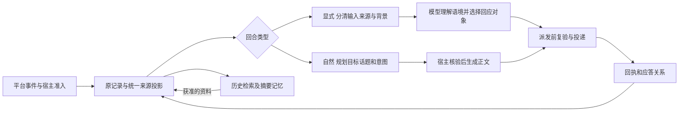

# 多端会话身份与应答关系改进方案

- 状态：当前分支的实现规格，关联 [Issue #338](https://github.com/sawaki-zexi/meido/issues/338)；尚未合并至 main。
- 最后核验：2026-11-09。
- 需求来源：多端会话中发言人、会话来源、引用及应答对象容易混淆。参考 Shiori 和 Tulpa，将上下文分清楚，让模型结合当前请求和群内语境判断怎么回、回应谁。
- 方案方向：参考 Shiori 保留清楚的来源并分离当前输入与背景，参考 Tulpa 表达回应目标、话题和意图。输入来源由宿主核实，回应内容与对象由模型判断；复用 Meido 已有输入保护、会话和授权机制。
- 核验基线：Meido [98d6a31](https://github.com/sawaki-zexi/meido/commit/98d6a31d143b66f4dae3f82f1904cf8600f4e54e)、Shiori [249043d](https://github.com/YinFengWindy/Shiori-Agent/commit/249043d653cd707d6556b737db445ec80495094a)、Tulpa [6753a28](https://github.com/fumingyang2004/Tulpa/commit/6753a28a9757c93c0ad34ed54064965df2cb081c)。现状以这些固定提交为准，不以当前工作区的未提交代码为准。
- 事实来源：第 12 节的固定版本源码、现有多端与自然群聊规格，以及本轮离线源码探针。下文分别标明已提取的现状、推断和计划。

## 1 问题与目标

群聊中的一句“你明天有空吗”可能是在问角色，也可能是主人在问另一位群友。发送者是主人，只能说明是谁说的，不能说明这句话是在对角色说。角色需要同时理解发言人、所在会话、明确的对话指向，以及自己正在回应哪条消息。

当前消息的发言人、被引用消息的作者、模型准备回应的人以及平台实际引用或提及的成员，是不同概念。主人 @ 角色，也可能是在请她回应另一位群友或接上之前的话题。保留当前输入是为了让模型理解这次请求，不能据此规定她只能回答这条消息的作者。

当前 Meido 已有账号归属、主人配对、独立线程和来源授权。已确认的缺口集中在这些事实到模型输入的投影、群内应答关系，以及角色回复进入后续上下文的过程。目标是在这些环节使用一致的来源事实，让自然参与建立在可辨认的多人对话上。

改进后的可观察结果是：模型能区分谁说了什么、对谁说、当前请求与哪些历史或引用有关，并据此决定回应内容、消息、成员或整体话题。主人要求角色回应他人、解释引用或继续旧话题时，能够自然完成。保持现有自然参与方式，角色可以适当地加入话题，也可以等待或沉默。

## 2 实施前基线与参考实现

### 2.1 Meido 的信息断点

以下现状均指实施前固定基线 98d6a31，来自源码直接证明的事实；位置对应文末 M1 至 M8。实施结果、验收证据及剩余边界见第 13 节。

| 环节 | 已有信息 | 已确认的缺口 |
| --- | --- | --- |
| QQ 入站与保存 | 发送者编号、昵称、主人标记、真实 @、引用消息、引用作者，以及接收账号的平台身份 | 后续各路径分别拼装上下文，没有共同的完整投影契约。 |
| 自然接话输入 | 发送者编号、主人标记、昵称、消息编号、部分引用身份与正文 | 未传入真实 @ 对象和接收角色的平台身份；原始 @ 段又已从纯正文中去除。 |
| 普通群回合的旁听块 | 时间、发言人、发言正文 | 丢失 @ 和引用关系。 |
| 普通群历史回放 | 用户消息含渠道和发送者标签，可显示 @ 编号 | 历史渲染未统一恢复引用关系；当前回合另外补充本条引用，后续回放与本轮看到的信息不同。 |
| 自然回合的前后文 | 近期旁听消息，以及另行提供的角色近期已送达正文 | 此前显式触发角色的提问没有一起构成完整应答过程；角色发言只留下名称和正文，缺少消息编号、时间和回应对象。 |
| 自然回复决策与保存 | 回复、等待、沉默、正文和表情候选；关联整批输入 | 没有明确选择所回应消息或话题的结果，不能据此重验目标、选择相关成员资料或重建下一轮关系。 |
| 生成期间的新消息关联 | 根据引用关系与是否同一发送者判断关联 | 没有持续跟踪发言者是否已经转向另一段对话；同一人的无标记后续仍可能被归入原话题。 |

普通显式回复的实际投递已固定到当前触发消息，QQ 群回复会提及当前发送者。本轮未发现普通回复把物理目标改成被引用者的证据。需要改进的是模型理解的对象以及应答关系的保存，不能将所有现象归为渠道发错目标。

普通 QQ 群回合还会把近期旁听文本和当前消息拼入同一条模型用户输入，已有“当前消息”文本分隔；旁听行省略了 @ 和引用方向。这个装配事实可能增加人物和对话关系混淆的机会，但尚不能据此确定用户遇到的具体误解发生在哪一步。见 M3、M4、M6。

Meido 已有当前输入定位、保留当前输入及其工具交换、不将其移入历史压缩前缀的机制。现有保护发生在输入装配之后，因此被保留的 QQ 当前输入已经包含拼接的旁听。改进重点是拆清被保护输入的边界和人物关系，复用原保护机制，不另建一套冻结、压缩或回合运行时。见 M8。

本轮对固定源码中的表达式和纯函数进行合成输入对照，确认三类信息损失：更换真实 @ 对象不改变自然模型输入；更换角色旧回复的消息编号和回应对象不改变近期角色发言块；仅更换历史消息的引用编号、作者与正文不改变普通渠道用户消息的基础渲染。探针证明信息损失，不能代替真实模型的理解效果验收。

### 2.2 借鉴 Shiori 的来源传递与当前输入保护

Shiori 以统一消息来源记录保存渠道、聊天、发送者、主人身份、昵称快照、@ 对象和引用作者。宿主计算可信身份，当前输入与历史回放复用来源渲染，工具上下文获得本轮发送者、会话和可用范围。旁听块也保留结构化 @ 对象。见 S1 至 S4。

Shiori 将合法历史、包含旁听的动态背景和当前提问分别装配，当前提问单独成条并附来源。首次渲染后保存本轮输入副本；重试、窗口重新渲染、压缩和最小请求继续使用这份输入，按已持有的当前消息对象恢复，避免把尾部附加提示当成当前提问。回复计划的生命周期也带有真实账号、聊天与发送者作用域。见 S5、S6。

本方案借鉴其来源记录与统一投影，保留 Meido 的独立原始线程和运行记录。Shiori 当前普通群入口仍要求 @ 或回复角色；它也会省略部分引用展示和嵌套引用信息，因此不能将其视为所有对话关系都完整保留的现成方案。

### 2.3 借鉴 Tulpa 的参与和回应选择

Tulpa 保留入站消息段、发送者、会话和自身发言，向模型提供明确指向角色的消息及指向其他人或对象未知的消息。回复计划可选择目标消息和相关话题，宿主核验这些消息确实属于本批次，并在实际发送前检查目标、新输入和授权。回应对象、显示引用、是否 @ 分别处理；出站回显保留发送请求的关联。见 T1 至 T4。

其实际流程由同一个 Agent 先提交规划，再按返回的计划提交表达。规划记录行动、可选目标、相关话题和简短沟通意图；发送读取计划中的目标，不能在发送时悄悄换成另一条消息。相关新输入使旧计划过时后须重新规划。目标仍由模型在批次内选择，文本回复也可以不指定单一目标，@ 只提供关注线索；宿主没有因此强制每条 @ 都必答。见 T3、T5。

本方案将自然回合适配为“规划 → 宿主核验 → 正文生成 → 派发复验”，沿用现有角色模型和批次调度。显式与自然回合都可结合完整语境判断回应对象；它们的启动条件、工具范围和生成流程继续区分。不引入 Tulpa 的外部 MCP 持续运行形态，也不新增多气泡、群互动或语言学习功能。

两项目上述路径的程序检查主要保护来源、输入归属、目标和新鲜度。模型依据这些信息理解交流意图和选择表达，宿主不以“回答的人必须等于触发者”替代语义判断。效果验收按完整上下文评估理解是否合理，不增加通用模型裁判或固定的语义判错规则。

### 2.4 对问题的解释

推断：多人对话经过上述投影后，明确的对话指向被削弱，角色自己的历史回答又缺少对应提问，模型容易将群聊理解成围绕自己展开的连续问答。共同的一对一聊天表达提示可能进一步放大这种倾向。

诊断时沿原始事件、运行、最终模型请求、模型选择的回应关系、生成结果和投递回执核对，分别判断信息是否丢失、模型是否误解语境，以及执行是否偏离模型的合法选择。回应其他人的消息本身不构成错误；需要结合请求、引用和对话语境理解该选择。

实施时既要修复信息传递，也要调整自然参与的判断依据。单独增加“不要抢话”的提示不足以恢复已丢失的对象和关系；仅保存额外字段，也不能证明模型真正收到了它们。

## 3 用户故事与范围

1. 作为主人，我希望自己对群友说话时，角色知道自己是在旁听，避免代替群友回答。
2. 作为群成员，我希望向角色提问时，她能理解我与所谈论人物的关系，不因为角色设定里的主人称呼而认错人。
3. 作为群成员，我希望引用他人的话时，角色能分清当前发言者、被引用者和被提问者。
4. 作为主人，我希望角色保留自然接话能力，并根据正在讨论的话题决定参与、等待或沉默。
5. 作为群成员，我希望多人交错讨论时，角色能接住选中的话题，而不是默认回复最后一人。
6. 作为主人，我希望同名成员、成员改名和同一个人在不同群出现时，身份判断仍有可靠依据。
7. 作为主人，我希望下一轮或重启后，角色仍能知道自己之前回应了谁。
8. 作为主人，我希望消息进入摘要、群资料和历史检索后，人物归属和会话来源仍然清楚。
9. 作为主人，我希望原有的私聊、群聊、工具和资料可见范围继续按当前授权生效。
10. 作为主人，我希望 @ 角色时可以请她回应另一位成员、解释引用或接续旧话题，由她根据完整语境判断怎么回、回给谁。

| 范围 | 本期行为 |
| --- | --- |
| 来源契约 | 适用于已有渠道输入、模型上下文和回复关联；不要求平台提供其本身没有的字段。 |
| 首要缺陷场景 | QQ / NapCat 群聊的普通触发、旁听、自然接话及后续回放。 |
| 其他渠道 | 复用共同来源投影并验证既有功能；不新增自然群聊、群支持或平台事件能力。 |
| 桌面与主人私聊 | 保持现有授权历史视图，统一标识来源和回应关系；不物理合并原始线程。 |
| 自然参与 | #338 原范围沿用每群开关、低优先级调度、等待与沉默。后续 [#343](https://github.com/sawaki-zexi/meido/issues/343) 替代本票的无工具限制：表达按宿主冻结当前真实发送者复用普通工具权限，保留有限预算及来源／回应对象分离。当前合同见 [QQ 群主动接话](../reference/qq-natural-chat.md)。 |
| 可见回复 | 模型选定的回应对象与显示引用、@ 分开表达。按平台现有能力和许可执行合法选择；未选显示方式时沿用默认策略，自然回复默认不 @。 |
| 资料维护 | 让现有摘要、记忆整理和历史查询消费同一来源事实，不重建记忆体系。 |

## 4 统一的数据含义

### 4.1 区分来源事实与当前权限

宿主在入站准入时形成消息来源快照，后续保存、投影和回放使用同一含义。来源事实与本轮仍可执行的权限分别维护：历史上已核验为主人说的话，在解绑后不会被改写成另一个人的发言；旧消息的历史身份也不能使新回合继续获得已撤销权限。

| 概念 | 必须表达的信息 | 约束 |
| --- | --- | --- |
| 角色与接收账号 | 角色身份、渠道、内部账号身份、角色在该平台的身份 | 区分内部账号编号和平台成员编号；角色名称仅作显示。 |
| 会话来源 | 原始线程、平台聊天、私聊或群聊类型，以及适用的平台子话题 | 始终关联实际接收位置；同一成员不等于同一会话。 |
| 消息身份 | 本地来源编号、平台消息编号、时间和方向 | 两种消息编号分别保存；平台编号必须在其账号与会话范围内解析。 |
| 发言人 | 规范身份键、平台成员编号、当时名称及宿主核验的主人身份 | 沿用现有平台或应用作用域；同名不合并，改名不新建人物。 |
| 明确指向 | 真实 @ 列表、引用消息及已核验的引用作者 | 原始关系与正文一起保留；解析失败标为未知。 |
| 来源类别 | 当前触发消息、旁听消息、角色自己的已确认发言 | 旁听不伪装成主人向角色下达任务；未确认送达不作为已发语境。 |
| 当前输入来源 | 本轮触发消息编号、真实发言人、正文、接收角色和所在会话 | 由宿主保留真实输入，不将其改记为其他人的发言；不预设模型必须回应此人或只谈此条消息。 |
| 应答关系 | 模型选择回应的消息、成员或话题，以及实际投递结果 | 根据完整语境形成，可与触发者不同；不扩大可投递会话范围、主人身份或工具权限。 |

完整来源保留在宿主记录中。模型只取得当前任务需要、且属于可见范围的身份与关系，不注入凭据、运行许可或内部授权快照。

### 4.2 区分明确指向与语义判断

宿主根据可核验的 @、引用及角色自身平台身份提供对话线索：明确指向角色、明确指向其他成员、混合指向、未知。引用作者与当前发言者分别标明。引用失效时不能自动认定引用了角色，也不能仅凭消息正文中的自称授予身份。

这些线索帮助模型理解对话，不取代原有显式触发规则。普通文本里的“你”、称呼和私梗由模型结合原文判断；没有充分证据时保留未知。真实 @ 角色并同时引用他人时，仍按既有显式入口处理，不能因为引用作者不是角色而忽略请求。

### 4.3 统一投影契约

当前消息、旁听、历史、自然输入和角色已发消息使用共同的来源读取与关系解析。不同场景可以有不同排版，但同一消息的发言人、会话和已知指向不得矛盾。

通用模型消息中的 user 只表示协议角色，不代表内容一定出自主人的直接请求。来源信息作为可见内容或结构化消息块进入最终模型请求，不能只留在适配器不会发送的 metadata 中。所有模型协议共用该投影结果，不在各适配器内重新猜测人物。

## 5 接收与上下文装配

### 5.1 入站与持久化

沿用现有账号归属、身份匹配、冻结来源和排队准入机制。适配器解析平台结构，宿主确定可信身份和会话归属，再形成来源快照。媒体或引用补全只能丰富已准入消息的关系，不能因等待后的新配对扩大原消息权限。

先兼容已有记录，再逐步让新写入统一使用来源契约。旧字段仍可被读取，但不能出现两套可独立修改的身份事实。原始消息正文、编号、运行和附件归属保持原样，不复制进另一个线程。

### 5.2 当前群的有界时间线

普通群回合与自然回合都从当前会话可见事件组织上下文，包含相关的显式提问、旁听及角色已确认送达的回复。按真实来源编号去重，按宿主顺序与消息时间组织先后；同一消息不能因出现在旁听和批次里而重复成为输入。

显式回合保留独立的当前请求。参考 Shiori，将旁听放进已有动态背景帧，保留时间、真实发送者、@ 和引用关系，并明确表示这些消息只是本群背景；当前提问单独成条，附本条自己的来源和必要引用。停止把整块旁听拼进当前用户消息，再整体作为当前发言人的输入保存和保护。

请求沿用“稳定系统 → 合法历史或工作摘要 → 动态背景帧 → 当前提问 → 本轮工具交换”的现有顺序。旁听、其他人的未答问题和旧回复不能因使用 user 协议角色而成为新的当前请求；不将旁听改放到可覆盖系统规则的位置。动态背景帧的位置、计量和独立检查继续由现有上下文机制管理。

自然上下文需要看到角色回答所依据的提问，以及后续成员接话的关系。旁听仍可使用有界近期窗口；持久旁听额度耗尽不妨碍既有近期窗口使用，也不能借本次改进将窗口内容全部补存为普通消息。已有按授权共享的外部动态继续标为资料，并保留来源，不作为当前群的实时发言。

### 5.3 历史与角色自身发言

历史消息按其保存的来源重建 @ 和引用关系，不只为当前消息补引用。角色自己的已确认回复也保留消息编号、时间、逻辑回应目标和实际可见引用，使后续“你刚才那句”有可回查的依据。

自然批次的参与者资料依据本轮候选话题涉及的发送者、@ 和引用作者选择，不默认把最后一条输入的发送者当作唯一交流对象。资料仍带规范身份与来源，人物名称不能替代编号匹配。

### 5.4 预算与信息缺失

新增来源和关系进入现有最终请求计量，沿用普通上下文窗口及自然回合的条数、字数和调用上限。优先保留角色自身身份、当前输入和所回应消息的关系；再裁剪更早或无关内容。无法容纳最低必要信息时，按现有预算规则结束或保持沉默，不发送缺少关键身份的旧草稿。

被引用原文不可见、来源被撤销或资料已经过期时，保留明确的缺失状态。不得为补齐关系读取其他群原文、未授权私聊或配对前历史。

### 5.5 当前输入保留与回应判断

实际 @ 或回复角色消息触发普通回合时，宿主记录真实触发消息、发言人、正文及会话来源。首个模型请求、工具返回后的继续生成、上下文压缩或降级后的请求以及既有重试，均保留这些输入事实。不能通过“群里最新一条消息”“最后一个 user 块”或最后活动成员，替换或重记本轮实际收到的请求。

复用已有当前输入对象及来源消息编号定位，扩展装配后的明确所有权传递：当前输入与必要附件、引用作为被保护输入，旁听背景另行提供。重新渲染候选窗口时恢复同一当前输入；工具结果、后台报告或附加提示即使出现在请求尾部，也不能冒充原发言者的新请求。最小请求保留当前输入及真实已执行结果，按可见范围提供必要关系。

生成期间其他成员的新消息保持自身来源，只能按现有准入与窗口规则作为背景或新的独立输入处理，不覆盖当前请求。当前发言人补充、纠正或停止请求时，沿用现有回合更新和取消规则，不将其他人的活动当成他的补充。

输入来源保留不等于限定回答内容和对象。模型结合当前请求、引用、历史及群内关系，判断应回应哪条消息、哪位成员或哪个话题。历史和旁听中的内容可以成为当前交流的主要对象，不限定为补充解释；自然语言中的转述、请托和指代也由模型结合语境理解。

显式回合在现有回复生成中表达所选择的回应关系，无需额外增加选题模型调用。主人 @ 角色请她回应群友时，允许模型选择该群友的消息；宿主核验其属于本轮可见且允许回应的候选，不能因为候选作者不是当前发言人就拒绝。选择回应他人也不改变当前回合的真实来源和工具权限。

## 6 回应判断与自然参与

显式与自然回合共用对发言人、指向、回应对象和话题的理解及表达方式，区别在于启动条件、工具范围和调用流程。以下分阶段流程用于自然参与；显式回合沿用原回复流程，并按第 5.5 节保留输入事实和模型的回应选择。

### 6.1 先选交流对象和话题

自然判断使用角色设定、当前群有界时间线、可信身份及明确指向，先决定自己与哪段对话有关，再选择回复、等待或沉默。

- 对角色的真实 @、引用或对角色已发消息的后续，提供优先关注线索；显式触发仍由原流程接管。
- 主人 @ 另一成员询问其安排时，不将角色代入被询问者。角色可以有依据地旁听或加入讨论，但不能用“我有空”替被问的人回答。
- 自然语言指代不清时，可以等待、沉默或简短澄清，不自动把每个问题当作交给角色的任务。
- 同一批有多个话题时，选择有限的目标消息及相关消息，不默认面向最后一人，也不逐条补答所有旧问题。

参与规则进入自然回合的明确上下文。角色设定仍决定表达风格，不能覆盖真实发言人、会话归属和当前授权。

### 6.2 规划与正文生成分阶段

参考 Tulpa，先确定这次交流在回应谁和什么，再组织实际表达。由同一角色的自然回合分两个有界阶段完成；#343 后续合同保留规划无业务工具，表达复用当前真实来源的已授权工具。推荐流程如下：

1. **规划。** 在本轮已展示的有限消息中，选择回复、等待或沉默，并给出可选的主回应消息、有限相关消息和一句沟通意图。只描述交流意图，不提交正文或内部推理。
2. **宿主核验。** 检查来源、批次、候选目标、当前开关、关联输入版本、期限和剩余预算。等待或沉默在此结束本次判断，不启动正文生成，也不创建用户可见计划或空白回复。
3. **正文生成。** 回复计划有效且预算足够时，向同一角色模型提供获准计划、对应原文和必要背景，生成文字或选择既有表情候选。执行沿用已核验的模型选择；若模型需要改变回应对象或话题，先更新选择并复验，不能直接改写实际投递位置。
4. **派发复验。** 根据计划检查相关新输入、引用和媒体有效性，再投递并记录结果。计划已失效时停止草稿，在原预算内重新判断，不能仅更新投递编号后继续发送旧正文。

规划与表达的具体字段在实现时对齐当前协议，含义固定如下：

| 决定 | 回应依据 | 宿主行为 |
| --- | --- | --- |
| 等待或沉默 | 可保留当前关注话题 | 不进入正文生成，不创建空白回复或虚构用户轮次。 |
| 回应具体消息 | 选择本轮已展示且仍有效的目标；列出必要相关消息和简短意图 | 核验后绑定计划；表达与实际发送始终使用该目标。 |
| 加入当前话题 | 可以没有单一目标，但须选择本轮已展示的相关消息并描述参与意图 | 固定话题依据，持续按这些输入复验，不借空目标绕过新鲜度检查。 |

模型可以选择本轮可见消息、成员或话题作为回应对象，不能借此指定目录外账号、其他群或任意私聊。宿主将候选映射到真实来源并核验范围，显示引用和 @ 按平台现有能力与许可执行。按 #343 的后续合同，自然规划不提供业务工具，表达按当前真实来源提供已授权工具；选择逻辑回应对象不会自行增加操作能力，群聊不继承主人私聊记忆权限。

显式回合也可根据请求和语境选择他人的消息或成员作为回应对象。宿主绑定已经核验的模型选择，是为了让生成、派发和记录保持一致；模型需要改变选择时按既有流程更新或重判，不把这种执行一致性变成“只能回触发者”的语义限制。

计划只保存当前批次、所选来源、意图和必要状态，附在现有自然批次与运行记录中，不建设新的计划服务或长期任务表。重启不恢复旧自然计划和待发正文；可读的诊断记录不作为再次执行的依据。

### 6.3 生成期间的新消息

以选定的目标及相关消息为起点，追踪引用链、参与者补充和已识别的指向变化。某人明确转向另一段对话后，其无标记后续不能仅因身份相同而自动归入原话题；明确引用当前话题或重新面向角色时，可以重新建立关联。

改变当前回答所依据事实、对象或引用链的相关新输入，使尚未派发的草稿失效并在原预算内重判。无关群流量不无限推迟发送。是否相关无法只靠编号判定时保留有限语义判断，不承诺识别所有话题变化。

原有最大等待、批次期限、累计调用额度和冷却继续约束重判；重新选择话题不重置预算。显式请求优先，取消自然过程不误停普通工具任务。

### 6.4 两阶段的调用成本与预算

完成一次自然文字回复通常需要规划和正文生成两次实际模型请求，比原单次决定并生成正文增加一次调用；等待和沉默只进行规划。两阶段分别计入现有批次调用次数、角色累计额度、实际 token 和图片消耗，计数入口按真实请求计算，不能把两次请求包装成一次判断后只计一次。

不提高现有调用上限，也不延长原批次期限。宿主在启动正文生成前复查剩余额度与时间；不足时结束计划，不发送未核验或旧正文。重判、失败和等待均继续扣费计数；可复用同批次已获准的媒体准备结果，不重复扩权或复制原件。

## 7 投递与关系回写

显式和自然回复均记录模型选定的逻辑回应关系。当前触发消息用于说明本轮从哪里开始，不能自动等同于最终回应对象。模型选择引用本会话另一条消息时，核验后应用该选择；未选择显示方式时沿用既有默认策略，自然回复默认不 @。实际发送始终限于当前许可的渠道、账号和会话。

回复表达区分未选择显示方式与明确选择不引用或不 @。默认策略不能覆盖模型已经作出的合法选择，也不能在模型选择其他回应对象后自动把触发者当作必须提及的人。

从生成结果到回复分段、待发计划和实际投递，分别保持原输入与运行归属，以及模型所选择的回应关系。自然回复另外携带经核验的原计划关联，发送读取该计划中的对象和话题。复用现有所有权和取消机制，避免执行时错用其他运行的结果。宿主检查来源、候选和执行一致性；交流意图及表达是否合适按完整上下文评估。

实际派发前复验角色、账号、会话、连接代次、群设置、来源许可、目标有效性和相关新输入。共享成员身份不使回复改投该成员私聊；自然回复的可达目标仍是原群。

投递记录同时保存逻辑应答关系、实际引用或提及、关联输入及真实回执。只有确认送达的内容进入已发语境；部分送达按现有分段回执投影，结果不确定不自动补发。平台自身回显与本地回执记录按现有消息身份去重，并保留已保存的应答关系。

下一轮读取、刷新与重启恢复都从这些事实重建关系。不能通过“线程最新一条回复”猜测对应提问，也不能因重启恢复而重新执行旧发送。

## 8 摘要与记忆连续性

群摘要、群笔记、成员资料和主人记忆继续使用现有分流与覆盖流程。输入统一携带发言者、会话来源、引用作者及角色已确认回复的关系，让整理器能够区分“谁问谁”“谁提出了观点”和“角色回应了什么”。

摘要不要求复述每条原文，但涉及人物归属和应答关系时，须保留稳定来源引用，名称仅作显示。模型推测不能变成确定身份或主人事实。已有来源失效、人工编辑版本和授权复验继续生效，不因新增关系绕过这些检查。

现有主人授权历史视图和上下文压缩机制继续负责可见范围、完整来源核验及工作摘要。关系投影变化应使受影响的派生缓存重新核验；复用既有来源指纹和失效机制，只有当具体缓存无法识别投影变化时才增量版本化。不得要求删除用户历史、清空全部记忆或重建向量库。

旧摘要缺少对应关系时，仅能表达其可证明的内容；能从获准原文重建则重建，不能凭现有昵称或当前配对追溯补成确定事实。

## 9 架构与兼容决定

本次采用统一的宿主来源读取、关系解析与模型投影，在现有适配器、线程存储、上下文、调度和投递之间传递一致含义。共同投影同时服务模型发送、预算估算及上下文检查。宿主提供可靠且可辨认的上下文，模型判断如何参与、回应什么和回应谁；宿主再核验其选择并按现有授权执行。显式回合保留真实输入，自然回合可先规划再生成，两者都不预先把触发者规定为必须回应的人。

该方案沿用现有原始线程、主人跨端授权历史、规范成员资料和来源撤销机制。它与 ADR-0009 的线程隔离、ADR-0027 的成员身份作用域、ADR-0028 的冻结历史及 ADR-0036 的上下文和记忆分工相容。相关决定见 R1 至 R4。

新保存的来源与应答关系优先采用现有消息 metadata 的兼容扩展，不预先引入新的关系数据库或重做模型运行时。来源缺失的旧记录显示未知；名称、当前账号配置或后来的配对都不能作为历史身份的反推依据。若实现阶段确需改变持久模型、身份键或授权语义，应单独记录真实取舍并按项目规则审议。

## 10 验收与测试决定

### 10.1 行为验收矩阵

| 编号 | 场景 | 可观察结果 |
| --- | --- | --- |
| A01 | 主人 @ 成员甲问“你明天能来吗” | 最终模型请求明确甲是 @ 对象、角色是旁听者；角色不能以被问者身份回答自己的安排。允许有依据的旁观接话。 |
| A02 | 成员甲 @ 角色提问 | 模型可辨认甲、角色及相关人物，结合问题和语境决定回应，不把甲认作主人。 |
| A03 | 成员甲引用主人的消息，再向角色提问 | 当前发言者、引用作者、被问对象分别可辨；引用主人不赋予甲主人工具权限。 |
| A04 | 主人不点名与甲连续聊天 | 自然模式可参与、等待或沉默；不会仅因主人发言就将其视为对角色的任务。 |
| A05 | 角色答复甲后，乙接着问“你刚说的是什么意思” | 上下文能定位角色旧回复及对应提问，并识别当前发言者乙。 |
| A06 | 同群两个话题交错，最后一条属于另一话题 | 所选回应目标、相关输入和成员资料保持一致，不默认回复最后一人。 |
| A07 | 甲明确转向乙后继续无标记补充 | 后续消息不再仅凭“同一发送者”归入原话题；重新引用原话题可恢复关联。 |
| A08 | 引用过期、作者未知，或只出现模糊的“你” | 保留未知与缺失状态，不伪造引用作者或确定指向。 |
| A09 | 重启后回放一次带引用的对话 | 来源、角色自身消息及应答关系一致，不重新发送旧回复。 |
| A10 | 相同昵称、改名、不同渠道或应用出现相同数字编号 | 按既有规范身份及作用域区分，不能仅凭名字或裸编号合并。 |
| A11 | 同一平台消息编号出现在不同账号或群 | 不跨来源去重或选择目标；模型伪造其他群目标不能派发。 |
| A12 | 生成期间收到关联纠正、显式请求或发生撤权 | 尚未派发的旧草稿按原因重判或停止；无关群流量不无限拖延。 |
| A13 | 关闭旁听或自然参与、连接换代、清空依赖记录 | 原自然运行不补发，也不把旧输入重新保存；普通回复保持既有行为。 |
| A14 | 自身回显、部分送达或投递结果不确定 | 依实际回执形成后续语境，不重复触发，不把未送达正文当作已说的话。 |
| A15 | 对话进入摘要、群资料或主人记忆整理 | 人物归属、来源和必要应答关系正确；群友内容及角色推测不变成主人事实。 |
| A16 | 旧数据缺来源字段，或有界上下文放不下全部信息 | 平稳降级为未知或缺失，遵守预算；必要身份不被静默丢弃。 |
| A17 | 桌面、配对私聊及已有其他渠道使用同一模型投影 | 保持各自授权历史和平台能力，不因身份贯通将私有原文并入群聊。 |
| A18 | 当前请求涉及群友、引用或已有话题，包括主人 @ 角色请她回应另一位成员 | 模型收到清楚的输入来源与相关语境，能够选择回应他人的消息、成员或整体话题；合法选择不会因对象不同于触发者被拒绝，效果按完整语境评审。 |
| A19 | 多位成员先后触发回合，或自然草稿与显式请求交错完成 | 每个运行的输入来源、模型选择和执行结果可分别追溯；既不挪用另一运行结果，也不把真实触发者与模型选定的回应对象混为一谈。 |
| A20 | 当前输入经过背景更新、工具续接、窗口重新渲染或最小请求，尾部还出现其他 user 协议资料块 | 最终模型请求保持来源、正文、必要引用和附件的真实归属，背景与当前输入清楚可辨；模型仍可据完整语境判断回应对象。 |
| A21 | 自然规划选中回应目标后生成正文，期间收到相关新消息；另有等待、沉默和预算耗尽分支 | 执行沿用已核验的模型选择；需改变选择时更新或重判，旧计划失效后不继续发送。两个阶段分别计入原额度和期限，等待或沉默不启动正文阶段。 |

### 10.2 自动化测试边界

优先在已有最高层行为入口验证：平台入站解析与宿主准入 → 真实临时存储 → 实际模型请求捕获 → 受控模型决定 → 平台协议夹具与回执 → 下一轮或重启回放。使用已有渠道测试、上下文检查和授权视图入口，不为测试建立另一套虚构业务链。

断言模型最终收到的内容与平台最终收到的请求，不能只检查中间 metadata。针对 A01、A03、A05、A06、A09 和 A15 验证跨阶段关系一致；针对 A10 至 A14、A17 验证原有身份、范围和停止边界。A18 至 A20 核对输入来源、可见语境、模型的回应选择及其实际执行，覆盖回应他人、排队、工具续接、上下文裁剪和迟到结果。A21 捕获两个阶段的实际模型调用、计划状态与平台请求，验证预算和停止边界。纯关系算法仅为可独立表达的状态变化补充小测试。

受控模型的沉默或正确回复只证明链路可以承接该决定，不能证明真实模型已学会辨认。自动化使用合成成员、隔离数据和本地协议夹具，不调用真实账号或付费模型。

上游验证可复用其关注的边界：Shiori 的当前输入所有权与副本恢复，Tulpa 的“对角色或对他人”动态线索、批次内选题及按计划发送。已运行的 Tulpa 确定性提示检查和 Shiori 源码函数探针均通过，它们只证明参考机制的行为；Meido 实施后仍须通过本节的实际请求链路验收。

### 10.3 模型效果验收

准备含明确 @、引用、转述与请托、模糊指代、同名成员和多人交错的固定对话样例；记录模型版本、角色设定和采样参数，对照改进前后的最终请求与回复。优先检查 A01 至 A08、A18 至 A19，每个关键场景重复采样，观察是否理解发言人关系、交流意图、引用对象及参与时机。

人类评审结合完整上下文理解模型的回应选择，区分人物误认与适当加入、忽略请求与按请求回应他人。模糊场景允许有根据的判断、澄清或沉默，不将唯一接收人、指定问题或固定措辞作为通用正确答案。实际模型调用的环境和额度在效果验收时单独落实，不将现有源码探针作为效果完成证据。

验收重点是上下文信息足够清楚，模型有依据决定怎么回、回给谁，以及执行忠实于其合法选择。回答了另一位群友的内容、回应对象不同于触发者，均不能脱离请求和语境单独判错。

## 11 实施顺序与风险

实施由 [Issue #338](https://github.com/sawaki-zexi/meido/issues/338) 统一跟踪，以下三个结果作为内部里程碑；验收范围仍为 A01 至 A21。

1. **普通群对话的来源连续性。** 优先把旁听移到独立背景帧，当前输入单独装配，复用已有输入保护与压缩；分开表达真实触发者与模型选择的回应对象。随后贯通旧历史和角色应答关系，保持其他渠道兼容读取。以 A01 至 A03、A08 至 A11、A16 至 A20 验收适用部分。
2. **自然参与的对象选择。** 自然回合先规划对象、话题和意图，宿主核验后才生成正文；沿用原计划复验、投递和回写。以 A01 至 A08、A12 至 A14、A21 验收，复用第一阶段来源事实和原有调用上限。
3. **摘要与跨轮次连续性。** 下一轮、重启、历史回查和现有资料整理保持人物与应答关系，补齐效果对照。以 A05、A09、A14 至 A17 验收，并复核前两阶段的关键组合场景。

| 风险 | 控制方式 |
| --- | --- |
| 多个投影入口逐渐产生不同语义 | 共同来源读取与关系投影，检查最终模型请求及下一轮回放。 |
| 错把历史身份当作持续权限 | 历史来源快照与当前授权分离，沿用冻结来源和撤销复验。 |
| 关系信息挤占上下文 | 纳入实际请求预算，保留必要对象和关系，有限选择相关材料。 |
| 引用缺失或语义话题切换难以确定 | 明示未知，有限重判；不按昵称补身份，不用无限模型轮询。 |
| 新回复协议破坏表情或旧数据读取 | 增量兼容来源和回应字段，保留原媒体候选、回执与平台能力契约。 |
| 静态检查通过但角色仍误认 | 自动链路验收与真实模型场景评审分别留证。 |
| 把触发者预设为模型必须回应的人 | 输入来源与回应选择分别表达，允许模型按请求和语境回应他人，宿主仅校验范围和执行一致性。 |
| 自然回复多一个规划阶段，增加延迟与消耗 | 两阶段分别计数，等待与沉默不生成正文；不提高批次和角色限额，时间不足时结束计划。 |

本期不重建主人配对、渠道宿主、线程数据库或记忆系统，不引入跨群原文共享、新群互动、自然工具调用、主动私信或平台能力扩展。不修改真实角色、正式数据和常驻服务。

## 12 事实来源与既有工作

### 12.1 Meido 固定源码

- M1：[QQ 入站结构解析](https://github.com/sawaki-zexi/meido/blob/98d6a31d143b66f4dae3f82f1904cf8600f4e54e/backend/app/channels/napcat.py#L135)、[宿主消息来源保存](https://github.com/sawaki-zexi/meido/blob/98d6a31d143b66f4dae3f82f1904cf8600f4e54e/backend/app/main.py#L3410)。
- M2：[自然回合上下文和决策](https://github.com/sawaki-zexi/meido/blob/98d6a31d143b66f4dae3f82f1904cf8600f4e54e/backend/app/main.py#L3106)、[自然投递](https://github.com/sawaki-zexi/meido/blob/98d6a31d143b66f4dae3f82f1904cf8600f4e54e/backend/app/main.py#L3223)。
- M3：[旁听文本](https://github.com/sawaki-zexi/meido/blob/98d6a31d143b66f4dae3f82f1904cf8600f4e54e/backend/app/channels/listening.py#L217)、[渠道历史文本投影](https://github.com/sawaki-zexi/meido/blob/98d6a31d143b66f4dae3f82f1904cf8600f4e54e/backend/app/session_store.py#L46)。
- M4：[普通回合当前引用补充](https://github.com/sawaki-zexi/meido/blob/98d6a31d143b66f4dae3f82f1904cf8600f4e54e/backend/app/main.py#L6824)、[当前身份上下文](https://github.com/sawaki-zexi/meido/blob/98d6a31d143b66f4dae3f82f1904cf8600f4e54e/backend/app/main.py#L6904)、[实际回复目标](https://github.com/sawaki-zexi/meido/blob/98d6a31d143b66f4dae3f82f1904cf8600f4e54e/backend/app/main.py#L7085)。
- M5：[自然消息关联](https://github.com/sawaki-zexi/meido/blob/98d6a31d143b66f4dae3f82f1904cf8600f4e54e/backend/app/channels/natural.py#L120)、[成员资料相关性选择](https://github.com/sawaki-zexi/meido/blob/98d6a31d143b66f4dae3f82f1904cf8600f4e54e/backend/app/channels/group_tools.py#L221)。
- M6：[最终模型消息转换](https://github.com/sawaki-zexi/meido/blob/98d6a31d143b66f4dae3f82f1904cf8600f4e54e/backend/app/agent_runtime/meido_provider.py#L517)、[冻结授权历史](https://github.com/sawaki-zexi/meido/blob/98d6a31d143b66f4dae3f82f1904cf8600f4e54e/backend/app/conversation_history.py#L172)。
- M7：[群主人身份回归](https://github.com/sawaki-zexi/meido/blob/98d6a31d143b66f4dae3f82f1904cf8600f4e54e/tests/python/channels/test_group_owner_identity.py)、[自然回合回归](https://github.com/sawaki-zexi/meido/blob/98d6a31d143b66f4dae3f82f1904cf8600f4e54e/tests/python/channels/test_natural_turn.py)、[自然调度回归](https://github.com/sawaki-zexi/meido/blob/98d6a31d143b66f4dae3f82f1904cf8600f4e54e/tests/python/channels/test_natural_scheduler.py)。
- M8：[已有当前输入保留](https://github.com/sawaki-zexi/meido/blob/98d6a31d143b66f4dae3f82f1904cf8600f4e54e/backend/app/agent_runtime/context_provider.py#L503)、[压缩前缀排除当前输入](https://github.com/sawaki-zexi/meido/blob/98d6a31d143b66f4dae3f82f1904cf8600f4e54e/backend/app/agent_runtime/context_provider.py#L358)、[当前问题与旁听的现有拼接](https://github.com/sawaki-zexi/meido/blob/98d6a31d143b66f4dae3f82f1904cf8600f4e54e/backend/app/main.py#L6833)。

### 12.2 Shiori 与 Tulpa 固定源码

- S1：[统一消息来源与模型来源标签](https://github.com/YinFengWindy/Shiori-Agent/blob/249043d653cd707d6556b737db445ec80495094a/packages/sdk/python/shiori_sdk/channels/message_source.py#L102)。
- S2：[宿主身份与旁听分流](https://github.com/YinFengWindy/Shiori-Agent/blob/249043d653cd707d6556b737db445ec80495094a/apps/backend/core/channels/hub.py#L130)、[入站会话投影](https://github.com/YinFengWindy/Shiori-Agent/blob/249043d653cd707d6556b737db445ec80495094a/packages/sdk/python/shiori_sdk/channels/projection.py#L35)。
- S3：[当前消息来源渲染](https://github.com/YinFengWindy/Shiori-Agent/blob/249043d653cd707d6556b737db445ec80495094a/apps/backend/agent/context.py#L122)、[历史来源重建](https://github.com/YinFengWindy/Shiori-Agent/blob/249043d653cd707d6556b737db445ec80495094a/apps/backend/session/manager/models.py#L134)、[旁听中的 @](https://github.com/YinFengWindy/Shiori-Agent/blob/249043d653cd707d6556b737db445ec80495094a/apps/backend/agent/prompting/listening_block.py#L87)。
- S4：[工具回合身份](https://github.com/YinFengWindy/Shiori-Agent/blob/249043d653cd707d6556b737db445ec80495094a/apps/backend/agent/lifecycle/phases/before_reasoning.py#L43)、[引用上下文](https://github.com/YinFengWindy/Shiori-Agent/blob/249043d653cd707d6556b737db445ec80495094a/packages/sdk/python/shiori_sdk/channels/reply_context.py#L69)。
- S5：[首次输入副本与重试恢复](https://github.com/YinFengWindy/Shiori-Agent/blob/249043d653cd707d6556b737db445ec80495094a/apps/backend/agent/core/passive_turn/reasoner.py#L453)、[按当前输入所有权恢复](https://github.com/YinFengWindy/Shiori-Agent/blob/249043d653cd707d6556b737db445ec80495094a/apps/backend/agent/core/passive_turn/minimal_request.py#L53)、[压缩和最小请求保留当前输入](https://github.com/YinFengWindy/Shiori-Agent/blob/249043d653cd707d6556b737db445ec80495094a/apps/backend/agent/core/passive_turn/compaction_render.py#L124)。
- S6：[按真实账号聊天与发送者持有回复计划](https://github.com/YinFengWindy/Shiori-Agent/blob/249043d653cd707d6556b737db445ec80495094a/apps/backend/agent/turns/channel_sequence.py#L83)。
- T1：[接收消息段与自身回显](https://github.com/fumingyang2004/Tulpa/blob/6753a28a9757c93c0ad34ed54064965df2cb081c/chatlocal/mcp_chat.py#L334)。
- T2：[明确对话指向](https://github.com/fumingyang2004/Tulpa/blob/6753a28a9757c93c0ad34ed54064965df2cb081c/chatlocal/mcp_chat_prompts.py#L155)、[先判断谁对谁说](https://github.com/fumingyang2004/Tulpa/blob/6753a28a9757c93c0ad34ed54064965df2cb081c/chatlocal/prompts/mcp_chat/behavior.md#L29)。
- T3：[关联话题追踪](https://github.com/fumingyang2004/Tulpa/blob/6753a28a9757c93c0ad34ed54064965df2cb081c/chatlocal/mcp_chat_turns.py#L198)、[回复计划与目标范围](https://github.com/fumingyang2004/Tulpa/blob/6753a28a9757c93c0ad34ed54064965df2cb081c/chatlocal/mcp_chat_turns.py#L358)。
- T4：[逻辑回应目标与实际发送](https://github.com/fumingyang2004/Tulpa/blob/6753a28a9757c93c0ad34ed54064965df2cb081c/chatlocal/mcp_chat.py#L704)。
- T5：[规划与表达的分阶段协议](https://github.com/fumingyang2004/Tulpa/blob/6753a28a9757c93c0ad34ed54064965df2cb081c/chatlocal/mcp_chat_turns.py#L35)、[发送沿用计划中的目标](https://github.com/fumingyang2004/Tulpa/blob/6753a28a9757c93c0ad34ed54064965df2cb081c/chatlocal/mcp_chat_turns.py#L517)、[相关新输入使计划过时](https://github.com/fumingyang2004/Tulpa/blob/6753a28a9757c93c0ad34ed54064965df2cb081c/chatlocal/mcp_chat_turns.py#L320)。

### 12.3 既有规格与架构约束

- [多端会话规格](multichannel-conversations-spec.md)与 [QQ 自然参与交付 #224](https://github.com/sawaki-zexi/meido/issues/224)提供既有产品范围；源码已实现的内容不能因旧文档仍写“待实现”而重新开发。
- R1：[ADR-0009 多端独立线程](https://github.com/sawaki-zexi/meido/blob/98d6a31d143b66f4dae3f82f1904cf8600f4e54e/docs/adr/0009-multichannel-conversation-threads.md)。
- R2：[ADR-0027 规范成员身份与来源](https://github.com/sawaki-zexi/meido/blob/98d6a31d143b66f4dae3f82f1904cf8600f4e54e/docs/adr/0027-shared-external-member-memory.md)。
- R3：[ADR-0028 冻结主人跨端历史](https://github.com/sawaki-zexi/meido/blob/98d6a31d143b66f4dae3f82f1904cf8600f4e54e/docs/adr/0028-frozen-owner-conversation-history.md)。
- R4：[ADR-0036 上下文与记忆职责](https://github.com/sawaki-zexi/meido/blob/98d6a31d143b66f4dae3f82f1904cf8600f4e54e/docs/adr/0036-shiori-context-memory-ownership.md)。

### 12.4 相似 Issue 核查

2026-11-09 在当前仓库检索开放及已关闭 Issue，使用“群聊”“身份 回复”“应答”三组关键词，并读取以下相关条目的正文与评论。相关能力已有交付记录，本方案以固定主线源码中的实际缺口确定增量。

| 相关条目 | 核查时状态 | 重叠与差异 |
| --- | --- | --- |
| [#118 QQ 群聊与旁听](https://github.com/sawaki-zexi/meido/issues/118) | 已关闭 | 已有群触发、身份与结构化来源；本方案补齐它们进入模型和历史后的关系。 |
| [#224 自然文字聊天](https://github.com/sawaki-zexi/meido/issues/224) | 已关闭 | 已有自然参与、预算、取消与关联更新；本方案细化实际回应对象和话题连续性。 |
| [#237 外部会话资料](https://github.com/sawaki-zexi/meido/issues/237) | 已关闭 | 已有规范成员资料、昵称和来源；本方案复用身份，补充对话关系在整理输入中的一致表达。 |
| [#238 跨端授权历史](https://github.com/sawaki-zexi/meido/issues/238) | 已关闭 | 已有来源、引用及冻结范围；本方案补齐普通群历史与自然回合的不同投影，不重做授权视图。 |
| [#265 聊天与 QQ 重构](https://github.com/sawaki-zexi/meido/issues/265)、[#268 普通拟人回复与 QQ 边界](https://github.com/sawaki-zexi/meido/issues/268) | 均已关闭 | 已有普通分条回复与工具边界；本方案的自然回应对象选择仍属另一条参与路径。 |
| [#275 聊天提示改进](https://github.com/sawaki-zexi/meido/issues/275) | 已关闭 | 已有共用聊天原则；本方案同时修复来源传递和应答关系，不只润色表达。 |
| [#302 上下文与记忆架构](https://github.com/sawaki-zexi/meido/issues/302) | 已关闭 | 已有窗口、覆盖、压缩和恢复；本方案让新的关系投影接入这些机制，不重建整套记忆。 |

实施前检索未发现专门覆盖上述全链路缺口的独立条目。增量实现由 Issue #338 跟踪，复用上述已交付能力；这些旧 Issue 不作为需要重新实现的任务。三个内部里程碑共用同一验收范围，不另行拆分产品范围。

## 13 实施结果与验收边界

本分支已实现共同来源投影、独立群背景、显式回应选择、自然两阶段、投递关系回写和资料整理连续性。完整对照、验收映射和验证记录见 [实施后 Shiori / Tulpa 对照](../research/multichannel-identity-reply-context-implementation-review.md)。合并与交付状态以关联 PR 为准。

- 当前输入继续由现有运行时保护；旁听放入动态背景帧。来源进入实际模型请求，并通过宿主侧来源资料供摘要使用，不解析聊天正文中的自造标签。
- 显式群回复可用可选的回应关系选择消息、成员或话题，关闭分条聊天时也可使用。原触发消息、发言人和运行归属单独保留；未提交选择的旧式正文标为缺省关联，不声称宿主已判断其正文语义。
- 自然参与先规划、后表达；两个实际请求分别计入原额度与期限。规划、生成、改选和派发都检查所选来源与相关新输入，等待或沉默不进入表达阶段。
- 模型的逻辑回应对象、请求的显示引用 / @、由真实回执证明的显示分别表达。确认的部分内容可以进入后续语境；结果不确定仍按原投递规则处理。
- 已核验的空正文或附件引用也可作为回应候选，依附真实父消息，不补存虚构原始消息。私聊引用原文只从当前获准记录重建；整理窗口缺少获准原文时保持缺失，不借缓存扩大读取。
- 工作摘要、群资料和主人事实提取使用同一来源含义。受影响的来源指纹增量携带投影版本；不按当前配对重写历史身份，不要求删除用户历史或重建记忆。

自动验证覆盖来源、实际请求、选择、投递、回放和停止边界。第 10.3 节的真实模型重复采样尚未运行，不能把受控模型提交正确选择的回归当作理解效果结论。自然完整回复通常增加一次请求；缺失的旧身份、引用或回执仍保持未知。
