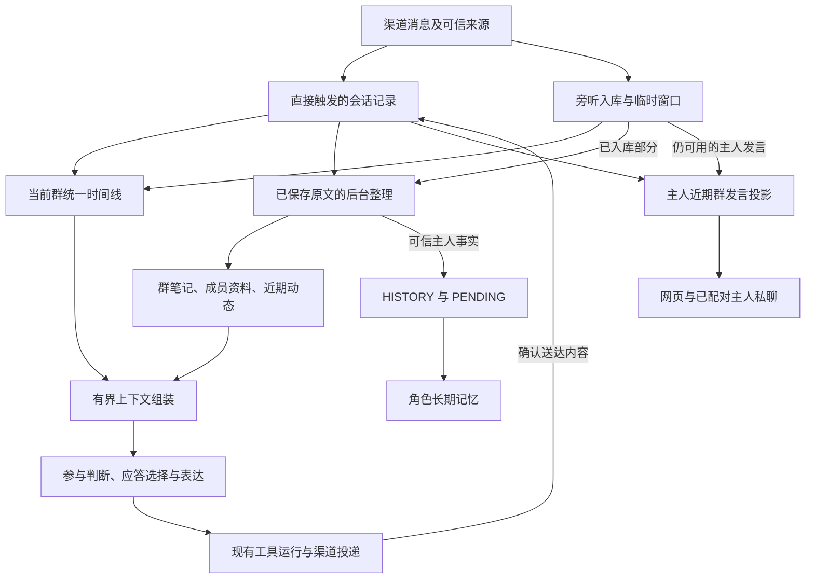

# 自然群聊上下文与主人近期群发言

状态为已确认规格，需求及四项开发任务划分已由维护者于 2026-11-12 确认，本文用于开发与验收。

最后核验日期为 2026-11-12。Meido 基线为 `76242e6e0a5972d41f7c04a6eaa62bc32fb7dfaf`。参考 Shiori `f319aab500a2698a01209b8f4d91ca70ca861d6e` 和 Tulpa `6753a28a9757c93c0ad34ed54064965df2cb081c`。

用户已确认自然聊天采用近期原文、群笔记、成员资料和近期动态组合，窗口达到容量后移出旧消息，需要细节时查询可用原文。主人群发言采用 Shiori 的旁听保留规则与有限近期投影，重要事实进入角色记忆整理。以下“目标”与“计划”描述待开发行为。

首版自然参与范围为现有 QQ 群入口。主人近期群发言的读取入口为当前角色的网页与已配对主人私聊。

## 问题陈述

角色参与群聊时，需要辨认实际发言人、对话指向、引用关系和已经送达的回复。历史与资料无限堆入模型会占满容量，按整段字符串截断又容易切断来源关系，或者让成员资料挤掉群笔记。主人让角色回答另一位群友时，触发者与应答对象需要分别保留。

当前旁听已经保存符合条件的消息及来源信息，群笔记、成员资料和近期动态也已经参与上下文构建。问题集中在资料预算、原文窗口、后台整理与历史查询之间的衔接。

### 已提取的基线事实

| 项目 | 当前行为 |
| --- | --- |
| 自然接话 | 默认候选窗口最多 30 条，消息投影采用 8000 字符预算，再核验完整模型请求容量 |
| 资料编排 | 自然模式将成员资料排在前面，组装后的当前会话资料再截取 3000 字符，可能截断结构或挤掉笔记与动态 |
| 旁听保存 | 旁听表默认每群每天入库 200 条，可覆盖配置，超额消息进入最近 30 条内存窗口。开发前的自然运行准入还会把当前旁听全文复制到会话消息表，形成绕过上限的第二保存路径，本次一并治理 |
| 旁听整理 | 默认每批最多 50 条，当日不足一批时通常等待跨日条件 |
| 主人群发言 | 已入库的可信主人事实可以进入 HISTORY、PENDING 及后续角色记忆消费 |
| 原文查询 | 已有会话历史查询工具，旁听记录使用独立存储，需补齐同一授权范围内的查询覆盖 |
| 普通对话 | 网页及普通渠道回复共用工作摘要压缩、覆盖验证和工具执行基础 |

上述数量分别约束入库、候选窗口、模型输入和整理批次。实现应按各自职责计算与记录。

## 解决方案

自然群聊每次从当前会话选出近期完整消息，并按相关性加载群笔记、成员资料和近期动态。容量紧张时移出较旧的普通背景消息，优先保留本轮输入、选定应答对象、必要引用关系及已执行工具结果。

后台整理消费已入库原文，更新群环境和成员资料。主人事实沿用角色级 HISTORY、PENDING 和长期记忆流程。自然回复与后台整理独立调度，记忆可以稍晚更新。

主人在网页或已配对私聊中，可以读取一小段“最近在群里说过”的补充材料。该材料保留群名和时间，默认取最近 6 小时、最多 10 条主人发言，每条发言及其对应角色回复分别最多 200 个字符。

### 目标数据流

## 用户故事

1. 作为群里的主人，我希望角色理解最近的对话经过，以便自然接话。
2. 作为群成员，我希望角色辨认实际发言人和提问对象，以便回应符合语境。
3. 作为主人，我希望能请角色回答另一位群友的问题，以便委托她参与讨论。
4. 作为主人，我希望角色看到我引用的消息及其作者，以便理解我具体指什么。
5. 作为群成员，我希望角色记住重要约定，以便话题越过近期窗口后仍有连续性。
6. 作为主人，我希望群笔记与相关成员资料都有读取空间，以便成员很多时仍能理解群环境。
7. 作为群成员，我希望结束或变更的事件获得更新，以便角色使用当前事实。
8. 作为主人，我希望追问旧话时角色能查询已保存原文，以便核对具体时间、数量和说法。
9. 作为主人，我希望角色能说明原文缺失，以便判断回答依据。
10. 作为主人，我希望旁听每日入库上限对自己的闲聊同样有效，以便控制保存量。
11. 作为主人，我希望在网页和已配对私聊中继续谈起自己最近的群发言，以便跨端接续。
12. 作为主人，我希望自己的重要事实进入角色记忆，以便日后仍能被理解。
13. 作为主人，我希望涉及其他人的陈述归属正确，以便角色形成准确的人物记忆。
14. 作为主人，我希望整理失败后能够从已保存进度重试，以便减少漏记和重复记忆。
15. 作为主人，我希望关闭旁听、清空记录或撤销绑定后，相关在途工作及时失效。
16. 作为主人，我希望角色根据真实送达结果回忆自己的发言，以便后续交流符合实际聊天记录。

## 实施决策

### 1. 旁听和主人消息的保存合同

复用现有角色、渠道账号、线程及旁听记录。身份使用接收时的可信快照，原文记录包含时间、发言人、真实提及、引用与可用附件信息。

每群每日入库上限采用现有全局默认值和群级覆盖，默认值为 200。上限对所有旁听发送者一致生效。超额输入采用最近 30 条临时窗口，参与当前语境；临时记录的可用期随窗口和进程生命周期结束。后台持久记忆整理消费已入库记录。

自然运行准入仅持久保存输入身份、定位与指纹回执，原文及引用正文、附件正文随当前运行保留在内存，运行终态或取消后释放。真实工具调用、工具结果与确认送达的角色回复沿用既有保存合同。后续恢复输入时从旁听原文表读取，超额原文已失效时返回缺失状态。既有会话表中的旁听全文副本保留现有数据，读取上下文和记忆整理时以旁听表为权威来源，避免副本重复消费或绕过上限。

网页、已配对私聊和直接触发的群对话采用现有会话保存与删除合同。主人在群中被旁听到的发言采用同一旁听合同。模型读取范围与数据库保存范围分别按其合同执行。

### 2. 统一时间线和应答关系

复用当前群时间线投影，合并普通对话、旁听与已确认角色回复。去重键包含接收角色、账号、线程和平台消息标识，按可信时间及接收顺序排列。

触发消息、实际发送者、模型选定的回应消息或成员、平台最终引用与提及分别保存。模型可以回应消息、成员或话题。选定应答对象必须能够追溯到本轮实际提供的候选资料。

规划与表达使用同一批来源快照。新消息导致目标失效或话题转向时，沿用现有重新判断、等待与取消流程。必要的目标和引用关系按完整结构保留。引用内容缺失时明确标记可用状态。

仅确认送达的角色正文进入后续会话视图，部分送达采用实际确认片段。

### 3. 有界上下文组装

在现有自然接话准备与模型请求流程中建立可复用的分块组装逻辑，输出选中消息、记忆块和宿主来源映射。普通群背景可以复用其投影和预算方法。

组装时先计算稳定提示、当前输入、输出预留、工具声明及当前工具执行结果占用的容量，再分配近期消息和补充资料。使用现有模型适配器的完整请求计量，首次规划、表达、工具续接和格式修正均核验容量。

当前输入与已选择的应答关系优先保留。较旧的背景消息按完整记录移出。工具调用与结果组成合法配对，本轮已确认执行结果参与后续生成和重规划。

容量缺省值使用既有策略。必要输入本身仍超出容量时结束该次自然生成，保留真实执行事实，并沿既有运行反馈记录原因。规划、表达、工具后续请求及格式修正使用现有有限调用额度和批次截止时间。

群笔记、当前群近期动态和成员资料分别设置预算。当前发言者、选定回应对象、真实提及和已验证引用对象获得优先资料，其余近期成员采用速记。按完整条目选择资料，长正文使用明确的有界摘录，来源字段保持完整。

其他会话动态沿用现有授权与来源标记，优先级低于当前输入和当前群资料。所选动态以更新时间和相关性参与预算。所有补充材料均作为资料参与模型判断。

自然群聊采用滑动窗口。普通对话采用现有工作摘要机制。记录来源的完整内部标识由宿主管理，模型需要辨认的发言人和应答关系通过结构化投影提供。

### 4. 后台整理和进度

复用渠道记忆整理服务、既有游标、资料版本及角色生命周期管理。持续处理已入库消息，更新群笔记、成员资料和近期动态。

新增触发条件包括持久消息积压、近期窗口开始移出尚未整理的持久消息，以及存在积压时的群空闲。触发请求按群合并，同一群最多运行一个整理任务。开发时根据回放负载确定批次、空闲间隔和重试退避参数，参数作为工程调优项记录在测试结果中。

当前聊天可在记忆更新前继续执行。窗口移出位置和整理成功位置独立推进。模型提炼完成后，提交前重新检查来源、身份、资料版本和游标。冲突或失败保留未消费记录及原资料，稍后重试。重启从持久进度恢复。

资料更新应处理新事实、已结束事项、修正和时间信息，避免追加无限增长的事件流水。主人手动编辑、清空和成员身份变化通过已有版本机制参与冲突检查。

### 5. 主人近期群发言

向当前角色的网页与已配对主人私聊提供只读补充块。采集范围限该角色仍获授权的群记录，包括直接触发的主人发言及其已确认角色回复，以及已入库或仍在临时窗口中的主人旁听发言。

默认窗口为最近 6 小时，最多 10 条主人发言。每条发言和对应角色回复各最多 200 个字符。按时序排列，标明时间、群名和来源关系，在完整请求预算允许时注入。缺失或不可信时间的旧记录跳过本投影。

历史主人身份由接收快照证明，当前绑定和账号范围在读取及发送前复核。解绑、重新配对、记录删除、账号失效或角色变化使旧授权快照失效。引用片段中的他人内容保持引用作者归属。

该补充块用于跨端理解近期事件。工具执行授权继续由本轮真实来源决定，群来源的消息仍使用原线程定位。

这是对主人上下文增加的有限群发言投影，需要在实施时新增 ADR，明确其与现有主人跨端历史授权视图的组合关系。

### 6. 主人长期记忆

对已入库的可信主人事实，复用主人群消息提取及 HISTORY、PENDING 写入流程，后续由既有长期记忆整理消费。群环境和外部成员资料使用各自归属与版本。

提取依据实际陈述对象，引用作者、被提及者和应答对象参与人物关系解析。来源由宿主核对，重复提交通过既有来源键和处理进度去重。

### 7. 按需回查

扩展现有历史查询能力，使当前群授权范围内的普通对话和已入库旁听可以通过一致的结果形式返回。优先处理明确消息定位，再复用已有搜索与有限邻接原文读取。

按角色、账号、线程、接收身份及当前授权限定查询。临时窗口中的信息仅在当前有效窗口内可用。退出临时窗口的超额旁听若没有可读原文，返回缺失结果。查询返回时再次校验来源和权限，并对条数与返回体积设上限。

回查采用旁听原始存储作为权威来源，旧运行副本按同一来源定位。关闭旁听使已捕获旧代次的在途查询失效，之后新发起的当前群查询仍可读取已保存原文，临时窗口仅在开启时参与。查询结果的工程初值为最多 50 条、24000 字符，正文每页默认最多 10000 字符；长原文通过正文偏移继续读取。原文缺失与本页预算省略分别返回状态，精确请求的原文优先于邻接材料。

### 8. 兼容与交付边界

已有会话、旁听、群笔记、成员档案与游标继续作为权威数据。兼容旧资料中的字段缺失，以未知状态表达。旧消息的人物身份依据可信历史证据读取。

采用现有模块与 API 能力扩展，存储变化仅用于必要的查询或恢复支持。最终 Schema 由实现期根据实际缺口确定，涉及迁移时覆盖失败恢复和重复升级。

## 验收标准

| 编号 | 可观察行为 |
| --- | --- |
| AC01 | 群持续产生消息并超过近期窗口后，角色仍可完成自然回复，模型请求满足配置容量 |
| AC02 | 当前消息、所选回应对象和引用关系在窗口裁剪后仍可辨认，原文缺失有明确状态 |
| AC03 | 主人提及另一成员、主人请求角色回答第三人、多个同名成员和交叉引用场景具有正确的来源及应答关系 |
| AC04 | 资料很多时按预算选择完整条目，相关成员资料、群笔记和动态均按分配规则参与选择 |
| AC05 | 当天少于原 50 条整理门槛的持久积压可通过窗口或空闲条件进入整理，并形成有效进度 |
| AC06 | 整理失败、超时、并发编辑或中途取消后可恢复处理，成功资料及重复防护有效 |
| AC07 | 主人旁听发言与群友采用同一每日入库限制，超额消息仅具有临时窗口的可用性 |
| AC08 | 主人网页与已配对私聊最多获得最近 6 小时的 10 条合法主人群发言，正文及角色回复各满足 200 字符限制，附群名和时间 |
| AC09 | 配对前消息、撤销来源和缺少可信身份的旧消息按可见性规则处理，其他成员的发言保持其真实归属 |
| AC10 | 主人可信事实进入 HISTORY 和 PENDING，群友事实进入对应群或成员资料，重试可去重 |
| AC11 | 历史查询可返回当前群授权范围内已保存的会话及旁听原文，缺失记录返回缺失状态 |
| AC12 | 重新规划和工具续接保留真实执行结果，确认送达的回复及部分送达片段正确进入后续上下文 |
| AC13 | 关闭旁听、清空记录、撤销绑定和删除角色后，旧来源的在途查询、记忆提交和自然草稿按现有生命周期失效 |
| AC14 | 重启恢复已入库历史与整理进度，既有笔记、成员资料、普通聊天摘要和原文可继续读取 |

## 测试决策

优先使用现有渠道入站到模型请求、真实工具执行和投递回执的行为测试入口，配合隔离数据库、可控时钟、受控模型响应与平台传输夹具。

复用自然群聊、会话关系、渠道整理、主人跨端历史、外部成员资料、历史工具和生命周期测试的现有夹具。只有高层测试难以准确定位边界时，为纯投影与预算选择增加小范围测试。

重点覆盖 AC01 至 AC14，特别是第 200 与 201 条旁听、临时窗口第 30 与 31 条、6 小时边界、第 10 与 11 条主人发言、长引用、身份撤销、资料编辑竞争和后批失败。正式真实渠道及付费模型由后续明确验收安排使用。

选用同一组合成群聊回放，记录每百条消息的规划、表达、记忆整理及查询续接调用量，模型输入量、应答耗时、整理积压和恢复结果。固定夹具验证结构及来源正确性，模型回答质量另用同一批场景观察，结果分别报告。

交付检查遵循仓库相关测试、类型检查、构建和 CI 要求。复杂的跨来源上下文与记忆变更进行仓库规范和需求规格两轴独立审查。

## 范围之外

本 Spec 的交付范围为自然群聊上下文、既有旁听整理衔接、主人近期群发言和授权范围内回查。下列主题留给各自独立需求。

- 普通聊天压缩协议的重新设计，以及新的原文定时删除或总容量清理策略。
- 主人群发言专用的额外长期原文归档，以及扩大每日旁听入库额度。
- 新增平台旁听适配、角色窗口控制、语音和其他渠道能力。
- 新的向量数据库、全量语义检索迁移或记忆页面排版改版。
- 生产服务更新与数据清理。

## 进一步说明

### 决策来源

保留规则采用用户最后确认的 Shiori 方向。早期讨论中的滚动清理存储，以及主人所有群发言额外长期保存，已由这一决定替代。

主人近期群发言的 6 小时、10 条、每段 200 字符取自已核验 Shiori 实现。后台批次、空闲间隔和退避时间留作实现期工程调优，验收使用可控时钟验证其确定行为。

### 相似工作核对

2026-11-12 已完成一次相似工作检索，使用仓库范围内的“旁听”“自然”“群 记忆”查询，覆盖开放和关闭 Issue。三组结果均完整，已阅读下列候选正文及相关结项评论。当前开放 PR 为记忆页面改进 #354。

| 已有工作 | 状态 | 重叠与本 Spec 增量 |
| --- | --- | --- |
| [#224 按群开启可停止的自然文字聊天](https://github.com/sawaki-zexi/meido/issues/224) | 已关闭 | 已有自然调度、窗口与入库额度。本 Spec 增加分块预算与及时整理，当前工具行为依据后续 #343 |
| [#237 管理并共享外部会话资料](https://github.com/sawaki-zexi/meido/issues/237) | 已关闭，结项评论确认已交付 | 已有笔记、动态、成员档案和版本。本 Spec 调整自然语境的资料选择和整理触发 |
| [#238 主人授权历史视图](https://github.com/sawaki-zexi/meido/issues/238) | 已关闭，结项评论确认已交付 | 已有网页和配对私聊接续。本 Spec 增加有限、标注来源的主人近期群发言块 |
| [#338 多端来源与应答关系](https://github.com/sawaki-zexi/meido/issues/338) | 已关闭，PR #339 已合入 | 已有来源投影、应答选择和真实回执。本 Spec 在窗口选择与分层记忆中复用这些合同 |
| [#343 自然参与调用现有工具](https://github.com/sawaki-zexi/meido/issues/343) | 已关闭，PR #350 已合入 | 已有来源授权、执行结果与有限预算。本 Spec 覆盖上下文裁剪和回查续接 |
| [#141 历史搜索与原文核验](https://github.com/sawaki-zexi/meido/issues/141) | 已关闭，PR #147 已合入 | 已有查询工具与授权范围。本 Spec 补齐已入库旁听的数据源 |
| [#351 工作摘要来源预算](https://github.com/sawaki-zexi/meido/issues/351) | Issue 开放，PR #352 已合入 | 已有有界摘要来源。本 Spec 的自然滑动窗口及主人近期群发言为新增行为 |

维护者于 2026-11-12 确认独立建立 Spec 总单，并划分自然群聊上下文、旁听后台整理、主人近期群发言、旁听原文回查四项开发任务。四项均无前置阻塞，按以上顺序实施以协调共享模块。复用以上已交付基础和本次检索结果。

### SPEC READY

| 项目 | 当前记录 |
| --- | --- |
| 权威规格 | 本文及 [Spec #360](https://github.com/sawaki-zexi/meido/issues/360)，2026-11-12 已确认 |
| 目标 | 自然群聊采用有界近期上下文、分层记忆与按需回查，主人群发言采用已确认的旁听保存和有限近期投影 |
| 基线 | sawaki-zexi/meido，main，76242e6e0a5972d41f7c04a6eaa62bc32fb7dfaf |
| 验证 | AC01 至 AC14，现有高层渠道、模型请求、记忆与投递测试入口 |
| 相似工作 | 已完成检索，维护者确认独立总单并复用已有实现基础 |
| 授权 | 需求、独立总单及四项开发任务划分均已确认，实施已授权 |
| 下一阶段 | 发布四项开发任务，按自然上下文、后台整理、主人近期群发言、原文回查的顺序实施 |

### 事实来源

- Meido 的领域词汇、外部会话资料规格，以及 ADR-0027、ADR-0028、ADR-0036 和 ADR-0038。
- [Meido 旁听实现](https://github.com/sawaki-zexi/meido/blob/76242e6e0a5972d41f7c04a6eaa62bc32fb7dfaf/backend/app/channels/listening.py)
- [Meido 自然接话](https://github.com/sawaki-zexi/meido/blob/76242e6e0a5972d41f7c04a6eaa62bc32fb7dfaf/backend/app/channels/natural_turn.py)
- [Meido 渠道记忆整理](https://github.com/sawaki-zexi/meido/blob/76242e6e0a5972d41f7c04a6eaa62bc32fb7dfaf/backend/app/channels/consolidation.py)
- [Shiori 群旁听](https://github.com/YinFengWindy/Shiori-Agent/blob/f319aab500a2698a01209b8f4d91ca70ca861d6e/apps/backend/conversation/listening_store.py)
- [Shiori 主人近期群发言](https://github.com/YinFengWindy/Shiori-Agent/blob/f319aab500a2698a01209b8f4d91ca70ca861d6e/apps/backend/core/memory/user_group_speech.py)
- [Shiori 群环境](https://github.com/YinFengWindy/Shiori-Agent/blob/f319aab500a2698a01209b8f4d91ca70ca861d6e/apps/backend/core/memory/group_environment.py)
- [Tulpa 应答上下文](https://github.com/fumingyang2004/Tulpa/blob/6753a28a9757c93c0ad34ed54064965df2cb081c/chatlocal/mcp_chat_prompts.py)
