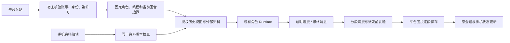

# Shiori 多端会话功能对齐 Spec

状态：当前规格，F01–F13 实现已合入主线。用户于 2026-10-26 要求按本规格开始实现并提交 PR，采用本文推荐的范围与架构方案；代码合入不代表正式实例已更新或真实平台验收完成。

最后核验：2026-10-28。交付跟踪见第 2 节；研究基线保留用于复查原始差距。最新固定源码复核见[差距报告的 2026-10-28 补充](../research/shiori-multichannel-parity-2026-10-26.md)。

关联：[多端规格 #116](https://github.com/sawaki-zexi/meido/issues/116)、[#118 QQ](https://github.com/sawaki-zexi/meido/issues/118)、[#202 会话浏览](https://github.com/sawaki-zexi/meido/issues/202)、[#134 配置体验](https://github.com/sawaki-zexi/meido/issues/134)、[#117 Telegram](https://github.com/sawaki-zexi/meido/issues/117)、[#119 QQBot](https://github.com/sawaki-zexi/meido/issues/119)、[#120 飞书](https://github.com/sawaki-zexi/meido/issues/120)、[#121 投递](https://github.com/sawaki-zexi/meido/issues/121)。

事实来源：[逐项差距核验](../research/shiori-multichannel-parity-2026-10-26.md)、[本轮深度研究](../research/shiori-multichannel-spec-deep-dive-2026-10-26.md)、[当前多端规格](multichannel-conversations-spec.md)、[ADR-0009](../adr/0009-multichannel-conversation-threads.md)、[ADR-0010](../adr/0010-channel-lifecycle-and-managed-qq.md)。以下“当前”指源码事实，“目标”“应”“必须”指本规格要求。

## 1. 目标、基线与交付边界

主人在 QQ、Telegram 等平台切换时，角色能认出本人并接续获授权的对话；群友身份、群资料和主人私有历史有明确边界。主人可以在手机会话中管理角色对外部成员及会话的认识。平台限流、引用失效和分段发送失败时，系统保留真实投递结果并给出可理解的反馈。

| 对象 | 核验基线 | 本规格中的地位 |
| --- | --- | --- |
| Meido 原研究基线 | `8a2d27d4e0bcab11bb1d7dfd6c788997d90ca750` | 原始差距与迁移起点 |
| Meido 已确认集成主线 | `b7f5ee420ecf872570a70855b73ab1e3ab1c8389` | 原七个开放功能 PR 已合入；独立 #261 扩展已由 #262 合入，详见研究中的实际合并表 |
| Shiori 原研究主线 | `d149de7f052f77c5bb88d4d1393d48dce1870875` | 保留原始逐行依据，不直接复制存储和全部权限模型 |
| Shiori 最新核验主线 | `d3acaed186b172a78a5892e0307e9affd89759f0` | 2026-10-28 固定快照；本批相关核心用户流程未变化，差异见研究补充 |
| [PR #230](https://github.com/sawaki-zexi/meido/pull/230) | 已合入，`b005967` | 发送者与引用身份、每群回复开关已补齐 |
| [Issue #233](https://github.com/sawaki-zexi/meido/issues/233) | 运行时事件实现已由 [PR #244](https://github.com/sawaki-zexi/meido/pull/244) 合入 | Telegram 实时工具进度复用该底座，渠道呈现由 [PR #258](https://github.com/sawaki-zexi/meido/pull/258) 合入 |

原研究阶段 Git 拉取遇到网络错误，随后通过 GitHub API 确认两边基线 SHA，采用与该 SHA 一致的本地源码；实施阶段已获取最新 Meido 主线。未读取或改变正式实例的数据、账号及运行版本，未进行真实平台收发。

本规格覆盖上轮 12 项差距及用户额外要求的每群彻底禁回。保留 Meido 已有的 QQ 自然接话、表情包和旁听能力。此次不新增 QQBot/飞书群聊、Telegram 旁听、通用语音/视频理解、手机代发输入框、动态插件加载体系或对外部 Bot 的完整工具授权开关。

2026-10-28 用户另行确认的 Story、角色插画/聊天背景、心情绑定与允许分类自动图片反应，以及工作台跨模块状态保留，由 [Issue #261](https://github.com/sawaki-zexi/meido/issues/261) 独立跟踪，并由 [PR #262](https://github.com/sawaki-zexi/meido/pull/262) 合入 `b7f5ee42`。它复用 NovelAI 等现有基础，不并入本文 F01–F13，也不改变以下原始渠道交付计数。具体契约见 [Story](shiori-story-parity.md)、[角色素材](../reference/role-illustrations.md)及[图片反应](../reference/role-reactions.md)。

相关当前规格、领域词汇与 ADR 随功能实现维护。未合入的功能不提前写成当前领域事实。实现按独立 Ticket 提交 PR；本次用户已授权实现及合并，正式实例发布仍按运行管理流程另行执行。

## 2. 功能范围与追踪

| 编号 | 用户结果 | 对应差距 | 当前基础与新增范围 |
| --- | --- | --- | --- |
| F01 | 私聊、群聊及引用中的主人身份表达一致 | D01 | 全局绑定已有；复用 #230，补可信被引用者身份 |
| F02 | 按群彻底停止回复，旁听独立控制 | 用户额外要求 | 复用 #230，补最终验收与后续发送路径兼容 |
| F03 | 桌面与已配对主人私聊连续对话 | D02 | 历史查询工具已有；改进自动历史组装和媒体连续性 |
| F04 | 同一个外部成员沿用作用域内的一份档案 | D03 | 从线程档案扩展为身份档案及会话关联 |
| F05 | 查看、修改、删除成员档案 | D04 | 增加手机入口、服务端操作及编辑冲突处理 |
| F06 | 管理群聊与陌生人私聊笔记 | D05 | 补 UI，并扩展目前仅群聊的笔记链路 |
| F07 | 查看最近动态，角色感知外部会话概况 | D06 | 补展示及有界摘要注入 |
| F08 | QQ 无直链文本文件也可读取 | D07 | 补文件编号解析、失败呈现及契约测试 |
| F09 | 各平台正确显示富文本及长消息 | D08 | 补普通发送路径，保留现有流式能力 |
| F10 | Telegram 显示输入和工具执行状态 | D09 | 在 #233 事件上增加渠道呈现 |
| F11 | 明确限流后安全等待与恢复 | D10 | 增加调度、逐段回执及有限重试 |
| F12 | 引用失效后仍可在原聊天回复 | D11 | 明确拒绝时取消引用，保持原聊天/话题 |
| F13 | 角色与固定 Grok Bot 双向文字交流 | D12 | 新增第五类内置渠道及本机回程客户端 |

截至本次核验，13 项对应实现均已合入主线。以下记录真实交付提交；不表示所有行为与上游毫无差异，也不表示正式实例已更新或真实平台验收完成。

| 范围 | 实现 PR | 状态 |
| --- | --- | --- |
| F01/F02 身份与每群禁回 | [#230](https://github.com/sawaki-zexi/meido/pull/230) | 已合入 |
| F03 主人连续历史 | [#253](https://github.com/sawaki-zexi/meido/pull/253) | 已合入，`6c7745bd`（2026-10-28） |
| F04–F07 成员资料、笔记与动态 | [#247](https://github.com/sawaki-zexi/meido/pull/247) | 已合入，`aacb49ce`（2026-10-28） |
| F08 QQ 文件 | [#245](https://github.com/sawaki-zexi/meido/pull/245) | 已合入，`65aedfbc`（2026-10-28） |
| F09/F11/F12 富文本、限流与引用恢复 | [#256](https://github.com/sawaki-zexi/meido/pull/256) | 已合入 |
| F10 Telegram 过程反馈 | [#258](https://github.com/sawaki-zexi/meido/pull/258) | 已合入，`45003831`（2026-10-27） |
| F13 Grok Bot | [#257](https://github.com/sawaki-zexi/meido/pull/257) | 已合入，`fc164abd`（2026-10-28） |

每项的最新检查与审查结果以 PR 为事实来源。各功能分支均从主线独立开发，后续集成保留分段确认内容与原始历史授权；没有用其他未合入功能分支作前置基线。

## 3. 领域边界和共享规则

### 3.1 身份、会话与资料

“主人绑定”确认平台发送者是主人；“原始历史共享”决定当前模型能读哪些消息；“成员档案”描述外部成员；“会话笔记/动态”描述某个外部会话。四者不能相互替代。昵称、头像、正文自称及被引用身份均不能给当前发送者授予权限。

成员档案按**角色＋渠道＋受验证的身份作用域＋发送者 ID**识别。QQ/Telegram 使用平台范围的稳定 ID；飞书/QQBot 必须包含应用账号作用域。无法证明属于同一应用时保持隔离。改显示名或同应用轮换凭据不创建新成员；更换应用不继承旧成员。不同角色始终分别维护档案。

同一成员在多个会话出现时，共享档案可以包含此前在其他会话形成的认识；会话关联、昵称观察和事实来源分别保留。群笔记及动态仍归各自会话。当前绑定主人、收到时已被可信标记为主人的发言不生成外部成员档案；旧访客档案可保留历史，但绑定期间从成员列表和模型资料中排除。

### 3.2 模型可见范围

| 当前来源 | 自动可读原始历史 | 外部资料 | 身份/工具边界 |
| --- | --- | --- | --- |
| 桌面、已配对主人私聊 | 当前角色桌面及有效授权主人私聊，遵守各次配对起点和上下文预算 | 可获得有限的外部会话动态 | 保持角色已获准的主人工具范围 |
| 主人在群内发言 | 当前群正常消息、合法引用及本群旁听窗口 | 当前群笔记、相关外部成员档案、其他外部会话有限动态 | 主人身份不自动带入主人私聊原文 |
| 群友触发、陌生人私聊 | 当前外部会话及其合法引用；旁听仅受支持群 | 当前会话笔记、相关成员档案、其他外部会话有限动态 | 保持 `external_allowed` 与当前来源限制 |
| QQ 自然接话 | 当前群自然回合已获准的语境 | 当前群资料、相关成员及有限外部动态 | 不因补身份或资料而获得工具调用权限 |
| Grok Bot | 当前连接对应的外部私聊 | 按外部会话规则 | 固定外部身份，不接受主人配对，不自动升级工具权限 |

**本规格按 Shiori 采用同角色外部摘要共享：一个群中的角色可以获得其他群或陌生人私聊的概况。** 该集合排除桌面和已配对主人私聊，不能包含其原文、引用或媒体。跨群原始聊天仍隔离；群笔记不因此自动全文注入其他群。当前已有的主人显式资料查询能力继续按原权限执行。

普通回合、自然回合、主动及 Drift 使用同一范围判定；后两者仍受各自许可、目标和执行预算约束。共享资料不是新的主动发送授权。

## 4. 产品流程和功能验收

以下验收要求验证用户操作、实际模型输入或平台请求/回执；仅有配置字段、类名或接口返回成功不算完成。

### F01 主人身份贯通

- QQ/Telegram 私聊完成配对后，同平台其他已连接角色账号及受支持群识别真实发送者，无需逐群配对；飞书/QQBot 保持应用范围。
- 当前发言者为主人、角色本人或外部成员时，模型收到宿主核验的明确标记；自然聊天也覆盖，不靠昵称或自称推断。
- 群友引用主人的消息时，模型同时知道“当前群友在发言”和“被引用者是主人”；引用角色消息时标明角色本人。引用者不会获得被引用者权限。
- 引用发送者来自平台结构化事件或核验后的同聊天引用查询；无法确认时明确未知。客户端伪造主人标记无效。
- 解绑后，新回合与排队中的旧授权不得继续使用主人权限；历史保留当时的来源事实，当前权限重新计算。

### F02 每群彻底禁回

- QQ 群的“允许本群回复”按角色、账号、群独立保存，旧群默认允许。关闭后 @、引用、自然接话、群内控制回复及通过工具向该群投递均停止；私聊和其他群不受影响。
- 旁听开关与每日上限独立；关闭回复保留旁听和自然接话偏好。重新允许回复恢复偏好，但不补发关闭前或关闭期间积压的回复。
- 许可在入站首次等待前固定，并在缓冲、引用解析、附件读取、排队、生成及实际发送前复验；关闭再开启不能让旧许可重新有效。
- 页面说明当前状态和自然接话暂停原因。保存失败保留可重试状态，不把未确认保存显示为已关闭。
- 对已提交平台的请求保留实际回执或不确定状态；关闭开关不声称撤回了已发送消息。实现复用已合入的 #230，并在后续渠道路径中保留该边界。

### F03 主人跨端历史连续性

- 桌面与授权主人私聊从统一授权历史视图组装模型消息，保留 user/assistant、来源、引用和受支持附件；在预算充足时，超过 24 条的跨端对话仍可正常接续。
- 当前原始 transcript、消息 ID、线程 ID、运行及工具结果归属不变；网页桌面仍只展示桌面消息，手机仍按账号和聊天展示。
- 在较小上下文预算下沿用正常裁剪/摘要机制，不承诺无限历史。裁剪按完整回合与来源边界处理，保留完整工具调用/结果组，不产生孤立工具结果；摘要不得把不可见原文重新带入。
- `search_messages`、`fetch_messages`、自动模型历史和历史媒体读取使用同一授权判定；原有更早文本查询能力保留。历史图片只有文件仍存在、属于当前角色且来源可见时才能重建；失效附件给出缺失提示。
- 历史查询/媒体读取前、异步读取或下载返回后、交给模型前均核对冻结来源和当前绑定；等待途中解绑、重配或更换账号后，旧结果不得继续返回或注入。
- 配对前消息及其迟到的助手回复不进入共享历史；解绑后重新配对建立新的授权起点，不恢复旧授权区间。缓存和临时摘要须复验其来源范围，已形成的主人长期事实沿现有记忆规则处理，不把“撤销原文读取”冒充“抹除所有记忆”。
- 未解绑的重复配对保留已知私聊原有历史起点，但刷新运行授权代次；新聊天从自身首次合法准入起共享，不能继承另一聊天更早的起点。历史可见起点与旧任务是否仍有效分别判断。
- 同时从两个渠道发言时，各回合只看到其冻结边界内的历史，不夹入未来消息，不重复拼接当前消息；未送达的助手文本不作为已经说过的话。

### F04 外部成员共享档案

- 同一角色在两个 QQ 群观察到同一真实 QQ ID 后，使用一份档案；两个同名不同 ID 的人分开；不同飞书/QQBot 应用中相同 open_id 分开。
- 保留曾出现的会话及昵称历史。模型只注入当前语境中有来源依据的相关成员资料，不将整个成员库全部塞入上下文；UI 列表仅列当前会话已观察且有档案的成员。
- 主人绑定与成员档案互不授予权限；配对前的访客档案和原文不自动变成主人记忆或共享历史。
- 同时整理两个群时，不丢失另一群已提交的资料；人工编辑优先于基于旧快照生成的自动整理结果。旧数据迁移按第 6 节处理。

### F05 成员档案管理

- 手机聊天头像或“聊天信息 → 成员”可进入档案，显示平台身份、只读昵称历史、可编辑速记及完整档案；角色自身和当前绑定主人不提供成员编辑入口。
- 修改后提供保存/还原；删除前说明该作用域的多个会话共用这份档案。保存后相关页面刷新，删除后返回来源页面；不会删除聊天记录。
- 服务端每次读取、保存、删除均核验角色、线程、成员关联及当前主人排除规则，不能通过改 ID 访问另一角色或当前会话未出现的成员。打开访客页后该成员完成主人配对，旧页面及在途请求也不能继续写入；自动整理提交时同样复验绑定。
- 本地编辑使用版本检查。后台整理或另一个页面已更新时，保留本地草稿并提示重新读取/合并，不能无声覆盖。
- 删除表示删除当前档案；后续正常整理可以重建，不提供“永久禁止学习”的隐含承诺。删除前已开始的旧整理不得直接恢复被删除版本；重新整理须读取新版本和有效输入。

### F06 会话笔记管理

- 群聊与陌生人私聊都有笔记页面，支持查看、编辑、保存、还原和以空文本清空；已配对主人私聊使用主人上下文，不显示外部会话笔记管理。
- 笔记由当前会话保存并用于该外部会话的后续语境，不能因同一成员档案共享而把 A 群笔记变成 B 群笔记。
- 笔记和动态的整理输入使用当前外部线程窗口内的合规对话，包含角色已确认的回复和主人在群内的发言，并排除内部维护/提示消息；成员事实单独按可信发送者提取，不能因排除主人成员档案而丢掉主人参与的群事件。
- 笔记保存、清空与自动整理共用持久版本检查。编辑后又还原成相同文字也视为一次写入，旧结果不能通过内容相同绕过版本检查。
- 打开成员页再返回时，未保存笔记草稿保留；返回聊天保留滚动位置与已加载消息。切换角色/会话时旧请求不得覆盖新页面。

### F07 最近动态

- 聊天信息显示当前外部会话的最近动态及更新时间；为空显示“暂无”，读取失败可重试。动态在该页面只读，来源于正常整理。
- 角色提示按 Shiori 的初始行为选择**最近 3 天、最多 5 个**外部会话动态，按更新时间排序；外部回合排除当前会话，主人私聊/桌面不进入候选集。
- 同一规则覆盖普通、自然、主动与 Drift 的资料组装。资料来源变为主人私聊、角色被删除或上下文权限改变后，旧候选不能继续注入。
- 摘要注入额外受模型当前总预算约束；预留不足时减少条目并保留来源，不能绕过预算。3 天/5 条是上游行为，不能误写为上游已有固定字符上限。

### F08 QQ 无直链文件接收

- 保留文件名、文件编号、大小和真实所属聊天；已有合法直链时复用，无直链时按实际 NapCat 版本调用群/私聊文件地址查询。群参数以受管版本契约为准，不照搬过时指南字段。
- 首版对齐 txt/md、每文件不超过 2 MiB、UTF-8 文本校验和 20 秒下载总预算；不将平台本地路径当成本机可读路径。
- 在当前来源通过准入后才解析或下载；普通旁听继续不下载附件。等待后群许可或账号失效时停止，不把文件送入其他回合。
- 不支持格式、过大、无地址、下载失败或非 UTF-8 时保留文件名与明确失败原因，不伪装成已经阅读；成功时正文/附件可由当前回合真实读取，并在手机与引用中正确展示。

### F09 富文本与长消息

- Telegram 将受支持 Markdown 转为平台格式实体，长文按平台限制拆分；实体 offset/length 按 UTF-16 处理。中文、emoji、链接、代码块混排不得丢字、重复或破坏格式。
- QQBot 普通发送支持 Markdown，保留被动回复的消息关联、次数/有效期和序号语义；不能为了格式回退而换成未经许可的主动发送或重建序号重放。
- 飞书普通回复与主动消息支持卡片/Markdown及长文拆分；仅在平台明确拒绝该格式时降为普通文字。已存在的 CardKit 流式继续可用。
- 拆分、降格式与媒体发送使用第 5.3 节共同投递契约；保持同一目标、引用及话题，逐段保存回执。保留已有 QQ 长文合并转发行为。

### F10 Telegram 过程反馈

- 私聊开始处理后可显示“正在输入”；执行长工具时显示安全的工具名称/阶段及完成或失败状态，实际等待工具返回前可见。
- 复用 #233 的 role/session/run/toolCallId 与单调序号；不用工具名配对调用，不在渠道重做另一套运行时事件系统。
- 高频更新合并为最新状态，受发送频率、所属运行生命周期及第 5.3 节投递期限约束，不能为状态消息延长运行。临时进度不进入最终回复事实或主人记忆，不伪造完成百分比，不展示原始敏感参数或完整思考内容。
- 停止、撤权、换账号、运行结束后，迟到更新不再发送；最终正文与临时状态分别处理，状态编辑失败不得重复发送最终正文。

### F11 限流与恢复

- Telegram 在账号整体和每聊天维度调度发送/编辑/typing；飞书识别已核验的明确限流响应。重试沿用原逻辑消息、当前分段、来源及固定期限。
- 初始默认可采用 Shiori 的 Telegram 发送 2 秒、编辑 5 秒、typing 8 秒、账号整体 0.25 秒及最多 5 次尝试；飞书最多 4 次尝试、0.5 秒起指数退避。它们是待验证的产品初值，不是平台保证或实测吞吐结论。
- 平台返回等待时长时遵守它；超过第 5.3 节剩余投递期限则停止并记录原因，不能重置期限无限等待。每个物理段的重试、降格式及去引用尝试共用计数和原期限，不能叠加多层重试放大次数。
- 限流器不扩大 Runtime 角色锁的职责；运行内工具/流式保持现有同角色串行，回合完成后的投递等待不得重新持有该锁。调度按账号/聊天隔离，不阻塞其他角色及独立账号；待发送数据有界、可取消，容量满时明确反馈，不能吞消息或无限排队。临时进度每个运行只保留最新待发状态。
- 每次等待结束、每段发送、流式开始及更新前检查原账号代次、当前来源授权和群许可；重新开启不恢复已失效的旧任务。
- 仅明确可恢复、可证明未接受的拒绝允许重试。传输超时、连接中断、缺少应有回执或未知结果不得自动重放。

### F12 引用失效后的回复

- Telegram 使用同聊天、同话题支持的无引用后备；飞书仅对已核验的“引用不存在/已撤回”等拒绝去掉引用后再发送一次。
- 后备保持原账号、原聊天和原话题；跨聊天/话题引用不支持时明确失败，不能丢掉话题 ID 改发默认聊天。
- 权限拒绝、账号失效、超时或未知错误不触发去引用重发；有前段已送达时只处理尚未被接受的当前段。
- 用户撤回触发消息后，符合条件的回复在原目标出现一次，回执保留原请求与后备结果关系。

### F13 Grok Bot

- 全局平台默认关闭；每角色连接一个固定外部 Bot，只支持文字私聊。角色可从目录找到唯一合法目标，正常回复与主动首发均进入该连接的同一外部会话。
- 配置保存 Webhook、密钥及交流上限；启用只校验配置并启动本机认证入口，不自动发远端测试任务。页面显示“本机入口已启用”，不能据此声称双向通信已经验证。
- Webhook 使用 HTTPS，不接受带用户名/密码、查询串或片段的地址；本机回程仅监听回环地址并验证连接凭据，未认证或协议无效的请求不得创建会话或消耗交流额度。
- 提供带当前实际路径的 Routine 配置和随包 Windows PowerShell 回程客户端；回程只访问本机。外部 Grok 必须已获准在运行 Meido 的同一电脑执行该客户端，应用不代为授予该权限，不要求另建公网回调端口。
- 协议版本、客户端和配置文案一起发布；入站只接受消息 ID、正文及可选父消息 ID，角色、发送者、目标及权限由保存的连接决定。密钥和回程凭据不进入模型、日志、可复制的 Routine 说明或命令参数。
- 对齐初值：正文最多 16,000 字符，消息/父消息 ID 最多 128 字符，请求体最多 64 KiB；每条交流默认双方合计 12 条、可设置 2–100。独立首发各有预算，回复继承父消息的链，重复接收不重复触发回合或占用额度。
- 同一消息 ID 但正文或父消息不同则拒绝，不覆盖原收据；入站在持久准入后才排入角色回合，重启恢复也按原 ID 去重。容量已满且无可淘汰交流时明确拒绝需要新收据的准入，不计额度、不触发运行、不删除受保护收据；已有重复请求仍按原收据处理。
- 上限及收据跨重启保留；收据初始最多 512 条，按完整已结束交流淘汰，待处理/发送中/不确定的交流不能被淘汰。去重保证以仍保留的收据为界，不承诺无限期去重；消息 ID 协议上禁止重用。
- **拟议收紧：** 未知、已淘汰或不属于当前连接的父消息 ID 明确拒绝，开始新交流须显式不带父 ID。Shiori 当前代码和测试会把未知父 ID 当新链，README 却写拒绝；本规格选择拒绝以避免旧回复重新获得额度，作为第 6 节评审项记录。
- HTTP 200 只表示 Webhook 接收任务，UI 显示“已提交 Bot”；不能把任务运行 ID 冒充平台消息 ID 或把接收任务显示成 Bot 已回复。超时或中断保持不确定，不自动重发。
- 暂停/移除/换 Webhook 先停止旧准入并处理在途结果；换对端建立新身份和会话，旧历史保留且不转交新对端。旧回程凭据失效，重启不清空交流预算，也不重放不确定出站消息。

## 5. 数据流与实现约束

### 5.1 复用现有模块

沿用渠道宿主、适配器、凭据库、角色 Runtime、线程历史、资料整理和实时事件。手机新入口复用现有逐级导航、焦点/滚动保留和失败重试。断线或暂停账号不妨碍本地资料查看和编辑；移除账号后的历史继续按 Meido 既有只读约定展示，不借新账号修改旧会话归属。

### 5.2 授权历史与外部资料

推荐保留独立 transcript，增加统一的授权历史投影，负责当前绑定、授权起点、回合截止点、已送达筛选、跨线程稳定排序和媒体授权。模型构建、历史工具、主动/Drift 的历史读取复用这一判定。展示快照不能单独授予权限；宿主冻结的真实入站来源与授权上限必须和当前事实共同核验，后续检查只能收紧，不能把原访客回合提升为主人回合。

成员的规范档案、曾出现的会话/昵称、会话笔记和动态采用不同的归属范围。人工保存、删除及自动整理提交使用持久版本和短事务比较更新；网络与模型调用不放在写锁内。自动结果只在输入范围和版本仍有效时提交，资料变更与消费游标共用同一事务边界，冲突、失败或取消不推进游标。重试重新读取，不覆盖已经保存的人工修改。

删除版本需要保留最小并发标记以防“空→有→空”或“改后又还原”的旧结果回写；该标记不是永久禁止学习。页面写入冲突返回可识别状态并保留草稿。动态摘要与规范成员档案均带可追溯来源，不能依赖模型自报作用域。

### 5.3 投递与回执

一条逻辑消息可以包含多个物理发送段。发送前固定逻辑 ID、目标/话题、来源与分段内容；每段取得真实回执后立即持久化，再处理下一段。重试、降格式和取消引用只作用于尚未被接受的当前段。

普通 Runtime 当前没有统一的整轮总截止时间，不能假定每次发送已有可继承期限。每条逻辑消息首次进入投递调度时冻结有限投递期限，建议初值为 120 秒；若工具、自然回合或其他来源已有更早期限则取最早值。所有分段、排队、等待与后备共用它，不因重试重置。120 秒是本规格的产品建议值，并非 Shiori 或平台保证；到期前未派发可明确停止，已发出但未取得结果的请求保持不确定。

| 已知结果 | 账本和用户呈现 | 后续行为 |
| --- | --- | --- |
| 尚未派发或正在明确限流等待 | `pending`，等待原因可见 | 在原期限/许可内等待，允许取消 |
| 全部分段取得应有回执 | `sent`，已发送 | 不重放 |
| 全部未接受且明确拒绝 | `failed`，具体失败原因 | 仅白名单恢复类型允许有限尝试 |
| 部分段确认，剩余段明确失败 | 保留成功段，失败终态附 `partialDelivery` 及未发尾部 | 显示“部分已发送”，不重发成功段 |
| 任一段结果未知、缺少应有 ID 或发送时崩溃 | `uncertain`，保留已有回执与未知段 | 停止后续自动派发，不自动补发/重放 |
| Grok 有真实 HTTP 接受证据 | `sent` 附 `receiptKind=transport_acceptance` | 显示“已提交 Bot”，不宣称对端完成 |

四种既有顶层状态继续保留，增加分段详情和回执种类。普通平台使用 `platform_message`，其缺少平台 ID 仍为不确定；Grok 的传输接受例外不能让其他适配器绕过真实回执。手机、查询工具、原始记录和后续模型上下文对部分送达保持一致，只把确认部分当作已送达事实。

停止/撤权后已提交的请求仍记录实际结果；未派发尾部停止。重启后遗留在途段转为不确定，不把已保存的逻辑消息当成可安全重放的出站队列。不要引入多个互不协调的自动重试层。

## 6. 数据兼容、迁移和架构取舍

以下推荐方案随用户“按 Spec 开始实现”的指令采用，实施对应功能时按仓库规则新增 ADR，保留原决策记录。开发和测试仅使用隔离数据，生产迁移随已合入版本发布另行执行。

| 决定 | 推荐方案与理由 | 取舍及兼容要求 |
| --- | --- | --- |
| A1 主人历史共享 | 在现有线程上构造统一授权视图 | 保留所有消息/运行 ID 和网页投影；新增补充或替代 ADR 说明对 ADR-0009“近期片段”策略的调整，保留旧决策记录，不要求物理合并消息表 |
| A2 外部成员资料 | 规范身份档案＋会话关联＋来源；应用 ID 作用域显式保留 | 改变目前按线程注入档案的策略；跨群共享只发生于同角色、同一可证明身份 |
| A3 人工编辑与整理 | 持久版本、冲突提示和短事务提交 | 自动整理可能重算；删除当前档案不承诺永久不重建 |
| A4 分段与 Grok 回执 | 扩展现有投递账本，保留段级结果与回执种类 | 增加展示及恢复语义；不把 HTTP 接收任务等同平台消息送达 |
| A5 Grok 未知父消息 | 明确拒绝，不静默开始新交流 | 有意区别于上游当前代码/测试；保留显式新首发入口及有界去重说明 |

迁移必须满足：

1. 升级前生成可验证备份，迁移幂等、原子或可恢复；中断后不出现半份档案或重复会话。不删除旧原始消息、投递记录、附件或来源。
2. 原有成员按真实身份归组。单来源或完全相同内容可自动生成规范档案；多个不同版本保留来源和候选，不无声按“最新”覆盖、不让模型凭空调和事实，也不按昵称合并。旧账号已删除或历史应用身份不足时保留独立的历史作用域，不用当前账号字段猜测合并。
3. 冲突候选在资料页明确显示“需整理”，主人可以选择或编辑合并后发布规范档案。未确认的冲突内容不作为跨群共同事实注入；旧内容仍能按来源查看。该状态受版本保护，自动整理不得绕过人工确认发布或覆盖规范档案，新增来源保留为候选；人工确认与在途整理也执行版本检查。迁移不调用模型。
4. 原有群笔记/摘要归属保持；陌生人私聊首次使用新笔记能力为空，不用主人私聊填充。成员与笔记迁移保留昵称顺序、更新时间、会话来源和删除/编辑版本。
5. 旧群回复默认值沿 #230，平台和账号原有连接意愿保留；新增 Grok 默认关闭，不启动真实连接。
6. 降级只能使用升级前备份或已验证兼容读取路径，不让旧版本覆盖新档案结构。迁移失败时保留旧数据并给出恢复办法，不能以静默跳过部分记录宣布成功。

## 7. 验证计划与完成条件

优先使用公开 HTTP/API、实际模型输入截获、平台传输替身和用户页面操作测试外部行为；并发场景使用可控等待点，不以固定 sleep 猜时序。实施默认红—绿—重构，相关测试、类型检查与构建通过后分别做仓库规范和需求审查。

| 验收组 | 必须覆盖的场景 |
| --- | --- |
| 身份与禁回 | 真正消费私聊配对码后进入两个群；群友同名冒充；引用主人；自然接话；解绑/重配；下载或排队期间关闭再开启；其他群和私聊不受影响 |
| 跨端历史 | 预算充足时超过 24 条接续；图片/引用往返；低预算裁剪和完整工具组；配对前入站但配对后生成完成；未解绑重复配对保留历史起点；媒体下载/查询等待中解绑重配使旧结果失效；两端同时发言；不存在/跨角色附件 |
| 成员与笔记 | 同 QQ 跨群、不同 ID 同昵称、同 open_id 不同应用；主人成员过滤；陌生私聊笔记；群友提问、角色回答及主人群内活动均进入合规笔记/摘要而不产生主人成员档案；人工编辑与整理交错；清空/删除/改回原文；多页冲突、角色切换、失败重试 |
| 动态 | 3 天边界、最多 5 条、当前会话排除、主人私聊排除、来源变更、无摘要/过期摘要、主动及自然回合使用同一范围 |
| QQ 文件 | 直链、仅文件 ID、解析地址为空、过大、非 UTF-8、格式不支持、下载超时、普通旁听不下载、撤权后不继续 |
| 发送 | 中文/emoji/链接/代码块；首段成功后二段限流并恢复；首段成功后二段超时；限流等待超过固定投递期限；无消息 ID；撤回引用；权限拒绝不能触发后备；原话题保持；重启不补发 |
| 过程反馈 | 工具未完成前已显示状态；连续同名工具隔离；高频更新合并；停止/解绑/换账号后零迟到派发；终态不丢失、最终正文不重复 |
| Grok | 两个首发方向；启用无外发；真实本机客户端与模拟 Webhook 往返；重复 ID、冲突 ID、未知父 ID、跨连接引用；交流上限及重启；512 条均受保护时新准入明确拒绝且不计数、旧重复仍可查询；200 接收/不确定与无虚构平台 ID |
| 兼容与页面 | 旧数据迁移中断/重跑/冲突处理；离线资料操作、移除账号只读历史、已加载页和草稿保留；桌面及窄屏、键盘焦点、来源定位不回退 |

自动化测试不能替代平台验收。最终交付须分别记录每个平台的真实账号权限、引用/格式、收发与回执结果；未运行的场景明确标记。平台限流用受控替身覆盖，不故意向真实账号刷消息触发限流。真实平台操作在获得该次授权后进行；本规格编写不执行外发。

飞书错误分类需在实现时对照可读取的官方文档和实际响应补齐白名单；本轮官方页面正文未能取得，仅有上游代码依据，不能把错误码列表写成已完成平台实证。

## 8. 实施顺序与已有工作的关系

以下保留原研究阶段的拆分与协调建议；真实实施及交付结果以第 2 节为准，不再表示尚待创建的 Ticket。各 Ticket 使用 `Parent / What to build / Acceptance criteria / Blocked by`，关联 #116；共享文件的协调顺序与真正功能依赖分别记录。

| 交付结果 | 范围 | 真正前置及协调事项 |
| --- | --- | --- |
| 群里认出主人并能彻底禁回 | F01/F02 | 在现有 #230 / #118 中补齐引用身份并复用开关；后续其他 Issue 若依赖它，待合入后从最新 main 创建分支 |
| QQ 文本文件可完整接收 | F08 | 无新的语义前置；与身份工作协调入站解析/下载边界的修改 |
| 查看和纠正跨群成员档案 | F04/F05 | 先完成 A2/A3 评审；迁移、页面与注入作为同一用户结果验收 |
| 管理外部会话笔记和动态 | F06/F07 | 同一资料版本契约；与成员工作协调共享资料模块，避免并行重复改写 |
| 在桌面和主人私聊连续对话 | F03 | A1 评审；复用现有历史工具，与其他涉及 main/history 的改动串行集成 |
| 各平台格式正确且失败可恢复 | F09/F11/F12 | A4 评审；围绕逐段回执完成端到端交付，复用 #121，不另建发送系统 |
| Telegram 看见真实执行进度 | F10 | #233 合入是中间进度实时性的前置；复用已完成的发送调度和撤权检查 |
| Grok 双向文字交流 | F13 | A4/A5 评审；配置、随包客户端、回程、会话与账本一起验收，无动态插件框架依赖 |

实施分支一律从当时最新 main 创建；需要未合入代码时等待对应 PR，不创建堆叠功能分支。正式发布仅从已合入 main 的版本进行，按现有运行管理流程另行执行。

## 9. 关键一手依据

- [Shiori 宿主身份与群准入](https://github.com/YinFengWindy/Shiori-Agent/blob/d149de7f052f77c5bb88d4d1393d48dce1870875/apps/backend/core/channels/hub.py#L162-L204)、[引用身份](https://github.com/YinFengWindy/Shiori-Agent/blob/d149de7f052f77c5bb88d4d1393d48dce1870875/packages/sdk/python/shiori_sdk/channels/reply_context.py#L49-L58)。
- [Shiori 授权历史视图](https://github.com/YinFengWindy/Shiori-Agent/blob/d149de7f052f77c5bb88d4d1393d48dce1870875/apps/backend/conversation/context_scope.py#L250-L264)、[历史窗口](https://github.com/YinFengWindy/Shiori-Agent/blob/d149de7f052f77c5bb88d4d1393d48dce1870875/apps/backend/agent/core/passive_turn/helpers.py#L30-L44)、[Meido 当前跨端补充](https://github.com/sawaki-zexi/meido/blob/8a2d27d4e0bcab11bb1d7dfd6c788997d90ca750/backend/app/multichannel.py#L1108-L1133)。
- [Shiori 成员资料](https://github.com/YinFengWindy/Shiori-Agent/blob/d149de7f052f77c5bb88d4d1393d48dce1870875/apps/backend/core/memory/member_profiles.py)、[最近动态](https://github.com/YinFengWindy/Shiori-Agent/blob/d149de7f052f77c5bb88d4d1393d48dce1870875/apps/backend/core/memory/group_environment.py#L136-L197)、[手机资料服务](https://github.com/YinFengWindy/Shiori-Agent/blob/d149de7f052f77c5bb88d4d1393d48dce1870875/apps/backend/desktop_bridge/phone_memory_requests.py#L100-L190)。
- [Telegram 官方回复参数](https://core.telegram.org/bots/api#replyparameters)、[实体偏移](https://core.telegram.org/bots/api#messageentity)、[限流响应](https://core.telegram.org/bots/api#responseparameters)；[QQBot 官方消息规则](https://bot.q.qq.com/wiki/develop/api-v2/server-inter/message/overview.html)。
- [NapCat 官方文件指南](https://napneko.github.io/develop/file)、[Shiori 文件接收](https://github.com/YinFengWindy/Shiori-Agent/blob/d149de7f052f77c5bb88d4d1393d48dce1870875/plugins/qq/backend/channel/files.py#L89-L142)、[飞书发送后备实现](https://github.com/YinFengWindy/Shiori-Agent/blob/d149de7f052f77c5bb88d4d1393d48dce1870875/plugins/feishu/backend/channel.py#L697-L764)。
- [Grok 连接与回程](https://github.com/YinFengWindy/Shiori-Agent/blob/d149de7f052f77c5bb88d4d1393d48dce1870875/plugins/grok_bot/backend/connection.py)、[Grok 交流账本](https://github.com/YinFengWindy/Shiori-Agent/blob/d149de7f052f77c5bb88d4d1393d48dce1870875/plugins/grok_bot/backend/exchange.py#L61-L113)、[未知父消息行为测试](https://github.com/YinFengWindy/Shiori-Agent/blob/d149de7f052f77c5bb88d4d1393d48dce1870875/plugins/grok_bot/tests/test_exchange.py#L43-L75)。

这些来源证明研究事实，不表示本文所有增强要求已经存在于 Shiori。迁移冲突处理、持久编辑版本、严格分段回执、Grok 未知父消息拒绝等为本规格明确提出的交付要求；详细差异及证据限制见本轮深度研究。
