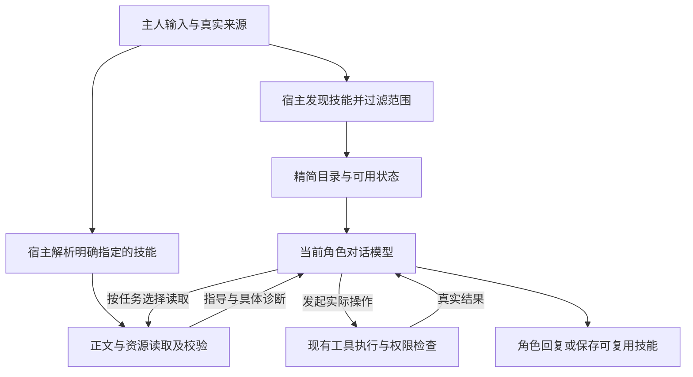

# Meido Skill 发现与自主复用改进方案

状态：已实现，待交付审查与合并

最后核验：2026-11-09

方案核验基线：Meido 主线 `b49d95667a4fbb8c1f1a8aef97735ac1c45959e0`；本机常驻版本 `6370ae11fc98437a6ef32c9d7c69198e0aaac696`。两者的普通 Skill 发现、触发和正文加载实现一致。实施起点更新为 `98d6a31d143b66f4dae3f82f1904cf8600f4e54e`，已包含 PR #335 的上下文压缩修复。

适用范围：普通角色对话中的 Skill 发现、选择、读取、导入和复用。2026-11-09 主人确认本方案并要求开始实施，明确选择将全部改动合并为一个任务、一个 PR；以下阶段仅表示同一任务内部的实施顺序。最终 PR 合并仍需主人确认。

## 方案摘要

让角色在对话中先看到可用技能的简短目录，结合当前任务自主判断是否需要某项技能，需要时再读取完整说明和参考资源。选择由当前角色的对话模型完成，不新增专用的技能判断模型。

保留主人直接指定技能的入口。角色通过聊天导入或自行整理的技能默认属于该角色，公共与内置技能继续提供共享的基础能力。技能提供可复用的工作方法；真正的文件、网络、MCP 和其他操作仍通过现有工具执行，并接受原有权限检查。

这次改进要补齐的用户结果是：主人不必记住技能名称，角色也能在合适的任务中主动复用已保存的方法；主人同时能看到技能是否保存成功、作用于谁、为何不可用，以及本轮是否实际读取。

## 问题与目标

### 当前已经具备的能力

以下为源码与测试直接证明的现状。

| 能力 | 当前行为 |
| --- | --- |
| 技能发现 | 每次运行发现当前角色、项目和内置来源的技能，保留描述、来源、内容哈希及支持资源信息 |
| 触发 | 按显式指定、关键词匹配或角色默认加载三种规则决定是否读取正文 |
| 关键词匹配 | 比较当前输入与技能 ID、描述中的词项；中文包含双字片段匹配，不是模型的任务理解 |
| 同名覆盖 | 当前角色的技能优先于项目和内置版本，角色工作区优先于角色旧目录 |
| 创建与复用 | 角色可用文件工具创建技能，后续对话显式调用；已有公开对话往返测试 |
| 文件导入 | Markdown 可作为聊天附件读取；上传附件本身不会自动登记成技能 |
| 权限 | 技能声明工具不会授予权限，依赖缺失和内容变化有诊断 |

主要缺口是：普通对话没有向模型提供完整的技能选择入口。显式技能需要主人记住名称，关键词触发容易漏掉换一种说法的需求，默认加载又容易让无关指导长期占用上下文。前端也缺少普通技能的统一查看、导入和配置入口。

### 改进目标

1. 角色能理解任务与技能适用范围，自主选择是否读取，而不要求主人每次输入技能名称。
2. 普通闲聊保持简短，不为展示能力而读取技能或执行工具。
3. 主人发来技能文件并明确要求保存后，角色能适配、保存、复核，并在后续对话复用。
4. 角色可在现有写入许可内沉淀有实际复用价值的方法，不必把每次对话都变成一次技能生成任务。
5. 来源、角色范围、手动调用限制、依赖和现有工具权限始终可解释、可检查。

## 借鉴 Codex 的部分与 Meido 的取舍

OpenAI 官方说明的核心是渐进加载：先提供技能名称、描述及路径，选中后才读取完整说明；支持用户指定和模型自动选择，并能关闭自动选择。[官方说明](https://learn.chatgpt.com/docs/build-skills#how-chatgpt-and-codex-use-skills)

Meido 借鉴这套职责分配：宿主负责发现、范围过滤和读取，当前角色模型负责理解任务、选择方法和使用工具。描述用于选择，详细步骤留在正文，参考资料按需读取。[Skill 与工具的关系](https://developers.openai.com/plugins/concepts/skills)

以下属于 Meido 的方案取舍，不是对 Codex 内部实现的描述：

- 保留现有角色、项目、内置三个常用范围及同 ID 覆盖顺序。Codex 的同名技能可以同时出现在选择器中；Meido 不直接照搬该行为。
- 新增受控的技能读取入口，不要求角色通过普通文件工具越过工作区读取项目或内置文件。
- 沿用现有运行记录、工具结果和内容哈希，不增加完整技能目录的持久版本链。
- 保持普通 Skill 与 Drift 长期任务的发现、创作许可和执行范围分开。

## 用户故事

1. 作为主人，我希望描述任务就能触发合适的技能，以便不用记住每个技能名称。
2. 作为主人，我希望普通闲聊不会无故触发工作流程，以便角色保持自然的交流方式。
3. 作为主人，我希望仍可明确指定某个技能，以便准确复现已知流程。
4. 作为主人，我希望将某项技能设为仅手动使用，以便控制它的适用时机。
5. 作为主人，我希望把技能文件直接发给角色保存，以便不用手工操作后台目录。
6. 作为主人，我希望角色把验证过的有效方法保存为技能，以便以后复用和改进。
7. 作为主人，我希望知道技能属于哪个角色，以免另一角色意外获得私人方法或资料。
8. 作为主人，我希望能明确把通用方法发布为公共技能，以便多个角色使用。
9. 作为主人，我希望看到同名技能最终选择了哪个来源，以便理解角色的个性化覆盖。
10. 作为主人，我希望依赖缺失时收到具体原因，以便补齐环境后继续使用原技能。
11. 作为主人，我希望对话变长或恢复上下文后，角色仍按本轮已经选定的方法工作，以免只记住“用过技能”却丢失关键步骤。
12. 作为主人，我希望能查看、修改、停用和移除角色技能，以便管理角色沉淀的经验。

## 用户流程

### 按任务自主选择

主人要求整理本周工作。角色看到技能目录中的周报技能及其适用说明，判断与任务相关后读取正文，再按说明使用当前已获准的资料和工具。正文已在有效上下文中时可以复用，不重复读取同一内容。

主人随后只是打招呼，角色可以直接回复，不因为目录里存在周报技能而继续套用周报流程。自动选择是可选的任务决策，不要求每轮至少使用一个技能。

### 明确指定技能

主人使用现有的技能名称调用入口。宿主先解析明确指定的技能，在首次模型请求前读取并验证正文，确保本轮具备该指导；不存在、已停用或不可用时返回具体诊断，不默默替换成另一个技能。

明确指定不会排除其他必要技能，也不扩大工具权限。读取成功表示指导已经交给模型，不表示工作已经执行完成。

### 导入与沉淀

主人上传 Markdown 并明确要求保存为技能。角色读取附件，适配格式、检查已有同类技能、保存并读回复核，报告技能名称、范围、调用方式和缺失依赖。只有上传附件、没有导入指令时，附件仍按普通资料处理。

角色在完成任务后，也可以依据当前任务与已获准的文件写入范围整理可复用方法。保存内容应包含适用条件、必要步骤、结果核验和失败处理；个人资料和本次原始聊天记录不应直接混入通用方法。

新建或修改的技能从下一次运行开始重新发现，不在当前运行中悄悄更换已选定的正文。创建与实际复用分别报告，避免把保存成功说成已经验证过执行效果。

## 范围与优先级

| 范围 | 可发现者 | 默认写入方式 | 同 ID 优先级 |
| --- | --- | --- | --- |
| 角色私有 | 当前角色在获准来源中的对话 | 聊天导入、角色沉淀、主人编辑 | 最高 |
| 主人公共库 | 满足来源与用途限制的各角色 | 主人在管理页明确发布；持久保存在应用数据中 | 次于角色、高于项目 |
| 项目公共 | 满足来源与用途限制的各角色 | 项目维护，只读发布的项目资源 | 次于主人公共库 |
| 内置 | 满足来源与用途限制的各角色 | 随项目发布 | 兜底 |

兼容角色旧技能目录，同一角色优先采用工作区中的版本。给角色 A 导入的技能不会自动出现在角色 B 的目录里；发布为公共技能是独立、明确的主人操作。

同 ID 的低优先级版本在管理界面标注为“被覆盖”，不同时交给模型充当多个有效版本。读取使用宿主返回的明确引用，包含来源和角色范围，不能靠同名字符串误读另一个角色或被覆盖版本。需要恢复公共版本时，主人可停用当前角色的覆盖项。

不同 ID 的技能不存在统一的数值优先级。模型根据任务选择一个或多个必要技能，不因目录顺序就必须全部读取。不同技能的指导冲突时，遵循宿主指令层级和主人的本轮要求；材料不足时澄清，不按“后读到的技能”自动取得更高权限。

## 目标架构与数据流

### 宿主职责

发现与读取继续由能力层承担，对话入口只提供角色、来源、任务和现有授权上下文。目录构建、明确指定的正文读取、模型发起的读取共用一套来源过滤、格式解析、内容校验与依赖诊断。

模型不提供绝对文件路径、角色身份、权限或凭据。读取服务按宿主生成的技能引用取得内容。新增读取入口只负责交付指导与资源，不安装依赖、不运行脚本、不连接 MCP。

### 模型职责

模型看到目录后，判断任务是否需要某项方法。适用时先读正文，再执行必要步骤；没有适用项时直接处理任务。技能描述不能替代正文，不能只看到名称就声称已经使用。

不增加一次固定的“分类模型请求”，也不在每轮结束后固定增加反思或技能生成请求。必要的选择、读取和沉淀使用当前角色已有的工具循环与运行预算。

### 工具职责

实际业务动作继续交给当前工具注册表。技能读取不会自动加载其声明的全部工具；需要延迟工具时，角色沿用工具发现入口。MCP 服务连接继续使用主人已配置的服务和当前授权。

该设计保留当前工具注册表、真实来源和资源归属边界。Skill 的内容哈希校验不应重新引入已废弃的普通工具执行器固定或完整目录版本链。[当前工具架构决定](https://github.com/sawaki-zexi/meido/blob/b49d95667a4fbb8c1f1a8aef97735ac1c45959e0/docs/adr/0032-current-tool-registry-and-raw-window.md)

## 技能目录与读取行为

### 初始目录

每个目录项包含稳定引用、调用名称、适用描述、来源范围、是否允许自动选择、可用状态及具体缺项。内容哈希和支持资源信息由宿主持有，不向模型暴露宿主绝对路径、凭据值或无关目录内容。

允许自动选择的有效技能进入初始候选目录；仅手动使用的技能不作为自动候选推荐。停用或当前来源不可见的技能不能通过隐藏名称被读出。主人明确指定但不可用的项，仍可获得该指定项的有界错误说明。

描述同时说明适用场景与排除条件。导入器和创作指导帮助角色把详细步骤留在正文，避免把整份技能压进描述来绕过渐进加载。

### 目录预算

建议初始目录最多使用模型上下文容量的 2%；容量未知时，以 8,000 字符为上限。该值是本方案的初始参数，目录与后续正文都必须计入现有请求预算。

超预算时先缩短过长描述，保留名称和关键适用条件；仍无法容纳时，明确记录目录未完整展示，并提供有界、可分页的目录查询。模型可以继续查看，不用向量库或后端语义筛选把某些技能永久排除。显式指定不受初始目录省略影响，正文仍受整体请求预算约束。

### 按需读取

提供常驻、只读、体积小的技能目录查询和技能读取能力。它们应能在需要时直接使用，避免必须先搜索“读取技能的工具”才能理解技能。

读取正文时检查当前角色、来源、启停状态、调用策略、文件身份、内容哈希及必需依赖。成功后返回完整正文、支持资源索引和可用性说明，沿现有工具结果记录真实读取事实。正文超预算时返回明确原因，不截断成半份指令再当作完整加载。

读取支持资源时必须指定已获准技能及其资源索引中的相对条目。项目和内置参考资料通过同一受控入口读取，不放开普通文件工具的宿主目录。脚本可以作为资料读取，其执行仍须通过原有工具和授权。

## 格式与调用策略

### 格式兼容

接受以名称和描述为最小元数据的 Codex 风格技能，同时保留现有 Meido 的 ID、版本、工具声明和依赖字段。内部稳定 ID 可在导入时分配，作者不必为了保存简单方法手工填写所有内部字段；已有技能的 ID 与调用名称保持兼容。

解析器只解释明确支持的字段与类型。导入时遇到其他宿主专用元数据，要具体说明哪些内容不会生效；不能把外部工具声明、安装命令或权限配置直接当作 Meido 的授权。

支持 Codex 风格的调用策略字段 `allow_implicit_invocation`。关闭自动调用的设置由宿主检查，不能只写进提示词后依赖模型自觉遵守。新建的普通技能在当前角色信任范围内默认允许自动选择；新格式不再依赖关键词字段触发。

### 兼容既有触发规则

| 旧配置 | 启用新机制后的推荐映射 | 兼容要求 |
| --- | --- | --- |
| 显式调用 | 仅手动使用 | 不静默扩大自动触发范围；主人可逐项改为允许自动选择 |
| 关键词触发 | 模型按描述自动选择 | 先展示迁移预览；新机制启用后不再叠加旧关键词强制加载 |
| 角色默认加载 | 保留已有常驻指导作为兼容项 | 不把原有稳定行为直接移除；后续可由主人改为自动或手动 |

先明确迁移策略，再逐角色启用。相互矛盾的调用设置须报出冲突或要求修正，不能通过多个字段叠加意外开启自动使用。旧的未信任来源仍需经过已有的来源处理，自动选择开关不能替代信任与授权。

内置技能逐项调整适用描述和调用策略。普通创作模板改为默认支持模型选择；不能只完成底层能力，却让所有旧模板继续只接受手动调用。

既有角色私有的显式技能保持手动；已经逐项审阅的内置方法在迁移预览中明确显示改为自动候选。关闭全局角色开关后，内置方法也恢复原文件中的旧触发规则。

## 上下文与运行生命周期

运行开始保存本轮可见目录、来源和调用策略。后续读取作为工具调用事实追加，运行状态保留已读取技能的引用与哈希，不原地改写最初快照，也不保存新的完整目录版本链。

同一有效上下文中已存在、内容未变且授权仍有效的正文可继续复用，不重复占用两份正文。新一轮重新发现当前版本；历史中出现过某个技能，不自动取得本轮调用许可。

上下文压缩后，本轮已经实际选定且仍要继续使用的技能应能按原引用和哈希恢复必要指导，或由模型重新读取。不能仅靠摘要中的“已使用某技能”声称其具体步骤仍在上下文。恢复计入实际请求预算，不能从别的角色或线程借用正文。[工作上下文与记忆边界](https://github.com/sawaki-zexi/meido/blob/b49d95667a4fbb8c1f1a8aef97735ac1c45959e0/docs/adr/0036-shiori-context-memory-ownership.md)

同一运行内文件被修改时，不自动把新正文替换进已读取内容。后续需要读取时返回“内容已变化”的具体诊断，由下一轮采用新版本。停用、来源撤权或角色删除后，停止后续读取和恢复；已经交给模型的文本不宣称能被追溯抹除。

## 聊天导入与技能管理

### 聊天导入与创作

聊天导入、角色自行创作和前端编辑共用格式校验与保存逻辑。只有实际保存并读回验证后才报告成功。重名时区分更新同一技能和创建另一技能，保留已有资源，不因同名导入删除原内容。

角色沉淀的方法应能独立说明输入、步骤和核验方式。创作指导要求先查已有相近技能，再决定更新还是新增；不固定在每轮对话后生成技能，也不把一次未经验证的尝试标成“验证成功”。

首版处理单份 Markdown 及明确提供的支持资源。正文提到但没有提供的参考文件要显示缺项，不伪造完整导入；压缩包市场安装和自动拉取远程依赖不包含在首版。

### 前端管理

新增普通角色技能管理入口，与 Drift 长期技能管理区分。主人可查看调用名称、适用说明、来源、有效版本、启停、自动或手动使用状态，以及依赖或格式问题。

支持上传 Markdown、查看和编辑角色技能、停用和移除角色技能；公共和内置项显示其来源及是否被覆盖。公共方法由主人明确发布，不因角色在聊天里写了“分享”就自动变为公共内容。

聊天过程只展示真实的“已读取某技能”及必要错误，不向主人编造模型的内部选择理由。读取、执行和完成是三个不同状态，界面不把读取成功显示成任务完成。

## 权限与失败处理

- 目录和读取服务都检查真实角色与来源。当前不允许工具的未点名群聊，不因新增技能机制而自动获得读取、文件或其他工具。
- 仅手动使用的技能必须有本轮主人指定事实；模型自己构造一个读取调用不能绕过限制。
- 技能中的工具、MCP、环境变量或脚本声明不授予执行权，不继承模型服务凭据，不修改服务配置。
- 格式无效、依赖缺失、资源越界、内容变化和超时均返回具体的有界诊断，其他无关技能与普通聊天可继续工作。
- 已有路径、符号链接、junction、文件大小和资源哈希限制继续适用；不能通过适配 Codex 文件格式放宽这些边界。
- 停止和撤权沿用现有取消与资源清理机制，技能恢复不能重新执行历史业务动作。

## 测试决定与验收标准

### 测试边界

优先复用公开对话、真实文件写入和现有工具循环这几个行为入口。用可控模型适配器验证目录交付、读取往返、来源限制和上下文恢复；不只测试解析函数或复刻实现分支。

| 验证层次 | 验证内容 |
| --- | --- |
| 对话与文件往返 | 主人发任务、模型读取技能、使用既有工具、保存与下一轮复用 |
| 范围与生命周期 | 跨角色、旧引用、仅手动限制、同名覆盖、内容变化、撤权、停止与压缩恢复 |
| 前端用户操作 | 导入、编辑、启停、查看来源和错误、公共发布以及保存失败 |
| 真实模型评估 | 不同措辞下的正确触发、普通闲聊不触发、相邻任务不过度触发、完整结果和额外开销 |

语义触发需要独立于程序正确性的评估。建议固定至少 12 个正例、12 个负例、6 个相邻或歧义请求，每项重复三次，记录实际读取与成果；各模型分别报告。初始建议门槛为正例触发率至少 90%、负例误触发率至多 5%，后续根据已记录基线评审调整，不把该数值写成模型保证。[官方评估思路](https://developers.openai.com/blog/eval-skills)

### 可观察验收标准

1. 未输入技能名称的适用任务，可通过当前角色模型选择并读取技能，完成一次真实工具往返。
2. 普通闲聊可直接完成，未被要求至少读取一个技能，也没有固定新增的选择模型请求。
3. 首次请求中的技能目录包含名称、描述及明确来源引用，不包含所有技能正文或宿主绝对路径。
4. 明确指定的有效技能在首次模型请求前交付正文；未知、停用和不可用项分别给出具体原因。
5. 仅手动技能在没有本轮明确指定时被读取服务拒绝，不能靠伪造名称绕过。
6. 当前角色可导入并复用自己的技能，另一角色不能列出或读取该私有技能及其资源。
7. 同 ID 覆盖遵循既定顺序，管理界面可看到有效来源与被覆盖项。
8. 目录超预算时明确显示未完整展示，模型可分页继续查看；明确指定仍能定位目标技能。
9. 正文和支持资源都经过范围及内容检查；缺依赖与缺资源不会被报告为完整加载成功。
10. 加载技能不会新增工具授权、MCP 服务、环境凭据或自动执行脚本。
11. 本轮读取事实与哈希可追溯，复用不会重复插入同一正文；压缩后继续执行时不会丢失必需指导。
12. 运行内文件变化不会静默替换正文，下一轮可发现修改后的版本。
13. 上传附件并明确导入后，角色实际保存并读回核验，下一轮可自动或显式复用；单独上传附件不自动安装。
14. 旧显式技能保持仅手动；关键词和默认加载技能有明确迁移结果，不同时走两套强制加载规则。
15. 停用、撤权、删除、停止或来源变化后，后续读取与恢复按当前权限拒绝，不重放已执行操作。
16. 前端能区分保存成功、读取成功和任务完成，并展示保存冲突与具体不可用原因。

## 交付顺序

以下是同一任务内部的可演示实施顺序，按主人选择一次交付一个 PR，不再拆成四个独立 Ticket。

| 阶段 | 主人可验证的完整结果 | 依赖 |
| --- | --- | --- |
| 普通对话自主复用 | 不记名称也能选中并读取现有技能，保留手动限制、角色隔离和压缩恢复 | 方案中的读取与调用策略获确认 |
| 聊天导入与沉淀 | 发技能文件或要求整理流程，角色保存、复核并在后续对话复用 | 第一阶段 |
| 前端管理与公共复用 | 查看和编辑角色技能，管理自动使用状态，明确发布公共方法并看到覆盖关系 | 前两阶段 |
| 迁移与模型评估 | 旧技能行为有迁移预览，可逐角色启用和回退，并有固定请求集的效果报告 | 前三阶段 |

先以可回退的逐角色方式启用，不批量改写现有技能文件。回退关闭新的目录与读取能力，恢复原触发策略；已经创建的文件保留，不恢复旧数据库或删除用户数据。

## 范围之外

- 不增加外部 Agent 执行器，不替换现有角色模型和对话循环。
- 不引入向量技能检索、独立语义路由模型、插件市场或任意远程安装器。
- 不将附件上传自动视为采用技能，不在普通角色对话中自动创建 MCP 服务或修改授权。
- 不把普通技能变成长驻后台任务，不强制每轮总结经验；Drift 的自主创作和执行继续沿用独立边界。
- 不替代角色设定、长期记忆、群资料或工作上下文。需要记录稳定事实时仍使用原有机制。

## 主要取舍

| 取舍 | 收益 | 代价与处理 |
| --- | --- | --- |
| 当前模型选择技能 | 能理解改写后的任务，避免固定关键词误判 | 仍会漏选或误选，需清晰描述与固定评估集 |
| 正文按需读取 | 减少无关指导进入上下文 | 首次读取增加一次工具往返，已有效加载的内容可复用 |
| 保留 Meido 同 ID 覆盖 | 角色个性化行为稳定，兼容现有技能 | 与 Codex 同名展示不同，前端必须说明实际来源 |
| 旧显式策略不自动放宽 | 避免升级后意外主动使用旧技能 | 需要迁移界面和逐项启用，不能宣称升级即全部自动生效 |
| 公共发布由主人明确操作 | 角色私有资料不会因经验沉淀扩散 | 多角色共享需要一个清楚的发布入口 |

## 既有需求关系

2026-11-09 已检查仓库中包含 Skill、技能的开放与关闭 Issue，以及当前开放 PR；并核对下列相关需求的正文及技能验收、提示词编译讨论。

| 既有工作 | 核验时状态 | 与本方案的关系 | 建议衔接 |
| --- | --- | --- | --- |
| [建立 Agent 能力扩展层 #83](https://github.com/sawaki-zexi/meido/issues/83) | 已关闭 | 已有发现、描述符、能力装配与权限基础；没有普通 Skill 的模型自主选择闭环 | 复用现有能力层，不重新建框架 |
| [复刻 Shiori 工具体系 #137](https://github.com/sawaki-zexi/meido/issues/137) | 开放 | 包含内置技能和主动运行的总范围，范围大于本方案 | 保留为相关背景，不在本次重做整套工具 |
| [使用天气摘要表情包和技能创建 Skill #152](https://github.com/sawaki-zexi/meido/issues/152) | 开放 | 已涉及创建、依赖诊断和后续显式激活；普通模型自主选择与统一管理是新增范围 | 复用其成果；后续发布时再决定扩展该票还是另建后续需求 |
| [角色提示词编译器 #207](https://github.com/sawaki-zexi/meido/issues/207) | 开放 | 负责身份、角色字段和运行时区块的编译边界，不负责技能选择 | 保持技能目录与指导为独立能力区块，协调装配接口 |
| [长期 Drift 技能 #179](https://github.com/sawaki-zexi/meido/issues/179) | 已关闭 | 已有独立作者许可、长期执行与进度；普通 Skill 不应替代该运行方式 | 保留专用范围与执行契约 |
| [简化工具加载与恢复 #234](https://github.com/sawaki-zexi/meido/issues/234) | 已关闭 | 涉及移除完整目录版本链，其部分旧约束已由后续架构决定替代 | 以当前源码及 ADR 为准，不恢复旧执行器固定方案 |
| [修复含工具历史的上下文压缩 PR #335](https://github.com/sawaki-zexi/meido/pull/335) | 已合并，实施前核实 | 修改上下文压缩入口和来源覆盖，不实现 Skill 自主选择；与正文恢复验证共用上下文边界 | 已更新实施起点，直接复用最新 main 中的修复 |

本次核验没有发现已经覆盖整套普通 Skill 自主选择与管理流程的开放 PR。主人已选择另建本次完整交付任务，关联 #152 并复用既有创建和权限基础；不扩大或关闭旧票。

## 事实来源

- [Codex 技能发现与自动调用](https://learn.chatgpt.com/docs/build-skills)
- [Skill 与 MCP 工具的职责](https://developers.openai.com/plugins/concepts/skills)
- [技能触发和结果评估](https://developers.openai.com/blog/eval-skills)
- [Meido 当前技能发现与触发实现](https://github.com/sawaki-zexi/meido/blob/b49d95667a4fbb8c1f1a8aef97735ac1c45959e0/backend/app/agent_runtime/skills.py)
- [Meido 当前能力装配与指导注入](https://github.com/sawaki-zexi/meido/blob/b49d95667a4fbb8c1f1a8aef97735ac1c45959e0/backend/app/agent_runtime/capabilities.py)
- [Meido 当前普通技能契约](https://github.com/sawaki-zexi/meido/blob/b49d95667a4fbb8c1f1a8aef97735ac1c45959e0/docs/reference/shiori-builtin-skills.md)
- [角色创建并在下一轮使用技能的行为测试](https://github.com/sawaki-zexi/meido/blob/b49d95667a4fbb8c1f1a8aef97735ac1c45959e0/tests/python/test_builtin_skills_api.py)
- [角色范围的附件读取实现](https://github.com/sawaki-zexi/meido/blob/b49d95667a4fbb8c1f1a8aef97735ac1c45959e0/backend/app/chat_attachments.py)

实施事实以 [ADR-0037](../adr/0037-model-selected-ordinary-skills.md)、[当前接口契约](../reference/shiori-builtin-skills.md) 与测试为准。公共发布采用应用数据中的共享库，适配本机版本化 release 的部署方式，项目和内置来源仍只读；该适配不扩大技能的工具权限或共享范围。真实模型效果评估需另行采集实际证据，本次确定性测试不作为语义质量结论。
